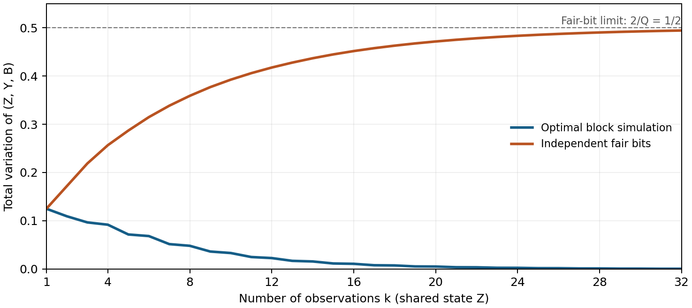

## Abstract

We determine the exact error of simulating noisy parities from a block of rounded observations sharing one hidden state. The noise has probabilities $(1/4,1/2,1/4)$ on $(-1,0,1)$, the rounding cells have even length $Q\ge4$, and there are $L\ge3$ cells. Each parity is individually fair conditional on the state, but its dependence on the rounded observations prevents an exact simulation of the full joint view. We derive a closed formula for the optimal total variation at every block length and give an exact sampler with expected polynomial running time. The optimal error tends to zero, whereas using independent fair coins has error tending to $2/Q$. Posterior resampling reproduces the public view exactly and lies within a factor of two of the optimal full-view error. At block length two, however, every full-view optimizer incurs a positive null-world error. We compute both errors exactly and exhibit parameters where their sum is larger than for independent coins. The example separates optimal simulation of one joint experiment from optimization of a two-world distinguishing bound.

## 1. Model and objectives

Let $Q\ge4$ be even, $L\ge3$, $P=LQ$, and $k\ge1$. The hidden state $Z$ is uniform on $\mathbb Z_P$. Independently of $Z$, the noises $E_1,\ldots,E_k$ are independent, with probabilities $1/4,1/2,1/4$ on $-1,0,1$. Write

$$
X_i=[Z+E_i]_P,\qquad Y_i=\left\lfloor X_i/Q\right\rfloor,
\qquad B_i=X_i\bmod2.
\tag{1}
$$

Here $[x]_P$ is the representative in $\{0,\ldots,P-1\}$. The parity $B_i$ is a bijective encoding of $F((P/2)X_i)$: even inputs give $0$, and odd inputs give $\lfloor L/2\rfloor$, where $F(x)=\lfloor[x]_P/Q\rfloor$. Thus the binary target also represents a particular rounded multiplicative observation.

A simulator sees the entire block $Y=(Y_1,\ldots,Y_k)$, uses fresh randomness to sample $\widetilde B$ from a kernel $K_Y$, and retains the original $Y$. It has no access to $Z$ or the noises. Its error is

$$
\delta_k(K)=\Delta\bigl(\mathcal L(Z,Y,B),\mathcal L(Z,Y,\widetilde B)\bigr),
\qquad \delta_k^*=\inf_K\delta_k(K),
\tag{2}
$$

with $\Delta$ equal to half the $\ell^1$ distance [1]. This is an average over the specified uniform prior, not a worst-state distance. The simulator is offline: it may use later observations to generate earlier output bits.

Conditional on any fixed $Z$, the bits $B_i$ are independent fair bits. Therefore independent fair coins reproduce $(Z,B)$ exactly for every $k$. Equation (2) asks for more: it retains the dependence of those bits on $Y$.

### 1.1 Statistical comparison and normalization

Let the source experiment at state $z$ be $\mathcal E_z=\mathcal L(Y\mid Z=z)$ and the target be $\mathcal F_z=\mathcal L(Y,B\mid Z=z)$. Then (2) is a prior-weighted deficiency with a restricted class of kernels,

$$
\delta_k^*=\inf_K\frac1P\sum_z\Delta(\mathcal F_z,\widehat K\mathcal E_z),
\qquad \widehat K:y\longmapsto(y,K_y).
\tag{3}
$$

General comparison of statistical experiments and deficiency are classical [2,3]. Unlike an unrestricted randomization, $\widehat K$ must preserve the observed block itself. We use half the $\ell^1$ norm; a convention using the full norm doubles all distances. No unrestricted decision-theoretic duality is asserted for the restricted class in (3). Repeated observations in comparison theory are also studied in [4]; the present calculation uses the particular boundary geometry of (1).

## 2. Conditional total-variation minimization

For $w_{z,y}=\Pr(Z=z,Y=y)$ and $\mu_{z,y}=\mathcal L(B\mid z,y)$, disjointness of the $(z,y)$ fibers gives

$$
\delta_k(K)=\sum_y\sum_z w_{z,y}\Delta(\mu_{z,y},K_y).
\tag{4}
$$

Two elementary consequences of the triangle inequality solve each observed block.

**Lemma 1 (dominant component).** If $a\ge\sum_j b_j$ with nonnegative weights, then $K=U$ minimizes $a\Delta(U,K)+\sum_j b_j\Delta(\mu_j,K)$. If the inequality is strict, the minimizing distribution is unique.

**Proof.** Since $\Delta(\mu_j,K)\ge\Delta(\mu_j,U)-\Delta(U,K)$, the objective is at least $\sum_j b_j\Delta(\mu_j,U)+(a-\sum_jb_j)\Delta(U,K)$. This is attained at $U$, and strictness forces equality only there. $\square$

**Lemma 2 (two components).** For nonnegative $a,b$,

$$
\inf_K\{a\Delta(\mu,K)+b\Delta(\nu,K)\}
=\min(a,b)\Delta(\mu,\nu).
\tag{5}
$$

Choosing the law of larger weight attains the bound. If the weights are equal, any mixture of the two laws attains it. The lower bound follows by retaining the smaller weight and applying the triangle inequality.

## 3. The exact block optimum

Let $U_k$ be uniform on $\{0,1\}^k$, and let $H_k$ be the product law with bit probability $2/3$. Define

$$
S_k=\Delta(H_k,U_k)=\frac12\sum_{j=0}^k\binom{k}{j}
\left|\frac{2^j}{3^k}-2^{-k}\right|.
\tag{6}
$$

**Theorem 1.** Under the assumptions of Section 1,

$$
\delta_k^*=C_k+M_k,
\tag{7}
$$

where

$$
C_k=\frac1Q\left[2(3/4)^kS_k+2(1/4)^k(1-2^{-k})\right]
\tag{8}
$$

and

$$
M_k=\frac1{Q4^k}\sum_{\ell=1}^{k-1}\binom{k}{\ell}3^{\min(\ell,k-\ell)}
\left[1-(2/3)^{\max(\ell,k-\ell)}\right].
\tag{9}
$$

In particular, $\delta_1^*=1/(2Q)$ and $\delta_2^*=7/(16Q)$.

**Proof for constant blocks.** Suppose $Y=(v,\ldots,v)$. There are $Q-2$ interior states in cell $v$, each with likelihood one and conditional bit law $U_k$. The two boundary states inside that cell have likelihood $(3/4)^k$ and laws $H_k$ and its bitwise complement. The two neighboring states outside it have likelihood $(1/4)^k$ and deterministic all-zero or all-one laws. These states are distinct because $Q\ge4$ and $L\ge3$.

The weight $Q-2\ge2$ of $U_k$ dominates the total other weight $2(3/4)^k+2(1/4)^k\le2$. Lemma 1 makes $U_k$ optimal. The distances to the two biased product laws equal $S_k$; those to the point masses equal $1-2^{-k}$. Multiplying by the prior $1/P$ and summing over the $L$ cells gives (8).

**Proof for mixed blocks.** A nonconstant block of positive probability uses two cyclically adjacent cells $u,v$ with $v=u+1\bmod L$. The orientation is unique for $L\ge3$. Let $\ell$ be the number of entries equal to $u$ and $r=k-\ell$ the number equal to $v$. Only two states are possible: $z_-=vQ-1$, which is odd, and $z_+=vQ$, which is even. Their likelihoods are $3^\ell/4^k$ and $3^r/4^k$.

Under $z_-$, the bits at positions in cell $v$ are zero and those in cell $u$ have independent probability $2/3$ of being one. Call this law $\mu_-$. Under $z_+$, the bits in cell $u$ are one and those in cell $v$ have independent probability $1/3$ of being one; call it $\mu_+$. Their supports meet at exactly one vector, with ones on $u$ and zeros on $v$. Its respective probabilities are $(2/3)^\ell$ and $(2/3)^r$. Hence

$$
\Delta(\mu_-,\mu_+)=1-(2/3)^{\max(\ell,r)}.
\tag{10}
$$

Apply Lemma 2, multiply by $1/P$, and count $L\binom{k}{\ell}$ patterns for each $\ell$. This gives (9). All other observed patterns have probability zero, completing the proof. $\square$

### 3.1 An exact optimal sampler

An optimal kernel $K^*$ uses fair bits on constant blocks. For a mixed block, it chooses $\mu_-$ if $\ell>r$, and $\mu_+$ if $r>\ell$. At a tie, choose one of these two laws with a single fair choice for the whole block. On impossible patterns, use fair bits. Choosing independently between the two laws at each coordinate would be a different kernel.

Reading the block and generating its output uses $O(k)$ word operations in expectation, with word lengths $O(\log P+\log k)$. A Bernoulli bit with probability $1/3$ or $2/3$ can be sampled exactly by drawing two fair bits, rejecting the value three, and using the three accepted values appropriately. The expected number of trials is $4/3$. Thus the algorithm has expected polynomial running time; it is not claimed to have a fixed worst-case random-bit budget.

The bounds $S_k\le1$ and $\min(\ell,k-\ell)\le k/2$ imply

$$
\delta_k^*\le\frac1Q\left[2(3/4)^k+2(1/4)^k+(\sqrt{3}/2)^k\right]\longrightarrow0.
\tag{11}
$$

The improvement comes from additional information in the observed block that helps the simulator identify the boundary state. It is not a statement that more observations reveal less information about the hidden state.

## 4. Independent coins have a different limit

Let $K^{\mathrm{fair}}$ always output independent fair bits. Only the two boundary states per cell contribute error. At a fixed boundary, classify one coordinate by whether it stays in the original cell and whether its parity agrees with the state. In the order “same cell, same parity,” “same cell, opposite parity,” “neighboring cell, opposite parity,” and “neighboring cell, same parity,” the real and simulated probabilities are

$$
(1/2,1/4,1/4,0)\qquad\text{and}\qquad(3/8,3/8,1/8,1/8).
$$

The common mass of their $k$-fold products gives

$$
\tau_k=1-\sum_{a+b+c=k}\frac{k!}{a!b!c!}
\min\left(\frac{2^a}{4^k},\frac{3^{a+b}}{8^k}\right),
\qquad \delta_k(K^{\mathrm{fair}})=\frac2Q\tau_k.
\tag{12}
$$

The sum ranges over nonnegative integers. The fourth category never occurs in the real distribution but has probability $1/8$ per simulated coordinate. Testing its occurrence yields $\tau_k\ge1-(7/8)^k$. Therefore

$$
\delta_k(K^{\mathrm{fair}})\longrightarrow2/Q.
\tag{13}
$$

## 5. Posterior resampling

Define $K^{\mathrm{post}}_y=\mathcal L(B\mid Y=y)$ on the real support, and use fair bits elsewhere. This reproduces $(Y,B)$ exactly. It also satisfies

$$
\delta_k^*\le\delta_k(K^{\mathrm{post}})\le2\delta_k^*.
\tag{14}
$$

For the upper bound, fix an optimal $K^*_y$. The posterior is the mixture of $\mu_{z,y}$ with posterior state weights. Convexity gives $\Delta(K^{\mathrm{post}}_y,K^*_y)$ at most the weighted mean of $\Delta(\mu_{z,y},K^*_y)$. Apply the triangle inequality to $\Delta(\mu_{z,y},K^{\mathrm{post}}_y)$ and average once more. Summing over $y$ proves (14); the lower bound follows from optimality.

An exact sampler does not enumerate all $2^k$ bit strings. On a constant block, sample the five component classes with integer weights

$$
(Q-2)4^k,\quad3^k,\quad3^k,\quad1,\quad1,
$$

then sample their conditional bit laws. On a mixed block, choose the two boundary laws with weights $3^\ell$ and $3^r$. The needed integers have $O(k+\log Q)$ bits. Uniform integer sampling by rejection and exact biased-bit generation give expected polynomial time.

## 6. Two worlds at block length two

Let $D_1=\mathcal L(Y)$ in the real experiment, and let $D_0$ be uniform on $\mathbb Z_L^2$. The target laws are

$$
T_1=\mathcal L(Y,B),\qquad T_0=D_0\times U_2.
$$

For $R_K(y)=(y,K_y)$, define $\varepsilon_j(K)=\Delta(R_K(D_j),T_j)$. These are public-view errors, unlike the stronger error (2).

**Theorem 2.** The independent-coin kernel, the balanced optimizer described in Section 3.1, and posterior resampling have the following errors:

| Kernel | Real-world error $\varepsilon_1$ | Null-world error $\varepsilon_0$ |
|---|---|---|
| Independent fair bits | $7/(16Q)$ | $0$ |
| Balanced block optimizer | $1/(8Q)$ | $5/(6L)$ |
| Posterior resampling | $0$ | $5/(6L)+1/[L(8Q-6)]$ |

**Proof.** A constant pair $Y=(v,v)$ has probability $(Q-3/4)/P$. In the order $00,01,10,11$, its conditional target probabilities are proportional to

$$
(Q/4-1/8,\ Q/4-1/4,\ Q/4-1/4,\ Q/4-1/8),
$$

with normalizing factor $Q-3/4$. Its distance from $U_2$ is $1/(8Q-6)$. All constant pairs together therefore contribute $1/(8Q)$ to real-world error for a fair output. Their total null probability is $1/L$.

For a mixed pair, reorder the two coordinates so that the first is in cell $u$ and the second in $v=u+1$. The two boundary laws are

$$
\mu_-=(1/3,0,2/3,0),\qquad \mu_+=(0,0,2/3,1/3).
$$

Their equal mixture is $(1/6,0,2/3,1/6)$, at distance $5/12$ from $U_2$. The mixture is both the posterior and the balanced optimal kernel. Mixed pairs have total real probability $3/(4Q)$ and total null probability $2/L$. Thus fair bits have real error $1/(8Q)+(3/(4Q))(5/12)=7/(16Q)$. The balanced kernel has only the constant-pair real error and mixed-pair null error $(2/L)(5/12)=5/(6L)$. Posterior resampling adds the constant-pair null contribution $1/[L(8Q-6)]$. Impossible real patterns use fair bits for all three kernels. $\square$

### 6.1 An unavoidable cost for every strong optimizer

Every kernel attaining $\delta_2^*$ obeys

$$
\varepsilon_1(K)\ge\frac1{8Q},\qquad
\varepsilon_0(K)\ge\frac5{6L}.
\tag{15}
$$

Indeed, for constant pairs the dominant weight $Q-2\ge2$ strictly exceeds the other weights $2(3/4)^2+2(1/4)^2=5/4$. Lemma 1 forces $K_y=U_2$, giving the first lower bound. For a mixed pair, equality in the triangle inequality between the two equally weighted boundary laws requires each coordinate of $K_y$ to lie between their corresponding probabilities. Thus $K_y(10)=2/3$ and $K_y(01)=0$. Its common mass with $U_2$ is at most $1/4+1/3=7/12$, so its distance is at least $5/12$. Summing the null mass of mixed pairs gives the second bound. The balanced kernel attains both simultaneously.

Consequently the smallest sum of two-world errors among full-view optimizers is

$$
\frac1{8Q}+\frac5{6L}.
\tag{16}
$$

This is larger than the fair-coin sum $7/(16Q)$ exactly when $L<8Q/3$. For $L=Q=4$, the sums for fair coins, the balanced optimizer, and posterior resampling are respectively $7/64$, $23/96$, and $17/78$.

These comparisons do not solve the global optimization of $\varepsilon_0+\varepsilon_1$ over all kernels. Nor do they rank actual adversarial advantages. They show that optimizing (2) can worsen the additive error term in a standard two-world bound. For every randomized target test $A$, let the source test be $A\circ R_K$. Define each test's advantage as the absolute difference between its acceptance probabilities in worlds 1 and 0. The test property of total variation and the triangle inequality show that these two advantages differ by at most $\varepsilon_0(K)+\varepsilon_1(K)$, hence [5]

$$
\operatorname{Adv}_{\mathrm{source}}\ge
\operatorname{Adv}_{\mathrm{target}}-\varepsilon_0-\varepsilon_1.
\tag{17}
$$

### 6.2 The source worlds must also be distinguished

For $k=2$, the real support of $Y$ contains $3L$ pairs: $L$ constant pairs and $2L$ ordered adjacent pairs. This is smaller than the null support of size $L^2$ when $L\ge4$, and equal to it when $L=3$. Equal support in the latter case does not mean equal laws. For every allowed $L,Q$,

$$
\Pr_{D_1}(Y_1=Y_2)=1-\frac3{4Q},\qquad
\Pr_{D_0}(Y_1=Y_2)=\frac1L.
\tag{18}
$$

For instance, $L=3,Q=4$ gives $13/16$ and $1/3$. This illustrates why the source law and null law must be specified, even when their supports coincide.

## 7. Verification and limits

The exact verifier enumerates 24 cases with $(P,Q)$ in $\{(12,4),(16,4),(18,6),(24,8)\}$ and $1\le k\le6$. It evaluates **76,440 state-and-noise tuples** and **33,936 nonzero joint atoms** with integers and rational arithmetic. It compares the three kernels, proves equality with the closed formulas on these finite domains, and records exact curves for $Q=4$ through $k=64$.

A separate linear-programming implementation constructs the conditional distributions independently. Nine in-domain cases and two deliberately invalid parameter controls use 182 conditional programs and 60 secondary optimization calls, or **242 solver calls** in total. The secondary checks minimize each public error among numerical full-view optima. They use a feasibility allowance of $10^{-12}$ and comparison tolerance $10^{-9}$. The out-of-domain cases $Q=2$ and $L=2$ disagree with (7), as expected: the proof's dominant component or unique adjacency description no longer applies. These numerical controls are not additional exact theorems.

For $P=16,Q=4,k=2$, the exact strong errors are $11/64$ for independent coins, $7/64$ for the balanced optimizer, and $51/416$ for posterior resampling. The corresponding real public errors, in the same order, are $7/64$, $1/32$, and $0$. The supplement includes the exact optimal sampler, independent optimization code, result files, figure generator, parameter descriptions, and reproduction instructions.

The restriction to a shared uniform state, independent three-point noises, even $Q\ge4$, $L\ge3$, and an offline observation-preserving kernel is essential to the stated result. The paper supplies an exactly solvable example of statistical simulation and its two-world limitations. It does not propose a cryptosystem, a hardness reduction, or a general theorem that repeated observations improve security.

## References

[1] David A. Levin and Yuval Peres, with contributions by Elizabeth L. Wilmer. *Markov Chains and Mixing Times*. Second edition, American Mathematical Society, 2017. Sections 4.1–4.2. [Author version](https://pages.uoregon.edu/dlevin/MARKOV/markovmixing.pdf).

[2] Erik Torgersen. *Comparison of Statistical Experiments*. Cambridge University Press, 1991. Chapter 6, “Deficiencies,” pp. 222–328. [DOI: 10.1017/CBO9780511666353.007](https://doi.org/10.1017/CBO9780511666353.007).

[3] Brendan van Rooyen and Robert C. Williamson. *Le Cam meets LeCun: Deficiency and Generic Feature Learning*. 2014, version 2. Section 4 and Appendix 7.5. [arXiv:1402.4884](https://arxiv.org/abs/1402.4884).

[4] Xiaosheng Mu, Luciano Pomatto, Philipp Strack, and Omer Tamuz. *From Blackwell Dominance in Large Samples to Rényi Divergences and Back Again*. Econometrica 89(1) (2021), 475–506. [DOI: 10.3982/ECTA17548](https://doi.org/10.3982/ECTA17548).

[5] Victor Shoup. *Sequences of Games: A Tool for Taming Complexity in Security Proofs*. 18 January 2006. Section 1.1. [Author version](https://www.shoup.net/papers/games.pdf).

## Authorship and use of generative AI

Samir Bouftass directed this research and is the sole named human author. The paper and its supporting programs were developed with extensive assistance from ChatGPT (OpenAI), including mathematical exploration, formulation and examination of arguments, proof drafting, writing and English translation, generation of verification programs, computational checks, and AI-assisted critical review. This assistance extends beyond language editing.

ChatGPT is disclosed as an AI tool and is not listed as an author or metadata contributor. AI-assisted reviews are not independent human peer review, and computational checks do not replace mathematical proofs. Responsibility for the final manuscript and its publication rests with the human author. This declaration does not certify that every argument has been independently checked by a human reviewer.

This authorship and disclosure revision is dated 18 November 2026. The mathematical text, scientific verification programs and recorded results of English edition 1.1 are unchanged.
