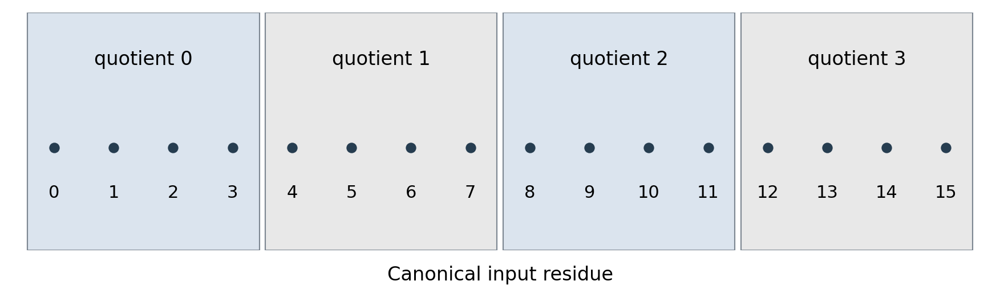
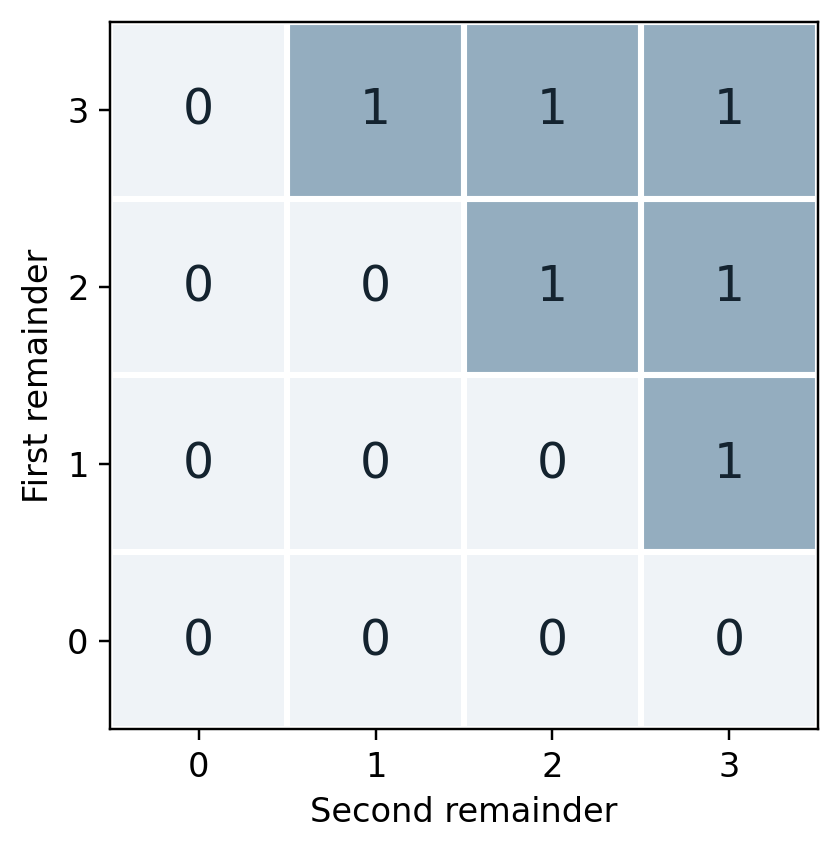
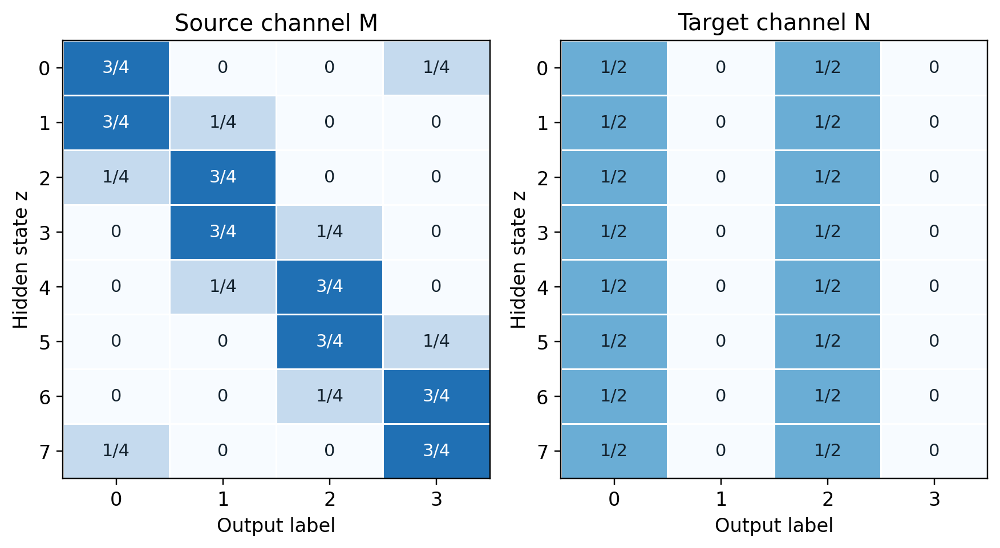
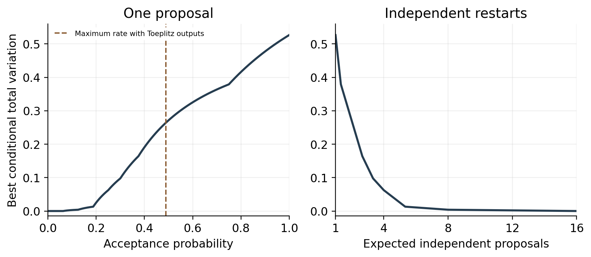
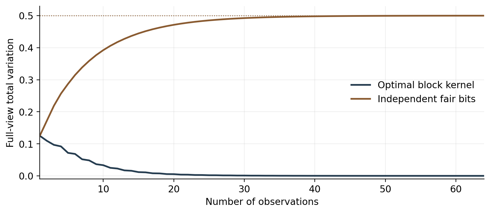
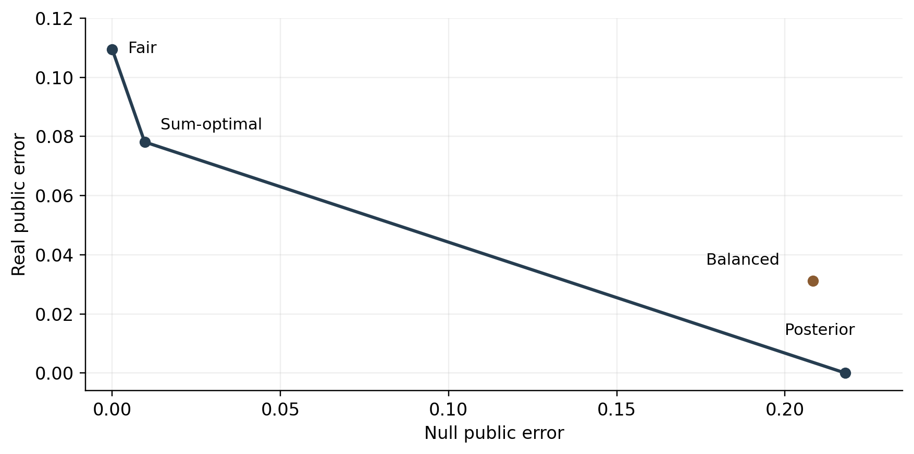

# Abstract

Rounding replaces an exact value by the label of a cell and discards its position within that cell. This thesis studies what can be computed or simulated from the remaining observation in finite modular models. Every result specifies the input information, allowed transformation and joint view whose distribution must be preserved.

For integers $P=LQ$ with $L,Q\ge2$, let $F(x)=\lfloor[x]_P/Q\rfloor$ act coordinatewise. The first part classifies all affine maps for which $F(Uz+b)$ is a function of $F(z)$ for every input. Each row of $U$ is zero or selects one coordinate with coefficient $1$ or $-1$, subject to an explicit translation alignment. Invertible maps are signed permutations; with zero translation, they are ordinary permutations. The exact missing-carry error for two uniform inputs illustrates the distinction between prediction, public simulation and preservation of the original input.

The second part treats a scalar state with three-point noise of probabilities $(\eta,1-2\eta,\eta)$ on $-1,0,1$, for $0\le\eta\le1/4$. We classify exact statewise affine simulation. At the singular endpoint, an alternating mode allows an extra fair target marginal. For the exceptional coefficient $P/2$ and even cell length, the best statewise error is $(1-4\eta)/2$, while retaining the original observation at the endpoint costs $1/(2Q)$ under a uniform state prior.

The third part compares uniform dense matrices with uniform Toeplitz matrices under adaptive signed row permutations. A complete row invariant gives orbit sizes, support success and optimal distributional distance. Rejection is governed by finite orbit capacities; exact conversion from one proposal has maximum acceptance $P^{-(m-1)(n-1)}$. A rectangular example separates support reachability from distributional accuracy, and row reversal transfers the conversion costs to Hankel targets.

The fourth part studies repeated noisy rounding of one uniform hidden state, with even $Q\ge4$ and $L\ge3$. We derive the exact full-view optimum for every block length and an exact sampler with expected polynomial cost. Its error tends to zero, while independent fair bits have limiting full-view error $2/Q$. At two observations, every strong optimizer incurs a positive error in a specified null experiment. We compute the complete weighted public optimum and show explicitly how it differs from strong optimization and posterior resampling.

All essential definitions and proofs are supplied within the volume. Exact finite enumeration and separate numerical optimization corroborate the stated domains. The results concern specified information constraints and simulation losses; they do not establish a cryptographic hardness reduction or a security level.

# Authorship and use of generative AI

Samir Bouftass is the named human author and directed the research project. This manuscript and its supporting programs were developed with extensive assistance from ChatGPT (OpenAI). That assistance included mathematical exploration, the formulation and examination of arguments, proof drafting, manuscript composition and English translation, generation of verification programs, execution and interpretation of computational checks, and AI-assisted critical review. These uses extend beyond language editing.

ChatGPT is identified here as an AI tool, not as an author or a contributor in the publication metadata. The AI-assisted reviews described in the accompanying materials are not independent human peer review. Computational checks and review reports do not replace the mathematical proofs or establish a claim of cryptographic security.

Responsibility for the final manuscript, the accuracy of its claims and the decision to publish rests with the human author. This disclosure does not certify that every argument has been independently checked by a human reviewer.

# Contents

**Chapter 1 — Questions and scope**

**Chapter 2 — Modular rounding and its fibers**

**Chapter 3 — Finite probability and simulation**

**Chapter 4 — Affine maps compatible with rounding**

**Chapter 5 — Noisy rounded channels**

**Chapter 6 — Approximate simulation and optimal error**

**Chapter 7 — Row transformations and matrix structure**

**Chapter 8 — Exact and approximate conversion of distributions**

**Chapter 9 — Repeated rounding of a shared hidden state**

**Chapter 10 — The cost in a second experiment**

**Chapter 11 — Conclusions and open problems**

**Appendix A — Worked calculations**

**Appendix B — Finite checks for noisy channels**

**Appendix C — Finite checks for matrix conversion**

**Appendix D — Finite checks for repeated observations**

**Appendix E — Notation and model conventions**

**References**

# 1 Questions and scope

## 1.1 A computation after information has been discarded

Suppose an observer receives the whole-number quotient of an integer divided by four. The report that the quotient is seven identifies the four possible integers $28,29,30,31$, provided that all four are allowed. It does not identify the remainder. A subsequent operation may need that remainder. For example, adding two inputs can create a carry from their remainders into their quotient sum. An observer who knows both quotients does not necessarily know whether this carry occurred.

The loss has two separate consequences. First, some deterministic computations cease to be functions of the reported information. Second, a randomized procedure may still reproduce a distribution associated with those computations. The second possibility does not reverse the first. A newly sampled remainder is not the actual remainder that was omitted, and it need not have the same relation to an unobserved state.

The distinction is visible in a small example. Let the modulus be $P=4$ and the divisor be $Q=2$. Both inputs $(0,0)$ and $(1,1)$ have rounded value $(0,0)$. Apply the invertible shear

$$
(z_1,z_2)\longmapsto(z_1+z_2,z_2).
$$

The transformed rounded outputs are $(0,0)$ and $(1,0)$, respectively. A deterministic function receiving the same input $(0,0)$ cannot return both answers. The difficulty here is not the time needed to search for the answer. The observation does not determine it.

If a distribution on the original inputs is specified, a simulator can choose an answer at random. There are then several meaningful objectives. It may seek to guess the answer from the actual run. It may seek to reproduce the public distribution of answers. Or it may seek to reproduce the dependence of those answers on a hidden state. Each objective must be stated before its optimum can be discussed.

## 1.2 The arithmetic model

Fix integers $L,Q\ge2$ and put $P=LQ$. For an integer $x$, write $[x]_P$ for the unique representative of its residue class in $\{0,\ldots,P-1\}$. The rounding map is

$$
F_{P,Q}(x)=\left\lfloor\frac{[x]_P}{Q}\right\rfloor.
$$

We usually write $F$ when the parameters are fixed. Its output has values in $\{0,\ldots,L-1\}$, which we identify with the canonical representatives of $\mathbb Z_L$. For vectors, $F$ acts on each coordinate. Arithmetic on an output vector is reduced modulo $L$ when brackets with subscript $L$ are present.

There are exactly $L$ cells, all of length $Q$. The assumption $Q\mid P$ makes the partition uniform. It also gives an exact relationship between integer quotients and reduction modulo $P$. Rounding conventions with unequal cells or nearest-integer ties require separate analysis. They are not silently included in this model.

The main algebraic problem asks for all integer matrices $U$ and integer vectors $b$ for which there is a function $g$ satisfying

$$
F(Uz+b)=g(F(z))\quad\text{for every }z\in\mathbb Z_P^m.
$$

The matrix may be rectangular. We impose no linearity or efficiency condition on $g$. Thus a failure of this identity rules out even an arbitrary deterministic postprocessing of the quotient within the stated input model. Conversely, existence alone should not be interpreted as a statement about a different source of observations.

## 1.3 Three questions that require different answers

The first question is one of **universal factorization**. Does an output depend only on the observation for every permitted input? A collision of two inputs under the observation, with distinct target outputs, gives a complete negative answer. No probability distribution is needed for such a witness.

The second question is one of **prediction under a specified law**. Given a random input and its observation, what is the greatest probability of producing the target value of that same run? The optimum depends on the input law. An impossible universal factorization can coexist with excellent prediction if the problematic inputs have small probability.

The third question is one of **distributional simulation**. A simulator uses the observation and fresh randomness to generate a replacement output. Which coordinates of the original experiment must remain jointly distributed with that replacement? A simulator can reproduce a target marginal perfectly while losing its correlation with the original input. In that situation, the word “exact” is meaningful only after the retained view has been named.

These questions interact, but their quantifiers differ. Universal factorization concerns all inputs. Prediction averages over a chosen distribution. Statewise channel simulation requires one kernel to work at every state. Average simulation fixes a prior. Worst-state simulation asks for uniform control over states. The thesis keeps these distinctions explicit rather than replacing them by a single informal notion of preservation.

## 1.4 Why the joint view matters

Let $S$ be a fair bit, let the observation $Y$ be constant, and let the target be $T=S$. A fresh fair bit $\widetilde T$ has exactly the target marginal distribution. Nevertheless, it is independent of $S$. The real pair $(S,T)$ is supported on $(0,0)$ and $(1,1)$, each with probability $1/2$. The simulated pair assigns probability $1/4$ to each of the four pairs. Their total variation distance is $1/2$.

The discrepancy is an observable property of the stronger pair: in the real experiment, the two coordinates always agree; in the simulated experiment, they agree only half of the time. An observer who never receives $S$ cannot apply this test. This explains why the same simulator can be exact for one view and inaccurate for another.

In cryptographic arguments, the relevant view is determined by the experiment being compared. A secret may be retained in a proof even when it is not publicly disclosed, because the proof needs to preserve a conditional law involving that secret. Conversely, including unavailable coordinates in a purported attack may create a test that an actual adversary cannot perform. Both directions require care. The mathematical distance of a specified joint view is a precise object; its operational role must be justified separately.

## 1.5 Relation to statistical and cryptographic work

Finite simulation by stochastic kernels belongs to the classical comparison of statistical experiments associated with Blackwell [1]. This supplies useful language for asking whether one observation can be transformed into another. The present arguments use direct finite calculations. We do not require an abstract decision-theoretic equivalence to establish the particular results below.

Total variation is the probability metric used throughout. Its event, test and coupling interpretations are standard; Levin and Peres [2] provide a general treatment. Chapter 3 proves the finite identities needed here, including the conditional decomposition that prevents errors in different hidden-state fibers from cancelling.

Rounded linear observations also arise in lattice-based cryptography. Regev [3] describes the learning-with-errors framework, while Banerjee, Peikert and Rosen [4] use deterministic rounding in their study of lattice-based pseudorandom functions. These works motivate examining what rounding preserves. Their hardness results involve complete distributions and parameter assumptions. None is obtained merely by recognizing a floor function in the model of this thesis.

The algebraic factorization problem can be phrased in the language of transformations that preserve a partition. Such transformations have been studied in general, for example by Sarkar and Singh [5]. Here the specific task is to compute the affine maps compatible with the product partition into consecutive modular cells. The general fiber criterion is elementary and classical; the explicit normal form is the result to be established.

## 1.6 Contribution of the first part

The main theorem classifies every row of an affine map compatible with the fixed rounding partition. A row is either constant, selects one input with coefficient $1$, or selects one input with coefficient $-1$. Positive and negative rows require different alignments of the translation. This description includes rectangular maps, repeated use of an input coordinate, and zero rows.

The theorem has a particularly restrictive consequence for invertible square maps. With admissible translations, the matrix is a signed permutation. With zero translation, it is an ordinary permutation. An invertible shear lies outside the class because it mixes discarded remainders into an output quotient.

A second conclusion gives an exact quantitative measure of one failure of factorization. For two independent uniform inputs, the unobserved carry in their sum is zero with probability $(Q+1)/(2Q)$ and one with probability $(Q-1)/(2Q)$. Predicting the more likely carry is optimal for agreement with the original run. Independently resampling the carry gives an exact public marginal, but a larger distance for a view retaining the unrounded input. Chapter 4 computes both quantities.

The probabilistic development also supplies tools for later questions about noisy scalar channels, structured matrix distributions and repeated observations. Those applications share an information constraint, but have different target laws and allowed transformations. Their proofs must therefore be developed in their own models. The present part supplies the definitions and first complete classification on which that development can build.

## 1.7 Scope and standards of verification

All arithmetic in the proofs is exact. Coefficients are interpreted modulo the input modulus $P$, not merely modulo the output modulus $L$. The floor of a negative number has its mathematical meaning as the greatest integer not exceeding it. These conventions matter in the proof of the carry identity and in the treatment of reflections.

The results are information-theoretic. When a stochastic kernel is optimized over a finite simplex, it may be expensive to construct that kernel from a compact description of the input distribution. Existence and computational efficiency are separate claims. Likewise, exhaustive verification of small parameters corroborates a general proof but cannot replace its unrestricted quantifiers.

A finite description can conceal a large state space. An algorithm polynomial in the number of channel entries may be exponential in the bit length of a modulus or in the number of coordinates. Whenever an efficiency statement is made, the objects supplied to the algorithm and their sizes must be identified. No security level follows from the sizes of the small examples in this part.

The exposition is organized so that each essential step can be checked locally. Chapter 2 derives the arithmetic identities. Chapter 3 establishes the probability tools. Chapter 4 proves the classification and the carry formulas. Appendix A records representative exact calculations and describes finite verification. External references provide context and attribution; the proofs of the stated finite results are contained in the manuscript.

## 1.8 Organization of the complete argument

Chapters 2–4 establish the arithmetic foundations, finite probability tools and affine classification. Their factorization criterion starts the distinction between exact computation and randomized simulation.

Chapters 5–6 add a specified three-point noise law. They classify exact statewise scalar kernels, calculate errors for a parity target and compare retained views. At the singular endpoint, exact target marginals coexist with a positive joint simulation error.

Chapters 7–8 address a separate requirement: converting dense uniform matrices into uniform Toeplitz matrices by permitted row operations. Orbit invariants give attainable-law and rejection-capacity formulas. The matrix marginal remains distinct from the secret and error correlations of a complete rounded experiment.

Chapters 9–10 return to one hidden scalar state observed repeatedly. They calculate the exact block optimum and the costs of using one simulator under two public source laws. The weighted public objective is compared explicitly with the full-view objective.

Chapter 11 synthesizes the results, computational limits and questions not settled here. Appendices A–D record examples and verification domains. Appendix E collects notation and distinguishes its local meanings. All essential definitions and proofs appear within the volume; the references provide public context and attribution.

# 2 Modular rounding and its fibers

## 2.1 Canonical representatives and Euclidean division

For a positive integer $M$ and any integer $x$, there is a unique pair of integers $a,r$ such that $x=Ma+r$ and $0\le r<M$. Existence follows by taking $a=\lfloor x/M\rfloor$. For uniqueness, subtract two such decompositions. The difference of the remainders has absolute value less than $M$ and is a multiple of $M$, so it is zero. This also forces equality of the quotients.

We write $[x]_M=r$. In particular, $[-1]_M=M-1$. Canonical representatives are useful for inequalities, while residue classes are useful for algebra. Switching between them without specifying the switch can invalidate an argument about intervals. In this manuscript, every interval of residues is described through canonical representatives unless a cyclic translation is explicitly stated.

**Lemma 2.1.** If $P=LQ$ and $x$ is any integer, then

$$
\left\lfloor\frac{[x]_P}{Q}\right\rfloor
=\left[\left\lfloor\frac{x}{Q}\right\rfloor\right]_L.
$$

**Proof.** Write $x=Ph+s$ with $0\le s<P$. Then $x/Q=Lh+s/Q$, so its floor is $Lh+\lfloor s/Q\rfloor$. The latter quotient lies between zero and $L-1$. Reducing modulo $L$ proves the identity. The integer $h$ may be negative, and no sign assumption was used. **End of proof.**

For example, take $P=12,Q=3,L=4$ and $x=-2$. The left side is $\lfloor10/3\rfloor=3$. The floor of $-2/3$ is $-1$, whose representative modulo four is also three. Truncation toward zero would give a different answer and is not the convention of the lemma.

## 2.2 Cells and discarded remainders

For each $y\in\{0,\ldots,L-1\}$, define

$$
C_y=\{Qy,Qy+1,\ldots,Qy+Q-1\}.
$$

These sets are disjoint and cover all canonical input residues. The fiber $F^{-1}(y)$ is exactly $C_y$. Thus observing $y$ identifies a cell of $Q$ possible residues. Every input has a unique representation

$$
[z]_P=Qy+r,\qquad y=F(z),\qquad 0\le r<Q.
$$

For a vector $z\in\mathbb Z_P^m$, the representation holds coordinatewise. The fiber over $y$ is a Cartesian product of $m$ cells and contains $Q^m$ vectors. The remainder vector records one position in each cell.

{width=6.1in}

This partition is not a quotient by a subgroup of the additive group. In particular, the cell $C_0$ contains both zero and one. If it were a subgroup, it would contain every residue, since one generates $\mathbb Z_P$. But $Q<P$. The word “quotient” refers here to integer division, not to a group quotient by these cells.

The distinction has a practical consequence: $F$ is not an additive homomorphism. With $P=8,Q=2$, one has $F(1)=0$ but $F(1+1)=1$. Algebraic identities that hold after reduction modulo a subgroup cannot simply be transferred to this rounding partition.

## 2.3 Uniform inputs and the quotient remainder bijection

The correspondence between $z$ and $(y,r)$ is a bijection between a set of $P=LQ$ residues and the Cartesian product of a set of $L$ quotient labels with a set of $Q$ remainders. Consequently, if $Z$ is uniform on $\mathbb Z_P$, then

$$
\Pr(F(Z)=y,R=r)=\frac1P=\frac1L\frac1Q.
$$

The quotient is uniform, the remainder is uniform, and they are independent. For a uniform vector in $\mathbb Z_P^m$, all quotient and remainder coordinates have the analogous product law.

Uniformity of the input is an essential part of this statement. If the input is restricted to even residues and $Q=4$, only the even remainder positions occur. More generally, a public relation between coordinates can correlate their remainders even when each individual coordinate looks uniform. The geometry of a fiber lists possible points; it does not assign their probabilities.

This separation is useful throughout the thesis. Algebraic compatibility is a property of every point in every relevant fiber. Prediction and simulation depend on the weights of those points. A counting argument becomes a probability calculation only when its sampling law has been supplied.

## 2.4 The fiber criterion

Let $f:X\to Y$ and $h:X\to T$ be functions between finite sets, with $T\ne\varnothing$. A function $g:Y\to T$ with $h=g\circ f$ exists if and only if $h$ is constant on every nonempty fiber of $f$.

To prove necessity, take $x,x'$ with $f(x)=f(x')$. A factorization gives $h(x)=g(f(x))=g(f(x'))=h(x')$. For sufficiency, assign to each attained value $y$ the common value of $h$ on $f^{-1}(y)$. Fix $t_0\in T$ and set $g(y)=t_0$ at unattained values. If $f$ is surjective, there are no such unused values and $g$ is unique.

This elementary criterion turns a functional equation into a statement about indistinguishable inputs. It also explains the role of a counterexample. A pair $x,x'$ in one observation fiber with different target values disproves factorization, irrespective of the complexity or form of the proposed function $g$.

For a restricted input set $\Omega\subseteq X$, the relevant fibers are $\Omega\cap f^{-1}(y)$. A factorization may therefore hold on $\Omega$ even when it fails on $X$. A support restriction is a change in the mathematical question. It is neither an approximation nor an exception to a theorem whose hypothesis ranges over all inputs.

## 2.5 The exact affine carry identity

Let $U$ be an $n\times m$ integer matrix and let $b$ be an integer vector of length $n$. Write an arbitrary representative of the input as $z=Qy+r+Ph$, where $0\le r_j<Q$ and $y=F(z)$. Applying Lemma 2.1 coordinatewise gives

$$
F(Uz+b)=\left[Uy+\left\lfloor\frac{Ur+b}{Q}\right\rfloor\right]_L.
$$

Indeed, the term $UPh$ changes the integer quotient by a multiple of $L$, while $QUy$ can be taken outside the floor. This derivation includes negative coefficients and modular wraparound. The remainder correction is an integer vector before its reduction modulo $L$.

Consider $P=12,Q=3$, $U=(2,-1)$, $b=-2$ and $z=(5,10)$. Here $y=(1,3)$ and $r=(2,1)$. Direct computation gives $Uz+b=-2$, so the rounded output is three. The identity gives

$$
\left[2\cdot1-3+\left\lfloor\frac{2\cdot2-1-2}{3}\right\rfloor\right]_4
=[-1+0]_4=3.
$$

The identity does not state that the remainder correction is small, independent or random. Those properties would require extra hypotheses. It states exactly where the information omitted by $F(z)$ enters the transformed quotient.

## 2.6 Reduction to the zero cell

Define the zero cell in dimension $m$ by

$$
D_Q^m=\{0,\ldots,Q-1\}^m.
$$

**Proposition 2.2.** There is a function $g$ satisfying $F(Uz+b)=g(F(z))$ for every $z$ if and only if $F(Ur+b)$ is constant for $r\in D_Q^m$.

**Proof.** Necessity follows because every $r\in D_Q^m$ has rounded value zero. Conversely, the carry identity shows that the residue modulo $L$ of $\lfloor(Ur+b)/Q\rfloor$ is precisely $F(Ur+b)$. If this vector is a constant $c$, the same identity gives $F(Uz+b)=[Uy+c]_L$ for every input. **End of proof.**

Only the residue of the correction modulo $L$ is required to be constant. The unreduced integer quotient need not be constant when arbitrary coefficient representatives are used. For instance, the coefficient $1+P$ defines the same modular map as coefficient one but produces larger integer quotients. Reducing coefficients modulo $P$ is legitimate because Lemma 2.1 accounts for the resulting multiples of $L$.

This proposition is special to the affine form and the equal-width partition. The general fiber criterion would require examining every nonempty fiber. Here the exact carry identity transports constancy on the zero cell to all other cells.

## 2.7 What changes on a restricted support

Suppose each coordinate of $z$ is a multiple of $Q$. The remainder vector is then zero, and for every integer matrix $U$,

$$
F(Uz)=[UF(z)]_L.
$$

A shear excluded by universal factorization is therefore compatible on this support. There is no contradiction: the collision involving two nonzero remainder coordinates is no longer available.

More subtly, a probability law can assign zero mass to some fibers or to some points within a fiber. An average-error simulator is not penalized at those points. A worst-state requirement, or a requirement to work for every prior, may still include them. Before using a support restriction, one must say whether it is an assumption about all permissible inputs, a fact about one distribution, or information available to the simulator.

The following chapter develops a language for those distinctions. The arithmetic identities already identify the missing information. Probability will determine how costly its absence is for a specified objective.

# 3 Finite probability and simulation

## 3.1 Laws and stochastic kernels

A probability law $\mu$ on a finite set $X$ assigns nonnegative masses summing to one. We write $\mathcal L(V)$ for the law of a random variable $V$ and $\delta_x$ for the point mass at $x$. Conditional laws are defined only on events of positive probability; their values on zero-probability events can be assigned arbitrarily unless another experiment later uses those events.

A stochastic kernel from $Y$ to $T$ is a family of laws $K_y$, one for each $y\in Y$. Equivalently, it is a matrix satisfying

$$
K(y,t)\ge0,\qquad \sum_tK(y,t)=1.
$$

If $Y$ has law $\mu$, the output has law $(\mu K)(t)=\sum_y\mu(y)K(y,t)$. A deterministic function is the special case in which each row is a point mass. Composition of kernels is matrix multiplication, obtained by summing over the intermediate value.

A fresh simulator receiving $Y$ produces $\widetilde T$ with conditional law $K_Y$. If $Z$ is an underlying state, freshness means

$$
\Pr(\widetilde T=t\mid Z=z,Y=y)=K(y,t)
$$

whenever the conditional event is defined. The simulator cannot use a random seed correlated with the hidden state unless such a seed is explicitly part of its input. This conditional independence is the content of the Markov relation $Z\to Y\to\widetilde T$.

## 3.2 Total variation and tests

For laws $\mu,\nu$ on the same finite set, define

$$
\Delta(\mu,\nu)=\frac12\sum_x|\mu(x)-\nu(x)|.
$$

The factor one half is used everywhere. Distances lie between zero and one. Zero means equality of laws. Let $a_x=\mu(x)-\nu(x)$. Since $\sum_xa_x=0$, the sum of its positive terms equals the absolute sum of its negative terms, and each equals $\Delta(\mu,\nu)$.

Taking the event $A=\{x:a_x>0\}$ therefore gives

$$
\Delta(\mu,\nu)=\max_{A\subseteq X}|\mu(A)-\nu(A)|.
$$

No event can give a larger difference, because discarding positive terms or including negative ones cannot increase the positive sum. Exchanging the two laws handles the absolute value.

A randomized binary test is described by its acceptance probability $a(x)\in[0,1]$ at each input. Splitting the signed sum into positive and negative terms proves

$$
\left|\sum_xa(x)\mu(x)-\sum_xa(x)\nu(x)\right|
\le\Delta(\mu,\nu).
$$

Thus total variation controls every randomized acceptance test. It does not assert that a maximizing test can be efficiently computed from a compact representation of the laws. The event characterization is information-theoretic.

The triangle inequality follows immediately from $|u-v|\le|u-w|+|w-v|$ at each point. A useful alternative expression is

$$
\Delta(\mu,\nu)=1-\sum_x\min\{\mu(x),\nu(x)\}.
$$

The sum on the right is their common mass. This identity follows from $|u-v|=u+v-2\min(u,v)$ and the fact that each law has total mass one.

## 3.3 Processing cannot increase the distance

**Proposition 3.1.** For a common stochastic kernel $K$,

$$
\Delta(\mu K,\nu K)\le\Delta(\mu,\nu).
$$

**Proof.** Expand the left side and use the triangle inequality inside each output coordinate:

$$
\sum_t\left|\sum_y(\mu(y)-\nu(y))K(y,t)\right|
\le\sum_y|\mu(y)-\nu(y)|\sum_tK(y,t).
$$

Every row sum is one. Dividing by two proves the claim. **End of proof.**

Taking $K$ to be a projection shows that a marginal distance cannot exceed the distance of the full joint law. Taking $K$ to be a deterministic relabelling gives the same conclusion. If that relabelling is bijective, its inverse gives the reverse inequality, so distance is preserved.

The common-kernel hypothesis matters. Applying one transformation to the first law and a different one to the second need not contract their distance. In particular, changing a target independently of the source is a change in the experiment, not an application of this proposition.

## 3.4 Conditioning on a common marginal

Suppose two laws on pairs $(V,T)$ have the same marginal weights $p(v)$ and conditional laws $\mu_v$ and $\nu_v$. Direct expansion gives

$$
\Delta\bigl(p(v)\mu_v(t),p(v)\nu_v(t)\bigr)
=\sum_vp(v)\Delta(\mu_v,\nu_v).
$$

The terms belonging to different values of $v$ occupy disjoint coordinates. Their errors add; they cannot cancel. This is stronger than merely knowing the distance after marginalizing out $V$.

For a real triple $(Z,Y,T)$ and an observation-preserving simulator, define

$$
w_{z,y}=\Pr(Z=z,Y=y),\qquad
\mu_{z,y}=\mathcal L(T\mid Z=z,Y=y).
$$

The real and simulated triples share the marginal of $(Z,Y)$. Consequently their distance is

$$
\delta(K)=\sum_y\sum_z w_{z,y}\Delta(\mu_{z,y},K_y).
$$

The choice of $K_y$ is separate for each $y$. This yields a finite convex optimization problem for every observed value. A minimizing law exists because the simplex is compact and the objective is continuous. Compactness does not provide an efficient method when the simplex has exponentially many coordinates.

## 3.5 Coupling and actual disagreement

A coupling of laws $\mu$ and $\nu$ is any joint law of $(A,B)$ having those marginals. For every coupling and every event $E$,

$$
|\Pr(A\in E)-\Pr(B\in E)|\le\Pr(A\ne B).
$$

Indeed, the two event indicators agree whenever $A=B$. Taking the largest event difference shows that $\Delta(\mu,\nu)$ is a lower bound on the disagreement probability of every coupling.

This lower bound is attainable. Put $c_x=\min\{\mu(x),\nu(x)\}$ and $s=\sum_xc_x$. With probability $s$, draw a common value from the normalized masses $c_x$ and set $A=B$ to it. With the remaining probability, draw from the two normalized residual laws. Those residual supports are disjoint, so the residual values disagree. The resulting disagreement probability is $1-s=\Delta(\mu,\nu)$. The cases $s=0$ and $s=1$ are interpreted by omitting the unused branch.

This construction optimizes over all possible couplings. A simulator may not be allowed to realize it. Its output must be generated from its actual observation and fresh randomness. The shared random variable needed by an arbitrary optimal coupling might depend on information the simulator does not possess.

For example, two independent fair bits have identical marginal laws, so the total variation between their marginals is zero. Their disagreement probability in the independent coupling is $1/2$. Calling the marginals equal does not make their actual values equal. This elementary point is central when a freshly sampled target is compared with the target of an original run.

## 3.6 Optimal prediction

Let $(Y,T)$ have a specified finite joint law, and let a fresh kernel predict $T$ from $Y$. Its success probability is

$$
\sum_{y,t}\Pr(Y=y,T=t)K(y,t).
$$

For each $y$, this is linear in the probability vector $K_y$. It is maximized by placing all mass on a target value with greatest joint mass at that $y$. Therefore

$$
\varepsilon_*=\inf_K\Pr(T\ne\widetilde T)
=1-\sum_y\max_t\Pr(Y=y,T=t).
$$

Randomization between tied maximizers is allowed, but cannot improve this optimum. A zero-probability observation contributes zero and imposes no constraint. The formula is equivalent to choosing a most likely target under the posterior distribution given an observation of positive probability.

When $T=t(Z)$ is deterministic and $Y=f(Z)$, the same quantity is the best joint distance for a view retaining $Z$. At a fixed $z$, the real target law is a point mass, and

$$
\Delta(\delta_{t(z)},K_{f(z)})=1-K(f(z),t(z)).
$$

Averaging shows that the joint distance is the disagreement probability in the actual fresh simulation. The deterministic-target hypothesis explains why the coupling issue from the preceding section disappears in this particular identity.

## 3.7 Posterior resampling

Define the posterior kernel by $K_y^{\mathrm{post}}=\mathcal L(T\mid Y=y)$ on the real support. Then

$$
\Pr(Y=y,\widetilde T=t)=\Pr(Y=y)K_y^{\mathrm{post}}(t)
=\Pr(Y=y,T=t).
$$

Thus posterior resampling always reproduces the public pair $(Y,T)$. This is a finite probabilistic identity, not an assertion that the posterior can be computed efficiently. Nor does it imply preservation of a hidden state correlated with the target.

There is nevertheless a useful bound for a view retaining $(Z,Y)$. Let $\delta_*$ be the smallest value of the conditional objective in Section 3.4. Then

$$
\delta_*\le\delta(K^{\mathrm{post}})\le2\delta_*.
$$

To prove the upper bound, fix an observation $y$ of positive mass. Write $\pi_z=\Pr(Z=z\mid Y=y)$, $\mu_z=\mu_{z,y}$ and $\bar\mu=\sum_z\pi_z\mu_z$. For a conditional minimizer $K_y^*$, convexity of the absolute value gives

$$
\Delta(\bar\mu,K_y^*)\le\sum_z\pi_z\Delta(\mu_z,K_y^*).
$$

The triangle inequality, followed by averaging over $z$, gives

$$
\sum_z\pi_z\Delta(\mu_z,\bar\mu)
\le2\sum_z\pi_z\Delta(\mu_z,K_y^*).
$$

Multiply by $\Pr(Y=y)$ and sum over observations. The lower bound is the definition of the optimum. Neither inequality says that posterior resampling is itself optimal for the stronger view.

## 3.8 Two useful conditional minimization rules

The conditional objective often contains a small number of distinct laws. Two elementary rules will be useful beyond the first affine application.

**Proposition 3.2.** Let $U,\mu_1,\ldots,\mu_s$ be probability laws and let the nonnegative weights satisfy $a\ge\sum_jb_j$. Then $K=U$ minimizes

$$
a\Delta(U,K)+\sum_jb_j\Delta(\mu_j,K).
$$

If the weight inequality is strict, the minimizing law is unique.

**Proof.** The triangle inequality gives $\Delta(\mu_j,K)\ge\Delta(\mu_j,U)-\Delta(U,K)$. Summing yields the value at $U$ plus $(a-\sum_jb_j)\Delta(U,K)$. This proves optimality. Under strict inequality, equality with the optimum forces $\Delta(U,K)=0$. At equality of the weights, this last conclusion does not follow. **End of proof.**

**Proposition 3.3.** For two laws $\mu,\nu$ and nonnegative weights $a,b$,

$$
\inf_K\{a\Delta(\mu,K)+b\Delta(\nu,K)\}
=\min(a,b)\Delta(\mu,\nu).
$$

**Proof.** Suppose $a\ge b$. Retaining the smaller weight on both terms and applying the triangle inequality gives a lower bound of $b\Delta(\mu,\nu)$. Taking $K=\mu$ attains it. The other ordering is symmetric. If $a=b$, every mixture of the two laws attains the bound, because along that segment the two distances add to $\Delta(\mu,\nu)$. This does not claim that the segment contains all minimizers in every probability simplex. **End of proof.**

## 3.9 Statewise channels and preserved observations

Let $M_z$ be the source observation law at state $z$ and $N_z$ the target output law. Statewise simulation asks for a single stochastic matrix $K$ such that $MK=N$. This holds if and only if, for every prior on $Z$, applying $K$ reproduces the joint law of $(Z,T)$. One direction follows by multiplying the row identities by the prior. For the converse, choose a point-mass prior at each state in turn.

This channel identity alone does not require preserving the original observation in the target view. Suppose a real experiment supplies a joint law $N_z(y,t)$ whose $Y$ marginal is $M_z(y)$. An observation-preserving simulator has joint masses $M_z(y)K(y,t)$. Reproducing these joint masses is a stronger requirement than reproducing their sums over $y$.

Pairwise agreement also need not imply agreement of a triple. Take independent fair bits $Z,Y$ and define $T=Z+Y\pmod2$. Replace $T$ by a fresh fair bit. Every pairwise marginal among the three coordinates agrees in the two experiments. Yet the real triple satisfies the parity equation with probability one, and the simulated triple satisfies it with probability $1/2$. Their total variation distance is $1/2$.

For approximate statewise simulation, average error under a prior $\pi$ and worst-state error are different objectives:

$$
\inf_K\sum_z\pi(z)\Delta(N_z,(MK)_z),
\qquad
\inf_K\max_z\Delta(N_z,(MK)_z).
$$

For each fixed kernel, the average is at most the maximum; the same inequality holds for the two infima. Equality requires an additional argument. A lower bound derived for one prior is a lower bound on the worst-state optimum, but it does not automatically describe every other prior.

## 3.10 Two-world distinguishing bounds

Let $D_0,D_1$ be source laws and $T_0,T_1$ target laws. Use one transformation $R$ in both worlds and put $\varepsilon_j=\Delta(R(D_j),T_j)$. For a randomized target test $A$, define the source test by first applying $R$ and then $A$. Each advantage is the absolute difference between that test's acceptance probabilities in worlds one and zero.

The randomized-test bound gives an error of at most $\varepsilon_j$ in each acceptance probability. The triangle inequality and the inequality $||u|-|v||\le|u-v|$ therefore give

$$
\left|\operatorname{Adv}_{D}(A\circ R)-\operatorname{Adv}_{T}(A)\right|
\le\varepsilon_0+\varepsilon_1.
$$

In particular, the source advantage is at least the target advantage minus the sum of the two errors. This elementary comparison is consistent with the game-based organization of security arguments described by Shoup [6]. Here its proof requires only finite total variation.

The relation concerns a target test and its composed source test. It does not compare two arbitrary tests. Moreover, a bound on the real-world error alone leaves the null-world error uncontrolled. Even an exact public simulation in one world is not sufficient to justify a two-world reduction.

## 3.11 Explicit tables and computational size

If a channel is supplied as a complete finite table, exact simulation can be written as linear equalities and inequalities in the kernel entries. Average total-variation minimization can similarly be written using auxiliary variables for absolute values. This description is useful for verification, but its size is measured in the number of table entries.

For a state in $\mathbb Z_P^m$, the explicit number of states is $P^m$. Its logarithm, rather than the number itself, is comparable to the size of a single encoded state. An exhaustive channel construction can therefore be enormous even when its matrix dimensions look finite and elementary.

The distinction also affects posterior resampling. Once an explicit posterior table is known, sampling from a row is straightforward with suitable randomness. Obtaining that row from a succinct experiment may require a separate counting problem. The algebraic theorem in the next chapter avoids such enumeration by classifying the affine maps directly.

# 4 Affine maps compatible with rounding

## 4.1 The scalar progression problem

The row-by-row classification begins with a scalar question. Let $a,b\in\mathbb Z_P$. When can the progression $[b+ar]_P$, for $0\le r<Q$, remain inside one rounding cell? The answer is rigid even though the input modulus may have many divisors.

**Lemma 4.1.** Assume $P=LQ$ with $L,Q\ge2$. The $Q$ progression values lie in one cell if and only if one of the following holds: $a=0$; $a=1$ and $b\equiv0\pmod Q$; or $a=-1$ and $b\equiv Q-1\pmod Q$. The translation is unrestricted when $a=0$.

**Proof.** The zero coefficient gives a constant progression. Otherwise choose $1\le a<P$, put $d=\gcd(a,P)$, and let $\ell=P/d$ be the additive order of $a$ modulo $P$.

If $\ell\le Q$, the progression contains the entire coset of the subgroup generated by $a$. Its canonical representatives are

$$
u,u+d,\ldots,u+P-d,\qquad u=[b]_d.
$$

Because the subgroup is nontrivial, $d\le P/2$. The diameter of these representatives is $P-d\ge P/2\ge Q$. A cell of $Q$ consecutive integers has diameter $Q-1$, so it cannot contain the coset. This excludes all orders at most $Q$, including order exactly $Q$.

Thus $\ell>Q$. The $Q$ progression values are distinct and fill the cell, call it $C$. Translation by $a$ removes the first progression point and adds the next. All $Q+1$ successive points are distinct, so

$$
|C\cap(C+a)|=Q-1.
$$

Translate $C$ to $\{0,\ldots,Q-1\}$. Translation is a bijection of the cyclic group and preserves the size of the intersection. The nonwrapped overlap with its translate by $a$ has length $\max(0,Q-a)$; the wrapped overlap has length $\max(0,Q-(P-a))$. Therefore

$$
|C\cap(C+a)|=\max(0,Q-a)+\max(0,Q-(P-a)).
$$

Since $2Q\le P$, both terms cannot be positive. Their sum equals $Q-1>0$ only if $a=1$ or $a=P-1$. In the first case, the start must be the first point of the aligned cell, so $b\equiv0\pmod Q$. In the second case, it must be the last point, so $b\equiv Q-1\pmod Q$. Both choices plainly suffice.

When $Q=2$, the required overlap is one. The same expression forces the two steps $1$ and $-1$, and the earlier diameter argument already excludes an order-two progression. Thus no endpoint exception has been omitted. **End of proof.**

The argument uses the geometry of consecutive representatives, not a field structure. Indeed, $P=LQ$ with both factors at least two is composite. Invertibility of a nonzero coefficient is not assumed and is not sufficient by itself to make it admissible.

## 4.2 The complete normal form

Let $U$ have $n$ rows and $m$ columns, with positive $m,n$, and let $b$ have length $n$. All coefficients in the following theorem are reduced modulo $P$.

**Theorem 4.2.** A function $g$ satisfying

$$
F(Uz+b)=g(F(z))\quad\text{for every }z\in\mathbb Z_P^m
$$

exists exactly when every row has one of the following forms:

| Row of $U$ | Alignment of $b_i$ | Output $g_i(y)$ modulo $L$ |
|---|---|---|
| All zero | Arbitrary | $F(b_i)$ |
| One coefficient $+1$ in column $j$ | $b_i\equiv0\pmod Q$ | $y_j+F(b_i)$ |
| One coefficient $-1$ in column $j$ | $b_i\equiv Q-1\pmod Q$ | $-y_j+F(b_i)$ |

Different rows may select the same column. When the factorization exists, $g$ is unique.

**Proof of necessity.** By Proposition 2.2, it is enough to study constancy on the zero cell. Fix one output row. Vary one input remainder and hold the others at zero. Lemma 4.1 implies that every nonzero coefficient is $1$ or $-1$, with the corresponding congruence for the same row translation $b_i$.

If both signs occurred, the row translation would be congruent to both zero and $Q-1$ modulo $Q$. These residues are distinct because $Q\ge2$. A row therefore cannot contain both signs.

Suppose two coefficients are positive. Choose integer representatives equal to one and write $b_i=Q\beta$. Set the corresponding remainders to $Q-1$ and every other remainder to zero. Compared with the zero vector, the correction quotient changes by

$$
\left\lfloor\frac{2(Q-1)}Q\right\rfloor=1.
$$

This is nonzero modulo $L$, so the row cannot be constant. If two coefficients are negative, choose representatives equal to minus one and write $b_i=Q\beta+Q-1$. The same remainder choice changes the numerator from $Q\beta+Q-1$ to $Q\beta-(Q-1)$, and changes its quotient from $\beta$ to $\beta-1$. Again the change is nonzero modulo $L$.

These arguments also apply when $Q=2$. We conclude that each row has at most one nonzero coefficient. A zero row allows every translation. A nonzero row has the sign and alignment stated in the table.

**Proof of sufficiency and uniqueness.** For a positive row with $b_i=Q\beta$, the integer quotient of $r_j+b_i$ is $\beta$ throughout the zero cell. For a negative row with $b_i=Q\beta+Q-1$, the quotient of $-r_j+b_i$ is also $\beta$ throughout that cell. The zero row is immediate. Substitution in the carry identity proves the three formulas, with all outputs reduced modulo $L$. Finally, $F$ is surjective, so every possible argument $y$ of $g$ occurs. The factorization determines its value uniquely. **End of proof.**

## 4.3 Invertible square maps

**Corollary 4.3.** If $U$ is square and invertible over $\mathbb Z_P$, an admissible affine map has a signed permutation matrix. If $b=0$, it has an ordinary permutation matrix.

To see the first statement, the normal form gives at most one nonzero coefficient per row. An invertible matrix has no zero row. If two rows selected the same column, fewer than all columns would be selected, so another column would be zero. The corresponding standard basis vector would then be in the kernel, contradicting invertibility. Thus each row and each column contains exactly one sign. Conversely, a signed permutation has an inverse over every modulus, and its rows admit the translations specified by the theorem.

With zero translation, a negative row would require $0\equiv Q-1\pmod Q$, which is false. Only positive rows remain. The proof uses invertibility over the ring $\mathbb Z_P$ directly and does not replace it by invertibility over a field.

The transformation of the quotient vector is itself a signed coordinate permutation followed by a translation modulo $L$. Nevertheless, the input coefficient classification must be made modulo $P$. For example, with $P=8,Q=2,L=4$, coefficients one and five agree modulo four. Coefficient five separates the zero-cell inputs zero and one into rounded outputs zero and two, so it is not admissible.

## 4.4 Examples that identify the boundary of the theorem

An unshifted reflection need not respect the cells. With $P=8,Q=2$, the inputs zero and one both round to zero, but their negatives round to zero and three. By contrast, the translated reflection satisfies

$$
F(-z-1)=L-1-F(z).
$$

Indeed, if $[z]_P=Qy+r$, then $[-z-1]_P=P-1-Qy-r=Q(L-1-y)+(Q-1-r)$. The second term is an admissible remainder. The translation is essential, and the identity is valid at the modular boundary as well as in the interior.

A translation by $Q\beta$ is admissible with positive coefficient one and gives $[F(z)+\beta]_L$. Translating by one is generally not admissible: it moves the last point of a cell into the next cell while leaving earlier points in the original cell. Thus even a simple invertible map can fail to descend to the observation.

Rectangular maps permit repeated coordinates. For example, the three outputs $z_1$, $z_1+Q$ and $-z_2-1$ are simultaneously computable after rounding. This does not contradict the invertible-square corollary, whose column argument uses equality of input and output dimensions and invertibility.

The assumptions $L,Q\ge2$ exclude two degenerate regimes. If $Q=1$, the observation retains every input residue and every affine map can be postprocessed. If $L=1$, the observation and transformed observation are constant. The normal form is a statement about a nontrivial loss of information into a nontrivial output alphabet.

## 4.5 Counting admissible maps

For a fixed input dimension $m$, there are $P$ zero-row affine choices, one for each translation. A positive row chooses a column in $m$ ways and a translation congruent to zero modulo $Q$ in $L$ ways. Negative rows give another $mL$ choices. The number of admissible coefficient-and-translation rows is therefore

$$
P+2mL.
$$

The families are disjoint because $P\ge4$, so $1$ and $-1$ are distinct residues. Choices for different output rows are independent. Thus the number of admissible affine pairs $(U,b)$ for an $n$-row output is $(P+2mL)^n$.

For an invertible square affine map in dimension $m$, there are $m!$ coordinate permutations, $2^m$ sign choices, and $L$ translations compatible with each selected sign in each row. Hence there are $2^m m!L^m$ admissible affine pairs. With translation fixed to zero, only the $m!$ ordinary permutations remain.

These counts concern pairs of coefficients and translations modulo $P$. They are not counts of cryptographic keys, and no security conclusion follows from their magnitude. Their main role here is to provide an exact check on the normal form and to show how restrictive the affine compatibility condition is.

## 4.6 The missing carry in a two-coordinate sum

Let $Z_1,Z_2$ be independent uniform residues modulo $P$. Write $Z_i=QY_i+R_i$ using canonical representatives. Section 2.3 shows that the remainders are independent uniform values in $\{0,\ldots,Q-1\}$ and independent of the quotient pair. The target is

$$
T=F(Z_1+Z_2)=[Y_1+Y_2+C]_L,
\qquad C=\left\lfloor\frac{R_1+R_2}Q\right\rfloor.
$$

The carry is zero or one. For a fixed $R_1=r$, there are $Q-r$ choices of $R_2$ giving no carry. Summing over $r$ gives $Q(Q+1)/2$ no-carry pairs among $Q^2$ pairs. Thus

$$
p_0=\Pr(C=0)=\frac{Q+1}{2Q},\qquad
p_1=\Pr(C=1)=\frac{Q-1}{2Q}.
$$

Since $L\ge2$, the two possible target values at a fixed quotient pair are distinct modulo $L$. The optimal predictor chooses no carry, and its error is

$$
\varepsilon_* =p_1=\frac{Q-1}{2Q}.
$$

{width=3.8in}

At $Q=4$, the carry-one pairs occupy six of the sixteen grid points, so the best prediction error is $3/8$. Increasing the modulus by increasing $L$ leaves this error unchanged: the uncertainty comes from the cell remainders. Increasing $Q$ makes the two carry probabilities approach one half. These statements concern independent uniform inputs; correlations or support restrictions can change the carry law.

The full shear output is $(F(Z_1+Z_2),F(Z_2))$. Its second coordinate is already observed. Consequently its optimal prediction error is the same as that of the first coordinate. The extra known coordinate neither removes the carry nor creates further uncertainty.

## 4.7 Public resampling and retained dependence

Draw an independent new carry $C'$ with probabilities $(p_0,p_1)$ and output $\widetilde T=[Y_1+Y_2+C']_L$. Because the real carry has this same law independently of the quotient pair, the public pairs $(Y,T)$ and $(Y,\widetilde T)$ have identical distributions.

For a view retaining $Z=(Z_1,Z_2)$, the real target is deterministic. Section 3.6 therefore identifies the joint distance with the probability that the two carries disagree. Freshness makes $C'$ independent of the actual carry, so this distance is

$$
\Pr(C\ne C')=2p_0p_1=\frac{Q^2-1}{2Q^2}.
$$

The smallest joint distance is instead $p_1$, achieved by always predicting the more likely carry. Their difference is

$$
2p_0p_1-p_1=\frac{Q-1}{2Q^2}>0.
$$

Thus an exact simulator for the public pair need not minimize the error of the stronger view. At $Q=4$, the public posterior simulator has joint error $15/32$, while the optimal predictor has joint error $3/8$. The latter's public output law is no longer exact. The two procedures optimize different objectives under the same available information.

| Cell length $Q$ | Best prediction error | Joint error of posterior resampling |
|---:|---:|---:|
| 2 | $1/4$ | $3/8$ |
| 4 | $3/8$ | $15/32$ |
| 8 | $7/16$ | $63/128$ |
| 16 | $15/32$ | $255/512$ |

## 4.8 A hidden-bit example

Take $P=4,Q=2$ and a uniform bit $S$. Let the unrounded vector be $Z=(S,S)$ and the observed vector be $Y=F(Z)$. The observation is always $(0,0)$. Under the shear from Chapter 1, the rounded target is $(S,0)$.

Any fresh simulator receiving only $Y$ has a distribution independent of $S$. If it assigns masses $a,b$ to the two valid target values $(0,0)$ and $(1,0)$, its probability of agreeing with the actual target is $(a+b)/2\le1/2$. Hence its joint distance from the real pair retaining $S$ is at least $1/2$.

Every output law supported on those two valid targets attains that lower bound. In particular, the fair mixture also reproduces the public target marginal exactly. No fresh random choice restores the missing association between the target and the original hidden bit.

This is an information-theoretic statement about one observation. It does not rule out a procedure supplied with another correlated observation, raw input access, or a different secret distribution. Each such change alters the conditional law available to the simulator and must be analyzed in its own right.

## 4.9 What the classification establishes

The affine theorem answers a universal fixed-parameter question completely. Its proof consists of a scalar interval argument, the exact carry identity and a row analysis. The probability calculations then measure one specific failure under a specified uniform law. Neither argument relies on an assumption about computational hardness.

The progression from exact computation to simulation is now precise. A target that is constant on observation fibers can be computed deterministically. A target that varies within fibers can be predicted according to its conditional probabilities. A posterior sampler reproduces the public joint law but may fail to preserve a hidden coordinate. The relevant objective, not the presence of randomness alone, determines whether the construction succeeds.

# 5 Noisy rounded channels

## 5.1 From a deterministic input to a channel

Chapter 4 classified affine functions that can be computed after modular rounding for every possible input. Randomness changes the question. A transformation of a noisy input need not be determined by its rounded value, yet a fresh randomized output might have the correct distribution for each underlying state. We now specify this requirement and determine exactly when it holds in a scalar model. The classification will also show why one exceptional simulator carries no information about the state.

Keep integers $L,Q\ge2$, put $P=LQ$, and use the same rounding map as before,

$$
F(x)=\left\lfloor\frac{[x]_P}{Q}\right\rfloor,
\qquad F:\mathbb Z_P\longrightarrow\{0,\ldots,L-1\}.
$$

The hidden state is $Z\in\mathbb Z_P$. Unless a prior is explicitly imposed, a statement about every state does not assign probabilities to the states. Independently of $Z$, let a noise variable $E$ satisfy

$$
\Pr(E=-1)=\Pr(E=1)=\eta,
\qquad \Pr(E=0)=1-2\eta,
\qquad 0\le\eta\le\frac14.
$$

Fix $c,b\in\mathbb Z_P$ and define

$$
X=[Z+E]_P,\qquad Y=F(X),\qquad W=h(X),
\qquad h(x)=F(cx+b).
$$

The simulator receives one value of $Y$. It knows the public parameters $P,Q,c,b,\eta$, but receives neither $Z$ nor $X$. Its output $\widetilde W$ is sampled from a row $K(Y,\cdot)$ of a stochastic matrix. Thus $K(y,w)\ge0$, $\sum_w K(y,w)=1$, and its randomness is independent of the original experiment conditional on $Y$. The same matrix must be used for every state. The statewise exactness requirement is

$$
\mathcal L(\widetilde W\mid Z=z)=\mathcal L(W\mid Z=z)
\quad\text{for all }z\in\mathbb Z_P.
$$

The target acts on the same noisy value as the source. In the expression before its final rounding, the noise is $cE$. Replacing this by an independent noise variable with the original law would define another target. For example, take $P=8$, $Q=2$, $c=4$, $b=0$ and $\eta=1/4$. At state zero, the target $F(4X)$ takes values zero and two with probabilities $1/2$ each. The different target $F(4Z+E')$, with fresh noise $E'$ of the original law, takes values zero and three with probabilities $3/4$ and $1/4$. This distinction is visible before any question of simulation is considered.

The parameter range is part of the model. The endpoint $\eta=1/4$ is the largest noise parameter studied here; it is not uniform noise on $\mathbb Z_P$. We will return to uniform noise on the whole group in Section 5.8.

## 5.2 Channel matrices and the available information

Let $H$ and $G$ be the $P$ by $L$ indicator matrices

$$
H_{x,y}=\mathbf1\{F(x)=y\},
\qquad G_{x,w}=\mathbf1\{h(x)=w\}.
$$

Each row of either matrix is a point mass. The matrix $H$ records which information is supplied to the simulator; $G$ records which deterministic function of the raw input is desired. Define a linear operator on functions on the cyclic group by

$$
(C_\eta f)(z)=\eta f([z-1]_P)+(1-2\eta)f(z)+\eta f([z+1]_P).
$$

Apply it separately to each column of a matrix. The source channel and target channel are

$$
M=C_\eta H,\qquad N=C_\eta G.
$$

Their rows have the direct interpretations $M_{z,y}=\Pr(Y=y\mid Z=z)$ and $N_{z,w}=\Pr(W=w\mid Z=z)$. Since the simulator first draws $Y$ according to a row of $M$ and then applies $K$, its output channel is $MK$. Consequently the exact problem is

$$
MK=N,\qquad K\ge0,\qquad K\mathbf1=\mathbf1.
$$

This finite randomization formulation belongs to the classical comparison of experiments developed by Blackwell [1]. Here the particular issue is the fixed information restriction encoded by $H$. The proofs below solve the displayed equations directly and do not require a general decision-theoretic comparison theorem.

The equation can also be written

$$
C_\eta(HK-G)=0.
$$

If the operator $C_\eta$ can be cancelled, then the deterministic obstruction from Chapter 4 survives the addition of noise. If it cannot be cancelled, the possible difference $HK-G$ must lie in its kernel, column by column. This observation explains the role of the spectral calculation that follows.

## 5.3 Priors and retained coordinates

For a prior $\pi$ on $\mathbb Z_P$, the real joint law of $(Z,W)$ has masses $\pi(z)N_{z,w}$. The simulated law has masses $\pi(z)(MK)_{z,w}$. Thus one matrix $K$ satisfies $MK=N$ if and only if it reproduces this joint law for every prior. Necessity follows by choosing a point-mass prior at each state. Sufficiency follows by multiplying each row identity by $\pi(z)$.

The order of the quantifiers matters. A matrix that works for one known prior can depend on that prior. A statement that a suitable matrix exists separately for each point-mass prior is very weak: at a single known state, a constant output law equal to $N_z$ always works. Statewise simulation requires one matrix to work simultaneously at all states.

There are also different choices of retained coordinates. The real joint channel of the observation and target is

$$
J_z(y,w)=\sum_{e\in\{-1,0,1\}}\Pr(E=e)
\mathbf1\{F(z+e)=y,\ h(z+e)=w\}.
$$

An observation-preserving simulator has joint channel $M_{z,y}K(y,w)$. Equality of these quantities for all $z,y,w$ implies $MK=N$ after summing over $y$. The converse need not hold because summation can hide opposite discrepancies at different observations. Under a specified prior, reproducing only the public pair $(Y,W)$ is weaker still: the simulator can use the conditional distribution of $W$ given $Y$ for that prior, without preserving its association with $Z$.

A simple secret interpretation illustrates why full support should not be silently assumed. If a fixed public integer $A$ is invertible modulo $P$ and $Z=AS$, then multiplication by $A$ bijects the possible secrets with the states. Statewise equality is therefore equivalent to equality of $(S,W)$ for every secret prior, allowing the kernel to depend on $A$. For a nonunit $A$ or a restricted secret support, only a subset of the states may occur. The all-state classification cannot be invoked as an impossibility theorem on that smaller subset without another argument.

## 5.4 The spectrum of the noise operator

For $0\le j<P$, let $\chi_j(x)=\exp(2\pi i jx/P)$. Direct substitution gives

$$
C_\eta\chi_j=\lambda_j\chi_j,
\qquad \lambda_j=1-2\eta+2\eta\cos(2\pi j/P)
=1-4\eta\sin^2(\pi j/P).
$$

These characters form a basis of the complex-valued functions on $\mathbb Z_P$. Indeed, the sum of $\exp(2\pi i (j-k)x/P)$ over $x$ is $P$ when $j=k$ and zero otherwise, by the finite geometric-series identity. The characters are therefore orthogonal and nonzero; there are $P$ of them in a space of dimension $P$. This proves diagonalization without assuming a separate Fourier theorem.

For $\eta<1/4$, all the eigenvalues are positive. At $\eta=1/4$, an eigenvalue vanishes exactly when $\sin^2(\pi j/P)=1$, which occurs exactly for even $P$ and $j=P/2$. We obtain the complete kernel description:

$$
\ker C_\eta=\{0\}
\quad\text{if }\eta<1/4\text{ or }P\text{ is odd},
$$

and, in the remaining case,

$$
\ker C_{1/4}=\operatorname{span}\{v\},
\qquad v(x)=(-1)^x.
$$

The only information annihilated by this operator at the endpoint is the alternating component. Other modes generally remain. The exceptional case therefore has a precise algebraic cause and cannot be interpreted as the raw noisy input becoming independent of the state.

**Proposition 5.1.** The source channel $M$ has full column rank $L$ throughout the stated parameter range. In particular, at most one real matrix $K$ can satisfy $MK=N$.

**Proof.** If $C_\eta$ is invertible, $Mu=0$ implies $Hu=0$. Every rounding cell is nonempty, and the value of $Hu$ on cell $y$ is $u_y$, so $u=0$. At the singular endpoint, $Mu=0$ implies $Hu=av$ for a scalar $a$. The function $Hu$ is constant on each cell, whereas each cell contains two consecutive points because $Q\ge2$. The values of $av$ at those two points are opposite; constancy forces $a=0$. Again $u=0$. Thus the columns of $M$ are independent. Apply this argument to every column of $K-K'$ to obtain uniqueness whenever $MK=MK'$. **End of proof.**

Uniqueness does not assert existence. A solution to selected linear equations may fail other equations, and a real solution may fail nonnegativity. These checks will remain explicit in the numerical verification.

## 5.5 Exact classification

Write $\delta_a$ for the point mass at output $a$. All congruences involving $c$ below are modulo $P$; the conditions on $b$ are modulo $Q$.

**Theorem 5.2.** A statewise exact stochastic kernel exists precisely in the following four families. Its row at observation $y$ is the law shown in the table, and it is unique.

| Coefficient and translation | Output law at observation $y$ |
|---|---|
| $c=0$, any $b$ | $\delta_{F(b)}$ |
| $c=1$, $b\equiv0\pmod Q$ | $\delta_{[y+F(b)]_L}$ |
| $c=-1$, $b\equiv Q-1\pmod Q$ | $\delta_{[-y+F(b)]_L}$ |
| $P$ even, $\eta=1/4$, $c=P/2$, any $b$ | $(\delta_{F(b)}+\delta_{F(b+P/2)})/2$ |

**Proof in the invertible case.** Suppose $\eta<1/4$ or $P$ is odd. Cancelling $C_\eta$ gives $HK=G$. For each raw input $x$, the row $K(F(x),\cdot)$ must therefore equal $\delta_{h(x)}$. Hence $h$ must be constant on every rounding cell. Conversely, this constancy defines a deterministic kernel with $HK=G$, and convolution then gives $MK=N$.

Lemma 4.1 and the scalar instance of Theorem 4.2 classify this constancy within the present volume. In particular, write $x=Qy+r$ and use

$$
F(cx+b)=\left[cy+\left\lfloor\frac{cr+b}{Q}\right\rfloor\right]_L.
$$

The scalar progression on the zero cell lies in one cell only when $c=0$, or when $c=1$ and $b$ is aligned with a cell's first point, or when $c=-1$ and $b$ is aligned with its last point. Substitution into the formula gives the first three rows of the table.

**Proof at the singular endpoint.** Suppose now that $P$ is even and $\eta=1/4$. The kernel description in Section 5.4 gives a row vector $a$ such that

$$
K(F(x),\cdot)-\delta_{h(x)}=(-1)^x a
\quad\text{for every }x.
$$

If $a=0$, the preceding deterministic argument applies. Assume $a\ne0$. Within each cell, inputs of the same parity must have the same target value because the other terms of the equation agree. Each cell contains both parities. Denote its even-input target by $u_y$ and its odd-input target by $v_y$. Subtracting the two equations gives

$$
\delta_{u_y}-\delta_{v_y}=-2a.
$$

This difference is nonzero, so $u_y\ne v_y$. A nonzero difference of two point masses has a unique coordinate equal to one and a unique coordinate equal to minus one. It therefore identifies the ordered pair of outputs. Since the right side is independent of $y$, there are global distinct values $u,v$ with $u_y=u$ and $v_y=v$ in every cell. Adding the two equations yields

$$
K(y,\cdot)=\frac12(\delta_u+\delta_v)
\quad\text{for every }y.
$$

It remains to determine which coefficients can make $h$ constant on all even inputs. Their unrounded affine images form the coset $b+\langle2c\rangle$ in $\mathbb Z_P$. If the subgroup is nontrivial, put $d=\gcd(2c,P)<P$. Its coset representatives have the form $r,r+d,\ldots,r+P-d$, with $0\le r<d$. The diameter of these representatives is $P-d\ge P/2\ge Q$, because a proper divisor $d$ is at most $P/2$. They cannot all lie in a rounding cell, whose diameter is $Q-1$. Thus $2c=0$ modulo $P$. The case $c=0$ would give $u=v$, which was excluded. The only remaining coefficient is $c=P/2$.

Conversely, when $c=P/2$, the affine image of $x$ equals $b$ for even $x$ and $b+P/2$ for odd $x$, modulo $P$. At $\eta=1/4$, the event that $E$ is odd has probability $1/2$, so $X$ has each parity with probability $1/2$ at every state. The target is the displayed fair mixture. Its two output values are distinct: the canonical representatives of the two inputs are separated by $P/2\ge Q$, too far apart for a single cell. A kernel that ignores $y$ and outputs that mixture is exact. Proposition 5.1 supplies uniqueness in every case. **End of proof.**

The proof includes odd cell lengths at the singular endpoint. The evenness of $Q$ will be an additional assumption for the error formulas in Chapter 6, not for Theorem 5.2. The families in the table are disjoint because $P\ge4$, so $P/2$ is neither zero nor $\pm1$ modulo $P$.

## 5.6 What the exceptional kernel preserves

The first three families have a stronger property than statewise exactness. They satisfy $h(x)=g(F(x))$ pointwise. Choosing $\widetilde W=g(Y)$ reproduces the actual target of the original run. Any joint view containing variables from that run and this output is therefore preserved.

The fourth family has a different mechanism. A fresh fair coin reproduces the target channel because every target row is the same fair law. The output has no dependence on the state. This establishes exactness for $(Z,W)$ under every prior, but does not reconstruct which of the two values occurred in the original run. Its association with $X$, and sometimes with $(Z,Y)$, can be lost.

For $P=8$, $Q=2$, $c=4$, $b=0$ and $\eta=1/4$, the target values are zero and two. Every row of $N$ is $(1/2,0,1/2,0)$. The rows of $M$ nevertheless differ with the state. At $z=0$, the observation equals zero with probability $3/4$ and three with probability $1/4$. At $z=1$, it equals zero with probability $3/4$ and one with probability $1/4$. The state-independent target law does not make the source observation state-independent.

{width=6.5in}

## 5.7 Direct access to the raw value

The information restriction has a simple exact witness away from the singular case. Take $P=8$, $Q=2$, $c=2$, $b=0$ and $\eta=1/8$. The raw target is

$$
h(x)=\left\lfloor\frac{[2x]_8}{2}\right\rfloor=[x]_4.
$$

If the simulator receives $X$, it can evaluate this expression without error. If it receives only $Y$, statewise exact simulation is impossible. The noise operator is invertible, so an exact kernel would require $HK=G$. But $F(0)=F(1)=0$, while $h(0)=0$ and $h(1)=1$. The same row of $K$ would have to be both $\delta_0$ and $\delta_1$.

An exact rank check gives the same obstruction: $M$ has rank four, whereas adjoining the target column for output zero raises the rank to five. The contradiction already follows from the displayed collision; the rank calculation is a reproducible finite certificate of that particular instance.

This example compares two explicitly different sources of information. It does not exclude a simulator allowed to obtain additional observations, change the state representation, or act before rounding. It also does not establish a computational hardness result: the impossibility here is the absence of any kernel under the stated access rule.

## 5.8 Uniform noise and other noise laws

The cancellation argument has a useful general form. Let $\psi$ be any probability law on $\mathbb Z_P$, let $E\sim\psi$ independently of $Z$, and define

$$
(C_\psi f)(z)=\sum_e\psi(e)f([z+e]_P).
$$

The same indicator matrices give $M=C_\psi H$ and $N=C_\psi G$. Whenever $C_\psi$ is invertible, statewise exactness again forces $HK=G$. Thus no invertible additive-noise operator enlarges the deterministic classification for this fixed target and quotient map. For a singular operator, the particular kernel of $C_\psi$ must be analyzed; the one-dimensional parity argument is specific to the noise family used above.

At the opposite extreme, let $E$ be uniform on all of $\mathbb Z_P$. Then $X$ is uniform and independent of $Z$, for every prior on $Z$. The rows of $M$ are uniform on the quotient labels, and the rows of $N$ all equal the distribution of $h(X)$ for uniform $X$. Ignoring $Y$ and drawing from this latter distribution is statewise exact for every $c,b$.

One can preserve the original observation as well. Define

$$
K(y,w)=\frac1Q\#\{x\in\{Qy,\ldots,Qy+Q-1\}:h(x)=w\}.
$$

Conditional on $Y=y$, the raw value is uniform on that cell and is independent of $Z$. The displayed kernel is exactly the conditional law of $W$, so it reproduces $(Z,Y,W)$ for every prior. It need not preserve $(X,W)$, because resampling may break a deterministic association with the particular raw value.

Uniform noise therefore provides a useful boundary case. It makes many simulations possible by erasing all state information in the raw value. The local noise at $\eta=1/4$ erases only one Fourier mode; the complete classification in Theorem 5.2 identifies precisely the resulting extra affine family.

# 6 Approximate simulation and optimal error

## 6.1 Objectives that name the retained view

When an exact kernel does not exist, the size of the best error depends on the distributional objective. Fix nonempty finite state, observation and target sets, with channel matrices $M$ and $N$. For a stochastic kernel $K$, write

$$
d_z(K)=\Delta\bigl(N_z,(MK)_z\bigr),
\qquad
\delta_\pi=\inf_K\sum_z\pi(z)d_z(K),
\qquad
\delta_{\max}=\inf_K\max_z d_z(K).
$$

Here $\pi$ is a specified prior and $\Delta$ is total variation with the factor $1/2$ used throughout Chapter 3. When the state set is $\mathbb Z_P$ and the prior is uniform, write $\delta_{\mathrm{av}}$ instead of $\delta_\pi$. Conditional decomposition shows that the average objective is exactly the distance between the real and simulated laws of $(Z,W)$ under that prior.

For a real joint channel $J_z(y,w)$ whose $Y$ marginal is $M_z$, define the stronger objective

$$
\delta_{\pi,Y}=\inf_K\frac12\sum_{z,y,w}\pi(z)
\left|J_z(y,w)-M_{z,y}K(y,w)\right|.
$$

This is the distance for the view $(Z,Y,W)$. Marginalizing $Y$ contracts total variation, so $\delta_{\pi,Y}\ge\delta_\pi$. The inequality compares separately optimized objectives over the same kernels. It does not assert that one minimizer must optimize both. The main example below happens to have a common minimizer.

These quantities are finite randomization errors of the kind studied in the comparison of statistical experiments; Torgersen [7] gives a general treatment. We use the displayed normalizations and derive the special values directly. No equivalence between different definitions of deficiency is needed.

The set of kernels is a product of probability simplexes. A probability simplex on a finite set of size $r$ is the set of vectors in $\mathbb R^r$ with nonnegative entries summing to one. It is nonempty, closed and bounded. The kernel set is therefore compact, and each displayed objective is continuous. All the infima in this chapter are attained.

## 6.2 Finite optimization and its size

For explicit rational channel tables, the average error is a linear program. Introduce nonnegative variables $u_{z,w}$ for absolute residuals. In addition to the stochastic constraints on $K$, impose

$$
u_{z,w}\ge N_{z,w}-\sum_y M_{z,y}K(y,w),
\qquad
u_{z,w}\ge\sum_y M_{z,y}K(y,w)-N_{z,w}.
$$

Minimize $\tfrac12\sum_{z,w}\pi(z)u_{z,w}$. For a worst-state objective, introduce $t\ge0$, add $\tfrac12\sum_wu_{z,w}\le t$ for each $z$, and minimize $t$. For the observation-preserving objective, replace the residual by $J_z(y,w)-M_{z,y}K(y,w)$, use variables $u_{z,y,w}$ and sum with weights $\pi(z)/2$.

These formulations are exact. Given a kernel, choosing each auxiliary variable equal to the relevant absolute residual attains its true error. Conversely, the two inequalities force each auxiliary variable to be at least that residual, so a feasible objective cannot understate the true error of its kernel. Zero-weight states in an average objective impose no accuracy requirement, just as the original definition permits.

If the state, observation and target sets have sizes $s,o,r$, the average program uses $or$ kernel entries and $sr$ residual variables. The stronger joint program uses $sor$ residual variables. Thus an explicit table formulation can be practical for small examples while being enormous for a succinct state description. For a vector state in $\mathbb Z_P^m$, the state count is $P^m$, whereas its encoding uses only order $m\log P$ bits. No efficient construction from a succinct problem description follows merely from writing the finite linear program.

Floating-point optimization is useful corroboration, but a solver tolerance is not a proof of exact zero. In the examples below, exact lower bounds and explicit attaining kernels give the unrestricted theorems. The supplementary programs separate rational equalities from numerical residuals.

## 6.3 A general signed lower bound

For any fixed kernel, a prior average is at most the worst-state error. Hence $\delta_\pi\le\delta_{\max}$. A lower bound for one prior therefore lower-bounds the worst-state optimum. It need not lower-bound the optimum for another prior. In particular, for a point-mass prior at $z_0$, the constant kernel $K(y,\cdot)=N_{z_0}$ gives $\delta_\pi=0$ for any pair of channels.

The following elementary witness will give an exact answer for a uniform prior. For a target event $B$, put $n_z=N_z(B)$. Let $a$ be a real vector on the state set satisfying

$$
a^TM=0,\qquad |a_z|\le\pi(z)\quad\text{for every }z.
$$

**Proposition 6.1.** Every stochastic kernel satisfies

$$
\sum_z\pi(z)d_z(K)\ge\left|\sum_z a_zn_z\right|.
$$

**Proof.** Let $k_y=K(y,B)$ and $q=Mk$, so $q_z$ is the simulated probability of $B$ at state $z$. Testing this event gives $d_z(K)\ge|n_z-q_z|$. The triangle inequality and the bound on $a_z$ give

$$
\sum_z\pi(z)|n_z-q_z|
\ge\left|\sum_z a_z(n_z-q_z)\right|.
$$

The term involving $q$ is $a^TMk=0$. This proves the claim. **End of proof.**

The witness uses only an event probability, so it remains valid if the simulator assigns mass to other outputs. Its purpose is to identify a signed state dependence that the source channel cannot produce, and then measure the corresponding component in the target.

## 6.4 Exact error for the parity target

Return to the scalar model of Chapter 5 and assume that $Q$ is even. Then $P=LQ$ is even. Let $c=P/2$, allow any translation $b$, and define the distinct outputs

$$
\alpha=F(b),\qquad\beta=F(b+P/2),\qquad d=1-4\eta.
$$

For each state, the probability of the first output is

$$
t_z=\Pr(W=\alpha\mid Z=z)
=\frac{1+d(-1)^z}{2}.
$$

Here $\alpha$ corresponds to even $X$. The probability is $1-2\eta$ for even $z$ and $2\eta$ for odd $z$, which gives the displayed expression and $0\le d\le1$.

**Theorem 6.2.** For uniform $Z$, the average error and the worst-state error have the common value

$$
\delta_{\mathrm{av}}=\delta_{\max}
=\frac{1-4\eta}{2}.
$$

The constant kernel that outputs $\alpha$ and $\beta$ with probability $1/2$ each attains both optima.

**Proof.** Let $v_z=(-1)^z$. Every rounding cell has even length, so the alternating signs sum to zero within each cell. In matrix form, $v^TH=0$. The convolution matrix is symmetric and $C_\eta v=dv$, whence

$$
v^TM=v^TC_\eta H=dv^TH=0.
$$

Apply Proposition 6.1 to $B=\{\alpha\}$, the uniform prior and $a_z=v_z/P$. The resulting lower bound is

$$
\left|\frac1P\sum_z(-1)^z\frac{1+d(-1)^z}{2}\right|=\frac d2,
$$

because $P$ is even and the alternating signs sum to zero. Thus $\delta_{\mathrm{av}}\ge d/2$ and $\delta_{\max}\ge d/2$. The constant fair kernel has simulated probability $1/2$ at each active output in every state. Its distance from the target row is $|t_z-1/2|=d/2$, independently of $z$. It attains both bounds. **End of proof.**

At $\eta=0$, the error is $1/2$: the target is determined by parity, and each observed cell hides an equal number of both parities. Increasing $\eta$ reduces the target's alternating component. At $\eta=1/4$, that component vanishes and the statewise error reaches zero. This describes exact loss of a particular state dependence, not a general increase in computational security.

| Noise parameter $\eta$ | Alternating factor $d$ | Optimal average and worst-state error |
|---|---|---|
| $0$ | $1$ | $1/2$ |
| $1/16$ | $3/4$ | $3/8$ |
| $1/8$ | $1/2$ | $1/4$ |
| $3/16$ | $1/4$ | $1/8$ |
| $1/4$ | $0$ | $0$ |

The even-cell hypothesis is essential to this formula. For a transparent comparison, let $Q\ge3$ be odd, let $L$ be even so that $P$ is even, and take $\eta=0$, $c=P/2$. Within each cell, one parity occurs $(Q+1)/2$ times and the other $(Q-1)/2$ times. Under a uniform prior, predicting the more frequent parity minimizes the disagreement with the deterministic target. Therefore

$$
\delta_{\mathrm{av}}=\frac{Q-1}{2Q},
\qquad \delta_{\max}=\frac12
\quad\text{in this noiseless odd-cell example}.
$$

For the first equality, each cell's objective is linear in its output probabilities, so a majority prediction is optimal. For the second, each cell contains states with both target values. Any row of the kernel has error at least $1/2$ at one of them, since its probabilities at the two values sum to at most one. A fair row attains $1/2$ at every state. For $P=6$, $Q=3$, the two optima are $1/3$ and $1/2$. Equality of average and worst-state errors thus requires an argument, not merely a symmetric-looking channel description.

## 6.5 The cost of preserving the observation

Now impose a uniform prior on $Z$, take even $Q$, set $c=P/2$ and fix $\eta=1/4$. Theorem 6.2 gives zero statewise error. We retain the original observation as an additional coordinate.

**Theorem 6.3.** Among all fresh kernels that receive only $Y$,

$$
\inf_K\Delta\bigl(\mathcal L(Z,Y,W),\mathcal L(Z,Y,\widetilde W)\bigr)
=\frac1{2Q}.
$$

The constant fair kernel on $\{\alpha,\beta\}$ attains the minimum.

**Proof of optimality of the fair kernel.** First map every output outside $\{\alpha,\beta\}$ to $\alpha$. This deterministic processing fixes the real distribution and cannot increase total variation. It converts any kernel into one supported on the two active outputs. We may therefore describe its row at $y$ by $p_y=K(y,\alpha)$.

Since the real and simulated laws have the same $(Z,Y)$ marginal, conditional decomposition expresses the total error as a sum of contributions, one for each $y$. The contribution for a fixed cell is a convex function of $p_y$: each summand is an absolute value of an affine function.

For that cell, consider the involution on the original variables

$$
z\longmapsto[(2y+1)Q-1-z]_P,
\qquad E\longmapsto-E.
$$

It maps $X$ to $[(2y+1)Q-1-X]_P$, which reverses the $Q$ points of cell $y$. It therefore preserves the event $Y=y$. The prior on $Z$ is uniform and the noise law is symmetric, so it preserves the conditional law of the experiment given this event. As $Q$ and $P$ are even, the reflected raw input has the opposite parity. The two target values are exchanged. Relabelling the summands by this involution shows that the cell contribution at $p_y$ equals its contribution at $1-p_y$.

Convexity now gives that the value at $1/2$ is at most the average of the equal values at $p_y$ and $1-p_y$. Thus $p_y=1/2$ minimizes every cell contribution separately. This proves global optimality of the constant fair kernel.

**Evaluation of its error.** Write the residue of a state modulo $Q$ as $r$. If $1\le r\le Q-2$, all three noisy raw inputs remain in the same cell. The observation is fixed and the target is fair, because the two odd noise steps together have probability $1/2$. Hence the real and simulated conditional laws of $(Y,W)$ agree at that state.

At a boundary state, $r=0$ or $r=Q-1$, exactly one noise step leaves the cell. This outward step has mass $1/4$ and a deterministic target. The simulator splits that mass equally between the two target values, contributing $1/8$ to total variation. Within the original cell, the two real target masses are $1/2$ and $1/4$. The simulated masses are both $3/8$. Their contribution to total variation is another $1/8$. Each boundary state therefore has conditional error $1/4$.

There are exactly two boundary states per cell, a fraction $2/Q$ of the uniform state space. The average error is $(2/Q)(1/4)=1/(2Q)$. For $Q=2$, every state is a boundary state and the interior set is empty; the same calculation still applies. Cyclic wraparound changes cell labels but none of these probabilities. **End of proof.**

The positive error persists at the very parameter value where the statewise channel becomes exactly simulable. The extra coordinate records how the observation and the target arose together at a given state; separate correctness of their marginals does not preserve that association.

## 6.6 A complete small instance and four views

Take $P=8$, $Q=2$, $c=4$, $b=0$ and $\eta=1/4$. At state $z=0$, the three possible raw values are seven, zero and one. The following table lists all nonzero real or simulated masses for the pair $(Y,W)$ at this state, using the fair kernel.

| Observation $y$ | Target $w$ | Real mass | Simulated mass |
|---|---|---|---|
| $3$ | $0$ | $0$ | $1/8$ |
| $3$ | $2$ | $1/4$ | $1/8$ |
| $0$ | $0$ | $1/2$ | $3/8$ |
| $0$ | $2$ | $1/4$ | $3/8$ |

The four absolute discrepancies are all $1/8$. Their half-sum is $1/4$, in agreement with Theorem 6.3 because $Q=2$. Summing the two entries for each target gives $1/2$ in both laws, so the target marginal at this state is nevertheless exact.

More generally, under the assumptions of Theorem 6.3, the best distances for four retained views are as follows. Each minimum ranges over the same class of fresh $Y$-only kernels.

| View retained | Minimum total variation |
|---|---|
| $(Y,W)$ | $0$ |
| $(Z,W)$ | $0$ |
| $(Z,Y,W)$ | $1/(2Q)$ |
| $(X,W)$ | $1/2$ |

To justify the first row, uniform $Z$ makes $X$ uniform for any independent additive noise. Each even-length cell contains equally many points of both parities. Conditional on $Y$, the target is therefore fair, so the fair kernel reproduces the public pair exactly. The second and third rows are Theorems 5.2 and 6.3.

For the last row, the target is deterministic given $X$. The distance between the real and simulated joint laws is thus the average probability of producing a different value, as proved in Section 3.6. In a cell, each target value occurs at exactly half the raw inputs. The mean agreement of any kernel row is $(K(y,\alpha)+K(y,\beta))/2\le1/2$. This proves a distance of at least $1/2$, attained by the fair kernel. In fact any row supported on the two active values has the same mean agreement in that cell.

These distances are compatible with contraction under marginalization. Both $(Z,W)$ and $(Y,W)$ are marginals of the stronger triple, so their zero distance does not force the triple distance to vanish. The pair $(X,W)$ retains different information from $(Z,Y,W)$; its larger error here is established by the calculation, not by treating $X$ as a known deterministic function of $(Z,Y)$.

## 6.7 A second experiment and the null-law cost

Simulation in one experiment is not by itself a reduction between distinguishing problems. Suppose the real target is the exceptional two-point law

$$
\rho=\frac12(\delta_\alpha+\delta_\beta),
$$

and the null target is uniform on the $L$ output labels. The constant fair kernel produces $\rho$ under every source law, including a uniform null observation law. Its null-world error is

$$
\Delta(\rho,\operatorname{Unif}(\mathbb Z_L))=1-\frac2L.
$$

For $L=2$, the two active outputs fill the alphabet and the error is zero. The real and null target laws are then identical, so this target experiment distinguishes nothing about the state. For $L>2$, the null-world discrepancy is positive. Theorem 5.2 also shows that no different kernel can keep exact statewise simulation of this real target while changing the null behavior: its exact kernel is unique.

By contrast, the aligned translation and reflection kernels permute the quotient labels. They preserve a uniform observation law. This establishes a property of those scalar null laws, but supplies no conclusion about a separate matrix distribution or a different secret support.

For completeness, the general relation from Section 3.10 applies to one transformation used in both experiments. If its two simulation errors are $\varepsilon_0$ and $\varepsilon_1$, the advantage of a target test and that of its composed source test differ by at most $\varepsilon_0+\varepsilon_1$. The null error must therefore be budgeted along with the real error. Exactness of a real marginal cannot silently remove it.

## 6.8 What the noise analysis establishes

The scalar results identify two separate constraints. The spectrum of additive noise determines which discrepancies can be hidden in a statewise channel equation. The retained joint view determines whether matching that equation is enough for the intended experiment. For the three-point noise law, only the alternating mode can disappear in the stated parameter range, and it disappears only at the singular endpoint on an even modulus.

The resulting extra affine family is completely classified. For even cell length, its statewise approximation error is exactly $(1-4\eta)/2$. At the endpoint, preserving the original observation still costs $1/(2Q)$ under a uniform state prior. All these values follow from the proofs above; finite programs provide additional checks of their domains and examples.

The statements do not cover an arbitrary noise law, multiple observations of one state, a simulator with raw input access, or changes in dimension and modulus. Even within this scalar model, changing the prior or the parity of the cell length changes the optimization problem. The explicit hypotheses explain which conclusions can be reused later when the source has matrix structure or the experiment provides repeated observations.

# 7 Row transformations and matrix structure

## 7.1 From rounded vectors to public matrices

The preceding chapters specify which information a simulator receives and which joint law it must preserve. A matrix transformation adds a different constraint: the public matrix itself may have to follow a prescribed distribution. Correctly transforming a rounded vector does not by itself establish that distributional requirement. We now isolate the matrix question and solve it for signed permutations of rows.

Corollary 4.3 explains the choice of this transformation class. If an invertible affine map on a vector must be computable from its coordinatewise rounded value for every possible input, its linear part is a signed permutation. Positive rows require a translation divisible by the cell length; negative rows require a translation congruent to one less than that length. In particular, without a translation, the universally compatible maps are ordinary permutations.

This statement concerns all vectors in the specified domain. It must not be applied without justification to a smaller set such as the possible values of $As+e$ for one fixed matrix or a restricted secret distribution. Nor does it assert that every signed permutation preserves a desired noise law. If the available observation is $Y=F(As+e)$ and a compatible affine map has linear part $U$ and translation $b$, the transformed rounded observation is

$$
F(UAs+Ue+b).
$$

Its public matrix is $UA$, but its effective error is $Ue+b$. Symmetry of $e$ can account for a sign change; it does not automatically account for the required translation. The results below therefore concern the matrix marginal. Their use in a larger experiment requires an additional argument about the remaining coordinates.

The main example compares a uniformly random dense matrix with a uniformly random Toeplitz matrix. The converter may inspect the whole source matrix before choosing its row operation. It may randomize and may use unlimited computation. Thus an obstruction in this model cannot be removed merely by choosing the row operation more intelligently. Conversely, a finite existence construction need not be efficient.

## 7.2 Dense matrices and diagonal constraints

Fix $P=2^p$ with $p\ge2$ and integers $m,n\ge2$. All matrix entries in this part lie in the ring $\mathbb Z_P$. Let

$$
\Omega=\mathbb Z_P^{m\times n},\qquad N=|\Omega|=P^{mn}.
$$

A dense uniform matrix means a uniform element of $\Omega$; equivalently, its $mn$ entries are independent and uniform modulo $P$. A Toeplitz matrix is specified by one value on each diagonal:

$$
T_{ij}=t_{i-j},\qquad 0\le i<m,\quad 0\le j<n.
$$

The index $i-j$ ranges from $-(n-1)$ to $m-1$. Each of the $m+n-1$ indices occurs in the matrix, so the map from diagonal parameters to matrices is injective. Every choice of the parameters is allowed. If $\mathcal T$ is the Toeplitz set and $\nu$ its uniform distribution, then

$$
t=|\mathcal T|=P^{m+n-1},\qquad
d=(m-1)(n-1),\qquad \frac{N}{t}=P^d.
$$

This count uses independent coordinates, not a rank theorem over a field. It is valid over the composite ring in use here. The quantity $d$ is the difference between the number of freely chosen dense entries and the number of diagonal parameters. Directly checking the equalities $T_{ij}=T_{i-1,j-1}$ for $i,j\ge1$ tests membership in $O(mn)$ ring comparisons.

The small number of parameters is a statement about a distribution, not just storage. A uniform Toeplitz matrix requires independent uniform diagonal parameters. A procedure that always produces some Toeplitz matrix may favor particular diagonals or particular matrices. Its output can therefore be far from $\nu$ even when every output has the right shape.

For example, a three-by-two Toeplitz matrix has the form

$$
\begin{pmatrix}
t_0&t_{-1}\\
t_1&t_0\\
t_2&t_1
\end{pmatrix}.
$$

It has four free parameters rather than six. Under independent uniform dense sampling, the probability of already having this form is $P^{-2}$. Permuting and negating rows may increase the chance of reaching this set; the amount of increase and the quality of the resulting law are separate questions.

## 7.3 Adaptive row operations and orbits

Let $G$ be the group of signed permutations of the $m$ row positions. An element is specified by a permutation $\sigma$ and signs $\varepsilon_i\in\{-1,1\}$, acting as

$$
(UA)_{ij}=\varepsilon_i A_{\sigma(i),j}\pmod P.
$$

Composition and inversion again have this form. There are $2^m m!$ such operators. The assumption $P\ge4$ ensures that $1$ and $-1$ are distinct in the ring, so these specifications give distinct operators. Some of them may nevertheless have the same effect on a particular matrix.

For $A\in\Omega$, its orbit is the finite set

$$
O(A)=GA=\{UA:U\in G\}.
$$

Two matrices have the same orbit exactly when one is obtainable from the other by an allowed operation. This is an equivalence relation: the identity, inverse and composition establish reflexivity, symmetry and transitivity. The orbits consequently partition $\Omega$.

A converter chooses an arbitrary probability distribution $\kappa_A$ on $G$ after observing $A$, and returns $B=UA$. Its choice can depend on all entries, including tests of candidate outputs. Nevertheless, $B$ remains in $O(A)$ on every run. Conversely, any probability distribution supported on $O(A)$ can be realized from that input. To see this, choose for each destination $B\in O(A)$ one operator $U_{A,B}$ satisfying $U_{A,B}A=B$, sample the desired destination, and use its chosen operator. Existence of these witnesses suffices for an information-theoretic construction; finding them is a separate task.

Suppose the converter also sees an observation $Y$. For any fixed joint law of $(A,Y)$, averaging its choice over $Y$ conditional on $A$ produces

$$
\overline\kappa_A(U)
=\sum_y\Pr(Y=y\mid A)\kappa_{A,y}(U).
$$

This is still an admissible matrix kernel. Thus every lower bound proved for all $\kappa_A$ also applies to the matrix marginal of such a richer converter. This averaging argument does not say that an optimal matrix kernel preserves the joint law with $Y$ or a hidden secret.

## 7.4 A complete invariant and the size of an orbit

Use canonical representatives for row entries and lexicographic order for row vectors. Replace each row $r$ by

$$
\tau(r)=\min\{r,-r\},
$$

where negation is taken modulo $P$, and then sort the resulting rows. Call the sorted multiset $\mathcal C(A)$. Both row permutation and sign changes leave it unchanged.

**Proposition 7.1.** Two matrices belong to the same signed-row orbit if and only if their multisets $\mathcal C(A)$ agree. If the distinct canonical row types have multiplicities $c_1,\ldots,c_j$, and $r_0$ is the number of row occurrences whose type is not fixed by negation, then

$$
|O(A)|=\frac{m!}{c_1!\cdots c_j!}\,2^{r_0}.
$$

**Proof.** Necessity follows from invariance. For sufficiency, match the occurrences of each canonical type in the two matrices. This matching gives a row permutation. Each matched row is either equal to the desired row or its negative, so a sign choice completes the transformation.

For the count, first place the multiset of types in the $m$ labelled row positions. There are $m!/(c_1!\cdots c_j!)$ such placements. Once the types are placed, every occurrence not fixed by negation has two distinct orientations at its assigned position, independently of the other occurrences. A fixed type has only one. This gives the factor $2^{r_0}$. Each resulting matrix determines its type placement and its orientations uniquely, so there is no further division. In particular, two occurrences of the same nonfixed type still contribute two independent orientation choices. **End of proof.**

A row is fixed by negation precisely when every entry satisfies $2x=0\pmod P$. For the present modulus, its entries then belong to $\{0,P/2\}$. There are $2^n$ such row types. Repeated rows and fixed rows explain why dividing or multiplying by the group order without checking stabilizers can give incorrect counts.

The stabilizer of $A$ consists of the operators fixing $A$. The map $U\mapsto UA$ from $G$ to its orbit has fibers of equal size: if $U_0A=B$, the operators sending $A$ to $B$ are precisely $U_0V$ with $VA=A$. Hence

$$
|G|=|O(A)|\,|\operatorname{Stab}(A)|.
$$

The proposition computes the orbit size without assuming the stabilizer is trivial. For three rows of length two modulo four, representative examples are:

| Rows of a representative | Orbit size |
|---|---:|
| $(0,0),(0,0),(0,0)$ | $1$ |
| $(0,0),(0,0),(1,0)$ | $6$ |
| $(0,0),(1,0),(1,0)$ | $12$ |
| $(0,0),(0,2),(2,0)$ | $6$ |
| $(0,1),(1,1),(1,2)$ | $48$ |

Canonicalizing one explicit matrix only requires modular negation, row comparison and sorting. This inexpensive invariant does not make enumeration of all possible invariants inexpensive: the space of input matrices still contains $P^{mn}$ elements.

## 7.5 The best probability of reaching the target set

The saturation of the Toeplitz set is the union of all orbits that meet it:

$$
G\mathcal T=\{UT:U\in G,\ T\in\mathcal T\}.
$$

Define $s_* = |G\mathcal T|/N$ and $h=2^{m-1}m!$. No rejection is allowed in the following statement: the converter returns one matrix on every input.

**Theorem 7.2.** For a uniform dense source, the maximum probability that the output is Toeplitz is $s_*$. Moreover,

$$
s_*\le\min\{1,hP^{-d}\}.
$$

Every resulting law $\rho$ satisfies

$$
\Delta(\rho,\nu)\ge1-s_*
\ge\max\{0,1-hP^{-d}\}.
$$

**Proof.** An input $A$ can reach a Toeplitz matrix exactly when its orbit meets $\mathcal T$, equivalently when $A\in G\mathcal T$. On that set choose one Toeplitz destination and an operator reaching it. Outside it, no choice succeeds. This proves the exact support probability, including adaptive and randomized converters.

Global negation preserves $\mathcal T$, so $U\mathcal T=(-U)\mathcal T$. Since $U$ and $-U$ are distinct operators for $P\ge4$, the $2^m m!$ operators pair into $h$ pairs. Each image of $\mathcal T$ has $t$ elements. A union bound gives $|G\mathcal T|\le ht$. Finally, $\nu(\mathcal T)=1$ whereas $\rho(\mathcal T)\le s_*$. The event characterization of total variation gives the claimed distance bound. **End of proof.**

Different images of the target may overlap, so the paired count is only an upper bound on support success. For $P=4,m=n=3$, it gives $s_*\le24/256=3/32$. Direct counting in Chapter 8 gives a smaller value. If $hP^{-d}>1$, the upper bound reduces to the trivial value one and supplies no positive distance lower bound. It does not establish that conversion is then possible.

The distance lower bound has an explicit test: check whether the output is Toeplitz. This test takes $O(mn)$ comparisons even when finding the best row operation is expensive. Its efficiency concerns distinguishing the two matrix laws. It does not by itself turn the construction into an attack on a cryptographic problem with a different pair of distributions.

## 7.6 Determining reachability without listing all group elements

Write the rows of a candidate output as $v_0,\ldots,v_{m-1}$. The Toeplitz condition is equivalent to

$$
(v_{i+1})_{1:n}=(v_i)_{0:n-1}
\quad\text{for }0\le i<m-1,
$$

where $(v)_{a:b}=(v_a,\ldots,v_{b-1})$ uses an exclusive right endpoint. Thus the suffix of a new row must match the prefix of its predecessor. Each original row can be used in either of its two orientations, with duplicate orientations identified for fixed rows. The problem is to order all row occurrences with these overlaps. Distinct occurrences remain distinct choices even when their values agree.

A finite dynamic program records the subset of row occurrences already used and the oriented last row. Initial states contain one occurrence in either orientation. A transition adds an unused occurrence whose chosen orientation has the required overlap. A state using all occurrences certifies success. Conversely, every signed row ordering with the Toeplitz property follows such transitions, so the procedure is exact.

There are at most $2m2^m$ states and at most $2m$ candidate extensions per state. Comparing an overlap takes $O(n)$ ring comparisons, giving a bound $O(2^m m^2n)$ for this direct implementation and $O(2^m m)$ Boolean states. Arithmetic and comparisons on residues additionally incur their bit costs in $\log P$. This is exponential in the number of rows; it is not asserted to be the fastest possible algorithm. The supplied finite verifier uses a recursive signed-ordering search, and an additional check implements the subset-state recurrence.

For distributional calculations, a different enumeration is useful. Enumerate the $P^{m+n-1}$ diagonal parameter vectors, compute the canonical invariant of each resulting Toeplitz matrix, and count how often each orbit occurs. Proposition 7.1 then supplies the total size of each accessible orbit. This avoids visiting every dense matrix, but its parameter count is still exponential in the input description length. It gives exact finite tables, not an efficient general simulator.

## 7.7 Toeplitz and Hankel targets under row reversal

A Hankel matrix has entries $H_{ij}=a_{i+j}$. Let $\mathcal H$ denote its support. The Toeplitz and Hankel sets need not be equal: modulo four, the matrix with rows $(0,1)$ and $(2,0)$ is Toeplitz but not Hankel. Nevertheless, their conversion problems under the present group have the same orbit data.

Let $R\in G$ reverse the order of all rows. For a Toeplitz matrix,

$$
(RT)_{ij}=t_{m-1-i-j}.
$$

The right side depends only on $i+j$, so $RT$ is Hankel. Conversely, row reversal of a Hankel matrix is Toeplitz. Since $R^2=I$, this is a bijection between the two sets. It acts within every orbit. Consequently,

$$
G\mathcal H=G\mathcal T,\qquad
|O\cap\mathcal H|=|O\cap\mathcal T|
\quad\text{for every orbit }O.
$$

In particular, the target sets have equal size and their uniform laws put equal total mass in each orbit. They have the same support success and all the distributional optima derived in Chapter 8. These equalities do not identify the two matrix distributions pointwise. They identify their conversion costs under an allowed bijection. Column reversal also exchanges the supports, but row reversal is already an operation in the stated model.

## 7.8 A boundary example involving columns

The restriction to row operations is substantive. Modulo eight, set

$$
A=\begin{pmatrix}1&0\\2&3\end{pmatrix}.
$$

Without swapping rows, a signed row permutation could be Toeplitz only if $1=\pm3$ modulo eight. With swapped rows, it would require $2=\pm0$. Both are impossible. Yet direct multiplication gives $A^2=I$. If a matrix-dependent column operation $V=A$ is allowed, then $AV=I$ is Toeplitz. Since $A^2=I$, this column operation is invertible as well.

The example shows that a support obstruction for signed row operations cannot be extended to arbitrary column operations. It does not produce a uniform Toeplitz law. A column change can also change the representation or distribution of a secret in a full observation. Such effects require their own model and are not included in the matrix theorems here.

At this stage, we know the exact set of inputs from which the target support can be reached. The remaining problem is how much probability mass those inputs place in each orbit. Randomization can redistribute mass inside an orbit; it cannot exchange that mass with another orbit. This conservation law determines both the best unconditional approximation and the cost of rejection.

# 8 Exact and approximate conversion of distributions

## 8.1 What an orbit permits a distribution to change

An input matrix can move to any point of its orbit, but it cannot leave that orbit. This gives a complete description of the attainable output laws. It is useful first to state the result for any finite group action and any source distribution; the uniform dense case will then follow by counting.

Let a finite group act on a finite nonempty set $\Omega$. Let $\mu$ be the source law, let $\nu$ be the desired output law, and write $\mathscr O$ for the set of orbits. Define their orbit masses by

$$
p_O=\mu(O),\qquad q_O=\nu(O),\qquad O\in\mathscr O.
$$

These are probability distributions on the orbit index set. A converter observes the actual input and may choose any group element as a function of that input and fresh randomness. No rejection is allowed yet. The parameter $p_O$ here is an orbit probability, not the exponent in $P=2^p$.

**Theorem 8.1.** A law $\rho$ on $\Omega$ is attainable exactly when $\rho(O)=p_O$ for every orbit. The smallest total variation distance to $\nu$ is

$$
\delta_* =\frac12\sum_{O\in\mathscr O}|p_O-q_O|.
$$

**Proof.** Every output stays in the input orbit, so the equalities of orbit masses are necessary. Conversely, suppose they hold. For an orbit of positive source mass, sample the conditional law $\rho(\cdot\mid O)$ from every input in that orbit. Every sampled destination is reachable. Choose a corresponding group element as described in Section 7.3. This realizes $\rho$. An orbit of zero source mass requires no action and has zero desired output mass as well.

Projection onto the orbit index contracts total variation, giving the displayed expression as a lower bound. For attainment, whenever $q_O>0$, use the target conditional law within the orbit, multiplied by total mass $p_O$. Its pointwise difference from $\nu$ has constant sign within that orbit, and its absolute sum is $|p_O-q_O|$. If $q_O=0$, place the mass $p_O$ arbitrarily in the orbit; its absolute discrepancy is again $p_O$. These choices have total mass one and satisfy the required orbit masses. Summing their absolute discrepancies proves equality. **End of proof.**

There are two distinct roles for randomness in this proof. It selects a destination within a reachable orbit, and it can make that destination follow the appropriate conditional target law. It cannot alter the probability of being in that orbit. Repeated random choices of row operations on the same matrix have the same limitation, because their composition is still a group element.

For uniform dense matrices and the uniform Toeplitz target, the masses specialize to

$$
p_O=\frac{|O|}{N},\qquad
q_O=\frac{|O\cap\mathcal T|}{t}.
$$

Thus the invariant and counts from Chapter 7 determine the exact optimum. This is an application of finite partition masses and total variation, not a new general principle of probability comparison. The elementary proof is included because the precise allowed transformations matter here.

## 8.2 When the support test gives the exact distance

For the uniform matrix model, let $s_* =\sum_{O:q_O>0}p_O$, the support success from Theorem 7.2. Because both orbit mass vectors sum to one, the sum of their positive differences equals half their absolute difference. Separating orbits with $q_O=0$ therefore gives

$$
\delta_*=1-s_*+
\sum_{O:q_O>0}(p_O-q_O)_+,
\qquad u_+=\max\{u,0\}.
$$

The first term is the source mass in orbits containing no target matrix. The second is excess source mass inside accessible orbits. Even when a target point is reachable, its orbit may receive more source probability than the entire target law assigns there. Randomization within that orbit cannot remove the excess.

For a simple illustration, suppose a partition has two cells and both meet the target support. Source masses $(1/2,1/2)$ and target masses $(3/4,1/4)$ give support success one but optimal distance $1/4$. The same mechanism occurs for the matrix family, as the rectangular example below will show.

**Proposition 8.2.** In the uniform dense-to-Toeplitz model, the condition $P^d\ge h$, where $h=2^{m-1}m!$, is sufficient for

$$
\delta_*=1-s_*.
$$

**Proof.** Fix an accessible orbit and a matrix $T\in O\cap\mathcal T$. Let $H=\{I,-I\}$, a subgroup of $G$ with $h$ cosets. The orbit $GT$ is covered by $h$ translates of the set $HT$. Global negation preserves the target, so $HT\subseteq O\cap\mathcal T$. Consequently,

$$
|O|\le h|HT|\le h|O\cap\mathcal T|.
$$

This bound does not assume that $T$ and $-T$ are distinct. It remains valid for fixed points and nontrivial stabilizers. Since $N/t=P^d\ge h$, division by $N$ gives $p_O\le q_O$ on every accessible orbit. All the excess terms vanish. **End of proof.**

The condition is sufficient, not necessary. If it fails, the excess terms must be calculated or bounded; failure of the condition alone does not imply a strict gap. The preceding proof also explains why the same factor of two appears in the paired support bound and in the orbitwise comparison.

## 8.3 A rectangular example with excess mass

Complete finite enumeration gives the following exact values. These are probabilities and distances for explicitly stated small matrix spaces, not cryptographic security estimates.

| Modulus $P$ | Shape $m\times n$ | Support success $s_*$ | Best distance $\delta_*$ |
|---|---|---|---|
| $4$ | $2\times2$ | $39/64$ | $25/64$ |
| $4$ | $2\times3$ | $211/1024$ | $813/1024$ |
| $4$ | $3\times2$ | $501/1024$ | $539/1024$ |
| $4$ | $3\times3$ | $4269/65536$ | $61267/65536$ |
| $8$ | $2\times2$ | $399/1024$ | $625/1024$ |

Consider the third row. Here $N=4^6=4096$, $t=4^4=256$, and the support lower bound is $1-s_*=523/1024$. It is strictly smaller than the optimal distance. Exactly four accessible orbits have excess source mass; their canonical representatives are listed by rows:

| Representative rows | Orbit size | Toeplitz matrices in the orbit |
|---|---:|---:|
| $(0,1),(1,1),(1,2)$ | $48$ | $2$ |
| $(0,1),(1,2),(1,3)$ | $48$ | $2$ |
| $(1,0),(1,1),(2,1)$ | $48$ | $2$ |
| $(1,0),(1,3),(2,1)$ | $48$ | $2$ |

For each row of this table, $p_O=48/4096=3/256$ and $q_O=2/256$. The excess is $1/256$; the four contributions sum to $1/64$. Hence

$$
\delta_* =\frac{523}{1024}+\frac1{64}
=\frac{539}{1024}.
$$

The four-orbit list is obtained by exhaustive enumeration of this finite domain. The contribution of the first orbit can also be checked directly. Write its types as $a=(0,1)$, $b=(1,1)$ and $c=(1,2)$. All are nonfixed by negation and distinct, giving $3!2^3=48$ signed orderings. In a Toeplitz ordering of three rows of length two, the second entry of each new row must equal the first entry of the preceding row. An oriented $a$ has first entry zero, while no available orientation has second entry zero. Thus $a$ must be the last row. An oriented $c$ has second entry two, while no available orientation has first entry two. Thus $c$ must be first. The only two compatible orderings are $(c,b,a)$ and $(-c,-b,-a)$. This gives the two Toeplitz points of that orbit without relying on the enumeration output.

Transposing the dimensions changes the answer. The spaces of $2\times3$ and $3\times2$ matrices modulo four have the same size, and their Toeplitz sets have the same size. But transposition changes a row operation into a column operation. It does not preserve the allowed transformation class, so the different support probabilities in the table are consistent.

## 8.4 Exact acceptance from one source draw

We now allow rejection. A converter receives one source draw $A$, then either returns a matrix in $GA$ or returns a separate rejection symbol. Let $\alpha>0$ be the total probability of acceptance. Exactness means that the matrix output, conditional on acceptance, follows $\nu$.

Let $r_O$ be the unnormalized probability of accepting and returning a point in orbit $O$. The source supplies only $p_O$ mass there. Therefore

$$
0\le r_O\le p_O,\qquad \sum_O r_O=\alpha.
$$

Conversely, any such orbit allocation can be realized: on an input in an orbit with $p_O>0$, accept with probability $r_O/p_O$ and then choose any desired conditional distribution within that orbit. Orbits with $p_O=0$ necessarily have $r_O=0$.

Exactness requires $r_O=\alpha q_O$. Thus, for an arbitrary source and target under the group action, a positive acceptance rate is exact if and only if

$$
\alpha q_O\le p_O\quad\text{for every }O.
$$

The maximum possible exact rate is the minimum of $p_O/q_O$ over positive-target orbits, with an upper cap of one. If one such orbit has zero source mass, no positive exact rate exists. These statements concern conditional output laws; rejection probabilities are part of the algorithm and cannot be silently omitted.

**Theorem 8.3.** For a uniform dense matrix and uniform Toeplitz target under signed row permutations,

$$
\alpha_{\mathrm{exact}}=P^{-d}.
$$

**Proof.** The zero matrix forms a singleton orbit. Its source probability is $1/N$, while its target probability is $1/t$. Exactness requires accepted zero mass $\alpha/t$, which cannot exceed $1/N$. Hence $\alpha\le t/N=P^{-d}$.

For attainment, accept precisely when the input itself is Toeplitz and return it unchanged. A uniform source conditioned on membership in $\mathcal T$ is uniform on that set. Acceptance has probability $t/N$, and the identity is an allowed operation. **End of proof.**

The zero matrix is only one witness; it need not be the only orbit attaining the limiting ratio. Its rarity does not weaken the conclusion under exactness. A positive target probability, however small, must be reproduced at the exact required rate.

The same exact acceptance bound holds if the allowed class is enlarged to all invertible row operations. Such an operation sends an input to zero only when the input was zero. The upper bound therefore remains valid, and the identity filter still attains it. This extension concerns the exact rate alone. The support bound and the signed-row orbit formulas need not survive that enlargement.

If the input distribution or target is changed, the conclusion must be recalculated. Excluding zero from the target, for example, removes this particular witness. The general orbit capacity condition still applies for a fixed group, but the value $P^{-d}$ cannot be carried over solely from the old zero-matrix argument.

## 8.5 The complete acceptance and error tradeoff

Fix an acceptance probability $0<\alpha\le1$ and permit an imperfect accepted law. In this subsection an accepted output may lie outside the target support. This convention matters when $\alpha$ exceeds the maximum probability of reaching that support.

**Theorem 8.4.** For the finite group model of Section 8.1, the smallest conditional total variation at acceptance rate $\alpha$ is

$$
\delta(\alpha)=
\sum_{O\in\mathscr O}
\left(q_O-\frac{p_O}{\alpha}\right)_+.
$$

**Proof.** If the accepted orbit masses are $r_O$, their conditional masses are $r_O/\alpha$, bounded above by $p_O/\alpha$. For two probability laws, total variation equals one minus their common mass, namely one minus the sum of their pointwise minima. Projection to the orbit index and the capacity bound show that common mass cannot exceed

$$
\sum_O\min\left(q_O,\frac{p_O}{\alpha}\right).
$$

Subtracting this expression from one gives the stated lower bound.

For attainment, first allocate $r_O^{(0)}=\min(\alpha q_O,p_O)$. The unallocated accepted mass is

$$
D=\alpha-\sum_O r_O^{(0)}
=\sum_O(\alpha q_O-p_O)_+.
$$

The remaining capacities have total $1-\alpha+D\ge D$. Orbits with remaining capacity already have $r_O^{(0)}=\alpha q_O$, including orbits with $q_O=0$. Distribute the additional mass $D$ among those capacities. This creates no new target deficit and fills the total accepted mass to $\alpha$.

In every orbit with positive target mass, use the target conditional law, scaled to the selected $r_O$. In a zero-target orbit, choose an arbitrary distribution with that mass. Accepting with probability $r_O/p_O$ on each positive-source orbit realizes the allocation. Within each orbit the discrepancy has one sign, so its common mass with the target is exactly the minimum of the orbit masses. The lower bound is attained. **End of proof.**

The formula gives $\delta(1)=\delta_*$ and gives zero precisely when all exact acceptance constraints hold. In the uniform dense matrix model this means $\alpha\le P^{-d}$. It also shows directly why small errors can improve acceptance: the algorithm is allowed to leave deficits in low-capacity target orbits. Their total conditional deficit is measured, rather than required to vanish.

**Corollary 8.5.** In the uniform Toeplitz target model, if every accepted output is additionally required to be Toeplitz, acceptance is feasible exactly for $0<\alpha\le s_*$. On that range, the same value $\delta(\alpha)$ remains attainable.

**Proof.** Only accessible orbits can supply accepted Toeplitz outputs, and their source mass totals $s_*$. This gives necessity. For sufficiency and optimality, perform the allocation in the previous proof using only positive-target orbits. The remaining capacity now sums to $s_*-\alpha+D$, which is at least $D$ on the stated range. The allocation can therefore be completed, and every conditional target law used is supported on Toeplitz matrices. **End of proof.**

At $\alpha>s_*$, Theorem 8.4 still describes the optimum when off-target outputs are allowed; it does not certify feasibility under this additional support requirement. Keeping the two conventions explicit prevents a nominally accepted but non-Toeplitz output from being mistaken for successful structured conversion.

The capacity calculation is an elementary finite form of budgeted rejection. Verine and coauthors [8] study budget-constrained rejection for general divergences. Here the capacities arise from the permitted matrix orbits, and the proof above supplies the exact total-variation expression needed for this model.

## 8.6 Acceptance rates and the cost of repeated proposals

For $P=4,m=3,n=2$, the exact rate is $1/16$. Evaluating the finite orbit profile gives:

| Acceptance probability $\alpha$ | Best conditional distance $\delta(\alpha)$ |
|---|---:|
| $1/16$ | $0$ |
| $1/8$ | $1/256$ |
| $1/4$ | $1/16$ |
| $1/2$ | $139/512$ |
| $1$ | $539/1024$ |

These entries use the convention of Theorem 8.4. In particular, $s_*=501/1024<1/2$, so the last two acceptance rates are impossible if every accepted output must itself be Toeplitz. The first three rates fall within the feasible support-restricted range and retain the same optimum there.

Now suppose fresh independent source proposals are available, and the same one-proposal rule with acceptance probability $\alpha$ is restarted independently after each rejection. If $J$ is the number of proposals until acceptance, then

$$
\Pr(J>k)=(1-\alpha)^k,\qquad
\mathbb E[J]=\sum_{k\ge0}(1-\alpha)^k=\frac1\alpha.
$$

The final accepted law is the rule's conditional law on one proposal: the probability of outputting a particular value is its one-proposal accepted probability multiplied by the geometric sum $1/\alpha$. Thus the conditional distance is unchanged by this independent restarting scheme.

Writing $B=1/\alpha\ge1$ for the expected proposal count gives

$$
\delta_B=\sum_O(q_O-Bp_O)_+.
$$

This function is nonincreasing, continuous, convex and piecewise affine in $B$. Each summand is the maximum of an affine function and zero. Its possible breakpoints occur at $B=q_O/p_O$ for $p_O>0$; zero-source orbits contribute a constant. These properties concern the budget variable $B$. In the acceptance variable $\alpha$, the pieces instead have the form of a constant minus a constant divided by $\alpha$.

The figure evaluates the exact orbit formula for the same rectangular domain. The vertical line in the acceptance panel marks $s_*$, the largest feasible rate if all accepted outputs must be Toeplitz. The second panel expresses the same error in terms of expected independent proposal count. The exact rate $1/16$ corresponds to expected count sixteen.

For general dimensions, the exact identity filter requires $P^d$ proposals on average. Each proposal needs only the Toeplitz membership test, but the expected number of proposals can be large. Cheap verification of a rare event does not make rejection inexpensive.

This restarting experiment is different from observing several source samples together and choosing one, combining them, or changing the output dimension. Block and Polyanskiy [9] study selection from several independent draws. The present one-proposal capacity bound must not be interpreted as excluding their broader sampling model or a cryptographic reduction that is allowed different resources.

## 8.7 Matrix marginals and a full rounded experiment

Suppose a source consists of a public matrix and additional coordinates, and a target requires the matrix marginal to be uniform Toeplitz. If the converter's output matrix always stays in the orbit of the source matrix, the distance of the full output law from its target is at least the distance of the matrix marginals. This follows by applying the projection that forgets all other coordinates. Section 7.3 shows that allowing the row choice to depend on an auxiliary observation does not invalidate the necessary matrix bound.

The converse is not automatic. The construction attaining Theorem 8.1 may resample a destination based only on the orbit and then choose a row operation reaching it. A prescribed observation could carry correlations with the original matrix, the secret or the noise that this procedure does not preserve. Similarly, a selected row operation can alter the effective error in the rounded observation through its signs and required translations.

There is a limited positive statement for the identity rejection filter. If $A$, a secret $S$ and an error $E$ are initially independent, then conditioning on $A\in\mathcal T$ leaves the joint law of $(S,E)$ unchanged and independent of the conditioned matrix. Indeed, for values $a\in\mathcal T,s,e$, the conditional mass factors as

$$
\Pr(A=a\mid A\in\mathcal T)\Pr(S=s)\Pr(E=e).
$$

If the target experiment differs only by replacing the dense matrix with a uniform Toeplitz matrix, while keeping these same secret and error laws and the rule $Y=F(AS+E)$, retaining the accepted input and observation produces that target exactly. The cost is the acceptance rate $P^{-d}$. If the source variables are dependent, or the target changes their laws, this simple factorization is unavailable.

This example illustrates why both sides of an argument matter. The matrix obstruction supplies a necessary limitation for the specified converter class. An explicit filter may attain it in a fully specified experiment. Neither conclusion is a general hardness reduction or a general impossibility theorem for all transformations of structured cryptographic samples.

## 8.8 Conclusions of the matrix analysis

The signed-row model has three exact numerical answers. The saturation determines the best probability of reaching the structured support. The source and target masses of each orbit determine the best unconditional approximation. The same masses, viewed as capacities for accepted probability, determine the full acceptance and error tradeoff.

For the uniform dense and Toeplitz laws, the zero orbit fixes the exact one-proposal acceptance threshold at $P^{-(m-1)(n-1)}$. The rectangular example shows that support success alone can overstate distributional accuracy. Row reversal transfers all these costs to the uniform Hankel target, whereas allowing column operations changes the problem.

The contribution here is the explicit specialization, counting and diagnosis for this constrained matrix family. The general partition and capacity arguments are standard finite probability tools, proved in place. The analysis leaves open what can be achieved when the transformation class, source distribution or available collection of samples changes. Those changes require new hypotheses and cannot be absorbed into the existing formulas by terminology alone.

# 9 Repeated rounding of a shared hidden state

## 9.1 What repetition changes in the experiment

The scalar analysis in Chapters 5 and 6 used one noisy observation. The matrix analysis imposed a separate constraint on the public matrix law. We now return to the scalar state and ask what happens when several observations share it. The simulator receives more information, but it must also reproduce a larger joint law. These two changes have to be analyzed together.

A particularly transparent example occurs at the singular noise level $\eta=1/4$. Each noisy parity is fair at every fixed state. Independent fair output bits therefore reproduce the state-and-parity marginal exactly, even for a long block. They need not reproduce how those parities depend on the rounded observations that are retained. This chapter calculates that stronger error and its optimum for every block length.

Throughout the chapter, let $Q\ge4$ be even, let $L\ge3$, and put $P=LQ$. Let $k\ge1$ be the number of observations. Draw $Z$ uniformly from $\mathbb Z_P$. Independently of $Z$, draw independent noises $E_1,\ldots,E_k$ with probabilities $1/4,1/2,1/4$ on $-1,0,1$. Define

$$
X_i=[Z+E_i]_P,\qquad Y_i=F_{P,Q}(X_i),\qquad B_i=X_i\bmod2.
$$

Write $Y=(Y_1,\ldots,Y_k)$ and $B=(B_1,\ldots,B_k)$. The uniform law on $\{0,1\}^k$ is denoted by $U_k$. Each $B_i$ is fair conditional on $Z$, because the total probability of an odd noise is $1/2$. Conditional independence of the noises gives

$$
\mathcal L(B\mid Z=z)=U_k\quad\text{for every }z.
$$

The bits are also an encoding of a rounded multiplicative target already encountered in Chapter 5. Since $P$ is even, multiplication by $P/2$ modulo $P$ sends even residues to zero and odd residues to $P/2$. Rounding sends these values to $0$ and $\lfloor L/2\rfloor$, respectively. The two labels are distinct. Replacing this two-label target by its binary encoding preserves total variation exactly, since the encoding is a bijection on the target alphabet.

A simulator sees the entire block $Y$, then draws a fresh block $\widetilde B$ from a kernel $K_Y$. It keeps the original $Y$. It does not see $Z$, the raw values or the noises. Its full-view error is

$$
\delta_k(K)=\Delta\bigl(\mathcal L(Z,Y,B),\mathcal L(Z,Y,\widetilde B)\bigr),
\qquad \delta_k^*=\inf_K\delta_k(K).
$$

This is an average under the specified prior, not a worst-state error. The kernel is offline: later observations may influence earlier output bits. A requirement to output each bit before seeing the next observation would define a different feasible class. No such causal constraint is imposed here.

## 9.2 Conditional laws and the geometry of cells

Set $w_{z,y}=\Pr(Z=z,Y=y)$ and, when this weight is positive, let $\mu_{z,y}=\mathcal L(B\mid Z=z,Y=y)$. The conditional decomposition from Chapter 3 gives

$$
\delta_k(K)=\sum_y\sum_z w_{z,y}\Delta(\mu_{z,y},K_y).
$$

The rows $K_y$ can be chosen separately. The finite probability simplices are compact and the objectives are continuous, so the infimum is attained. The problem is therefore to identify the possible conditional laws and their weights for each observed pattern.

There are only two types of patterns with positive probability. A constant block stays in a single cell. A nonconstant block uses the two cells on opposite sides of one boundary. A unit noise cannot cross two boundaries, since cells have length at least four. For $L\ge3$, a pair of distinct cyclically adjacent cells has a unique orientation $u,v$ with $v=u+1\pmod L$. When $L=3$, every unordered pair is adjacent, but its orientation is still unique. When $L=2$, this uniqueness fails; that case is excluded.

Two elementary facts from Propositions 3.2 and 3.3 will determine the optimum. If a law has weight at least the total weight of all other laws, choosing it minimizes the weighted sum of distances. A strict inequality makes that choice unique. For two laws of weights $a,b$, the minimum is $\min(a,b)$ times their distance; a law of larger weight attains it. These statements follow from the triangle inequality and apply to unnormalized likelihood weights as well as posterior weights.

The formulation is a prior-weighted comparison of finite experiments with the additional requirement that the actual observation remain unchanged. General deficiency and comparison theory provide the surrounding language [1,7,10]. Repeated independent experiments have also been studied in a broader comparison framework [11]. Here the exact calculation uses the cell boundaries and the restricted observation-preserving kernel. We do not invoke an unrestricted decision-theoretic equivalence for this restricted class.

## 9.3 Constant observation blocks

Fix a constant block $y=(v,\ldots,v)$. The following list gives the contributing states, their block likelihoods and their conditional output laws. Likelihoods in the table exclude the common prior factor $1/P$.

| State class | Number of states | Likelihood per state | Conditional bit law |
|---|---:|---:|---|
| Interior of cell $v$ | $Q-2$ | $1$ | $U_k$ |
| Two endpoints inside cell $v$ | $2$ | $(3/4)^k$ | Two complementary biased product laws |
| Neighboring states outside cell $v$ | $2$ | $(1/4)^k$ | All-zero or all-one point mass |

An interior state remains in the cell for every noise value. Conditioning on the rounded block adds no restriction there, so the independent fair parity law remains $U_k$. At an endpoint, staying in the cell conditions each noise to two possible values with relative weights two and one. At the upper endpoint the parity-one probability is $2/3$; at the lower endpoint it is $1/3$. An external neighboring state can enter the cell only by the single inward step, fixing its parity on every observation. All states listed are distinct under the stated assumptions.

Let $H_k$ be the product law whose bits equal one with probability $2/3$, and define

$$
S_k=\Delta(H_k,U_k)
=\frac12\sum_{j=0}^k\binom{k}{j}
\left|\frac{2^j}{3^k}-2^{-k}\right|.
$$

A vector with $j$ ones has mass $2^j/3^k$ under $H_k$; grouping vectors by that count proves the expression. Complementing every bit preserves $U_k$, so the complementary biased law has the same distance $S_k$. A point mass has distance $1-2^{-k}$ from $U_k$.

The aggregate interior weight is $Q-2\ge2$. The total other likelihood weight satisfies

$$
2(3/4)^k+2(1/4)^k\le2.
$$

Thus $K_y=U_k$ is optimal on every constant block. Multiplying the two biased and two deterministic contributions by the prior, and summing over the $L$ possible cells, gives the total contribution

$$
C_k=\frac1Q\left[2(3/4)^k S_k
+2(1/4)^k(1-2^{-k})\right].
$$

This argument allows equality in the dominance condition. In particular, it does not claim uniqueness at $Q=4,k=1$. For $k\ge2$ the other weight is at most $5/4$, so it is strictly below $Q-2$ and the fair row is the unique minimizing law on a constant block. This strictness will matter in Chapter 10.

## 9.4 Mixed observation blocks

Consider a nonconstant block using $u$ and $v=u+1\pmod L$. Let $\ell$ be the number of positions in cell $u$, and let $r=k-\ell$ be the number in cell $v$. Both counts are positive. Only two states can produce the block:

$$
z_-=[vQ-1]_P,\qquad z_+=vQ.
$$

They have odd and even parity, respectively, including at the boundary wrapping from cell $L-1$ to cell zero because $P$ is even. Their likelihoods for this particular ordered block are $3^\ell/4^k$ and $3^r/4^k$.

Under $z_-$, all positions observed in $v$ have parity zero; positions observed in $u$ independently have parity-one probability $2/3$. Call the resulting law $\mu_-$. Under $z_+$, positions observed in $u$ have parity one; those in $v$ independently have parity-one probability $1/3$. Call this law $\mu_+$.

The supports intersect at exactly one bit vector: ones at all $u$ positions and zeros at all $v$ positions. The masses of that vector are $(2/3)^\ell$ and $(2/3)^r$. All other vectors have zero mass in at least one of the laws. The common-mass identity for total variation therefore gives

$$
\Delta(\mu_-,\mu_+)
=1-(2/3)^{\max(\ell,r)}.
$$

The two-law minimization selects the state with larger likelihood. For $\ell>r$, choose $\mu_-$; for $r>\ell$, choose $\mu_+$. At equality, any mixture of the two laws is optimal. A balanced choice uses a single fair decision for the whole block. It does not choose a state independently at each coordinate, since that would usually produce a different joint law.

For each boundary and each $\ell$, there are $\binom{k}{\ell}$ ordered observation patterns. Distinct oriented boundaries produce distinct nonconstant patterns. Multiplying by $L$ boundaries and by the state prior gives the mixed contribution

$$
M_k=\frac1{Q4^k}\sum_{\ell=1}^{k-1}
\binom{k}{\ell}3^{\min(\ell,k-\ell)}
\left[1-(2/3)^{\max(\ell,k-\ell)}\right].
$$

When $k=1$, the sum is empty and its value is zero. Patterns not covered by the constant or adjacent mixed cases have zero real probability. Their kernel rows can be chosen freely for the present objective. We use fair bits there, a choice that will later specify the same kernel completely in the null experiment.

## 9.5 The optimum for every block length

**Theorem 9.1.** For the model in Section 9.1 and every $k\ge1$,

$$
\delta_k^*=C_k+M_k,
$$

with $C_k$ and $M_k$ as computed above. The kernel using $U_k$ on constant blocks and the larger-likelihood boundary law on mixed blocks attains this value. A balanced mixture may be used at a tie, and fair bits may be used on impossible patterns.

**Proof.** The conditional objective separates over observed blocks. Section 9.3 minimizes every constant row, and Section 9.4 minimizes every positive-probability nonconstant row. Zero-probability rows do not affect the sum. Adding their contributions proves both the lower bound and its simultaneous attainment. **End of proof.**

For $k=1$, $S_1=1/6$ and the formula gives $\delta_1^*=1/(2Q)$, agreeing with the one-observation retained-view calculation of Chapter 6. For $k=2$, direct evaluation gives $C_2=5/(16Q)$ and $M_2=1/(8Q)$, hence

$$
\delta_2^*=\frac7{16Q}.
$$

The optimum depends on $Q$ and $k$ but not on $L$ within the allowed range. The local boundary likelihoods are the same at every cell, and summing over $L$ cells cancels the factor $L$ in the uniform prior $1/(LQ)$. This cancellation would require a new argument for a nonuniform state prior.

An exponential bound follows without estimating the binomial sum sharply. Use $S_k\le1$, bound the bracket in $M_k$ by one, use $\min(\ell,k-\ell)\le k/2$, and extend the binomial sum to all indices. Then

$$
\delta_k^*\le\frac1Q\left[
2(3/4)^k+2(1/4)^k+(\sqrt3/2)^k\right]
\longrightarrow0.
$$

Every base is smaller than one. This proves convergence for fixed admissible parameters, not a monotonicity theorem for arbitrary repeated-observation problems. Here a mixed block increasingly identifies which of two boundary states generated it, while the remaining problematic constant boundary blocks become unlikely. Repetition makes simulation easier through additional information; it does not mean that the observations disclose less about the state.

## 9.6 Independent coins and their persistent error

Let $K^{\mathrm{fair}}$ output $U_k$ on every observation. It is exact for $(Z,B)$, as shown in Section 9.1. To compute its full-view error, note that every interior state contributes zero. Only the two endpoint states per cell matter, giving prior weight $2/Q$.

At one such state, classify a coordinate by whether it stays in the original cell and whether its parity agrees with that state. In the order same cell and same parity, same cell and opposite parity, neighboring cell and opposite parity, neighboring cell and same parity, the real and simulated probabilities are

$$
(1/2,1/4,1/4,0),\qquad
(3/8,3/8,1/8,1/8).
$$

This classification is a bijective relabeling of the four possible observation-and-bit pairs at the boundary, so it does not lose information. Both experiments have independent coordinates conditional on that state. For counts $a,b,c$ in the first three categories, the respective masses of an ordered sequence are $2^a/4^k$ and $3^{a+b}/8^k$. A sequence containing the fourth category has zero real mass. The total common mass of the product laws yields

$$
\tau_k=1-\sum_{a+b+c=k}\frac{k!}{a!b!c!}
\min\left(\frac{2^a}{4^k},\frac{3^{a+b}}{8^k}\right),
\qquad
\delta_k(K^{\mathrm{fair}})=\frac2Q\tau_k.
$$

The sum is over nonnegative integer counts. The fourth category is absent in the real world and appears with probability $1/8$ in each simulated coordinate. Testing whether it ever appears gives $\tau_k\ge1-(7/8)^k$. Since $\tau_k\le1$, it follows that

$$
\delta_k(K^{\mathrm{fair}})\longrightarrow\frac2Q.
$$

The test here is on the full view: it uses the state to identify the boundary and compare parity with it. It need not be available to an observer who sees only $(Y,B)$. The calculation establishes a joint-law distance, not a public attack with an undisclosed state as an input.

{width=6.4in}

The curves use the exact finite formulas. The optimal block kernel approaches zero, while independent coins approach one half for $Q=4$. They are compared under the same strong retained view. Under the weaker state-and-bit view, the fair kernel already has zero error for every block length.

## 9.7 Posterior resampling and its guarantee

Define $K^{\mathrm{post}}_y=\mathcal L(B\mid Y=y)$ on the real support, with fair rows elsewhere. This reproduces the public pair $(Y,B)$ exactly by the definition of conditional probability. It generally changes the dependence on the actual hidden state.

**Proposition 9.2.** Posterior resampling satisfies

$$
\delta_k^*\le\delta_k(K^{\mathrm{post}})\le2\delta_k^*.
$$

**Proof.** Fix an observed block of positive probability. Let $\pi_z=\Pr(Z=z\mid Y=y)$, and let $K_y^*$ be any optimal row. The posterior output law is $\sum_z\pi_z\mu_{z,y}$. Convexity of total variation gives

$$
\Delta(K_y^{\mathrm{post}},K_y^*)
\le\sum_z\pi_z\Delta(\mu_{z,y},K_y^*).
$$

Apply the triangle inequality to each $\Delta(\mu_{z,y},K_y^{\mathrm{post}})$, average with weights $\pi_z$, then multiply by $\Pr(Y=y)$ and sum over $y$. The two resulting sums are each the optimal objective, giving the upper bound. The lower bound is the definition of the optimum. **End of proof.**

This argument is a general finite fact about posterior mixtures for this loss. It does not depend on rounding and does not assert that the posterior row is itself an optimizer. In the present model, the proposition and Theorem 9.1 show that its full-view error also tends to zero. Chapter 10 will compare its behavior under a second source law, where exactness of the real public pair supplies no guarantee.

## 9.8 Exact sampling and computational cost

The optimal row can be sampled without writing down its $2^k$ probabilities. Read the observation block, determine whether it is constant or uses one oriented adjacent pair, and count the two cell occurrences. A mixed block requires either one boundary law or one fair tie choice followed by that law. Each output coordinate is then deterministic, fair, or a Bernoulli bit with probability $1/3$ or $2/3$.

To sample a uniform integer in $\{0,1,2\}$ from fair random bits, draw two bits as an integer in $\{0,1,2,3\}$ and reject three. Each attempt succeeds with probability $3/4$, so the expected number of attempts is $4/3$. Membership in one or two of the accepted values gives the required biased bit exactly. Thus the strong-optimal sampler takes $O(k)$ word operations in expectation, with words of $O(\log P+\log k)$ bits. Its random-bit budget has no fixed worst-case bound; the probability of an endless rejection sequence is zero.

Posterior sampling is also exact without an exponential output table. On a constant block, choose among the five component classes from Section 9.3 with integer weights

$$
(Q-2)4^k,\quad3^k,\quad3^k,\quad1,\quad1,
$$

then draw from the selected conditional bit law. The interior states may be aggregated because their output law is identical. On a mixed block, choose the two boundary laws with weights $3^\ell$ and $3^r$. These integers have $O(k+\log Q)$ bits. Their computation and arithmetic use polynomial time in the explicit block length and parameter bit length.

A weighted class choice can be made by drawing an integer uniformly below the sum of the weights. Draw as many fair bits as the bit length of that sum, and reject out-of-range values. Each attempt has acceptance probability at least one half. Comparing the accepted integer with cumulative integer weights then gives the exact class law. This is expected polynomial time, not unit-cost arithmetic on arbitrarily long integers.

These algorithms rely on the special conditional structure. A generic linear program over every $y$ and every bit vector can still be exponentially large. The closed calculation explains why this particular family admits an efficient sampler despite that generic representation. The assumptions on the prior, noise, cell length, cell count and offline access remain part of the theorem.

# 10 The cost in a second experiment

## 10.1 One kernel used under two source laws

An optimal simulator for the full real experiment need not be optimal for a comparison of two experiments. A distinguishing argument uses the same transformation under both source laws. Its error in the second law must be calculated, even when the first simulation is exact. The purpose of this chapter is to make that cost explicit in the repeated-rounding model and then optimize the appropriate public objective directly.

Fix $k=2$ and retain the assumptions of Chapter 9. Let $D_1=\mathcal L(Y)$ be the real observation law. Let $D_0$ be uniform on $\mathbb Z_L^2$. The desired public target laws are

$$
T_1=\mathcal L(Y,B),\qquad T_0=D_0\times U_2.
$$

For a kernel $K$, write $R_K(y)=(y,K_y)$ for the randomized transformation that retains its input and adds the sampled bits. Define

$$
\varepsilon_j(K)=\Delta(R_K(D_j),T_j),\qquad j\in\{0,1\}.
$$

These errors concern the public pair, while $\delta_2(K)$ retains the actual state as well. Projection gives $\varepsilon_1(K)\le\delta_2(K)$. There is no analogous reason for a small $\delta_2(K)$ to force a small $\varepsilon_0(K)$: the latter uses a different observation law and a different target.

The behavior of the kernel on impossible real observations is now relevant. A row with $D_1(y)=0$ can still have positive null mass. The three kernels from Chapter 9 use fair bits on those rows, which agrees with the null target there. This completes their definitions under both laws.

For any randomized target test with values in $[0,1]$, the test property of total variation bounds the change in its acceptance probability in world $j$ by $\varepsilon_j$. Applying the reverse triangle inequality to the two signed differences gives

$$
\left|\operatorname{Adv}_{\mathrm{target}}
-\operatorname{Adv}_{\mathrm{source}}\right|
\le\varepsilon_0+\varepsilon_1,
$$

where the source test first applies $R_K$ and then the target test. Each advantage is the absolute difference of acceptance probabilities between worlds. This is the two-world estimate proved in Section 3.10, consistent with the game-comparison method in [6]. The right side is an additive error allowance, not the actual advantage of a particular test. A larger allowance weakens this bound; it does not by itself rank the actual tests.

## 10.2 The public conditional laws for two observations

Write $a_y=D_1(y)$ and $\nu_y=\mathcal L(B\mid Y=y)$ on the real support. The null conditional bit law is always $U_2$, with observation mass $b_y=1/L^2$. We calculate the two positive-probability types explicitly.

For a constant pair $y=(v,v)$, the aggregate likelihood is

$$
(Q-2)+2(3/4)^2+2(1/4)^2=Q-3/4.
$$

Thus $a_y=(Q-3/4)/(LQ)$. In the bit order $00,01,10,11$, the conditional law is the normalized vector

$$
\nu_y=\frac1{Q-3/4}
\left(Q/4-1/8,\ Q/4-1/4,\ Q/4-1/4,\ Q/4-1/8\right).
$$

To check the vector, the $Q-2$ interior states contribute $(Q-2)/4$ to each entry. The two internal boundary states contribute $(5/16,4/16,4/16,5/16)$ together, and the external states contribute $(1/16,0,0,1/16)$. The entries above result after addition. Subtracting $1/4$ from the normalized entries gives equal positive deviations at $00,11$ and equal negative deviations at $01,10$, so

$$
d_c:=\Delta(\nu_y,U_2)=\frac1{8Q-6}.
$$

There are $L$ constant pairs. Their total real probability is $1-3/(4Q)$ and their total null probability is $1/L$.

For a mixed pair, reorder the coordinates so that the first observation is in $u$ and the second in $v=u+1$. Both boundary states have likelihood $3/16$. Their conditional bit laws are

$$
\mu_-=(1/3,0,2/3,0),\qquad
\mu_+=(0,0,2/3,1/3).
$$

Their posterior weights are equal, giving

$$
\nu_y=(1/6,0,2/3,1/6),\qquad
d_m:=\Delta(\nu_y,U_2)=\frac5{12}.
$$

The real probability of each such pair is $a_y=3/(8LQ)$. There are $2L$ ordered mixed pairs, with total real probability $3/(4Q)$ and total null probability $2/L$. Reversing the coordinate order permutes the bit law and leaves its distance from $U_2$ unchanged.

All remaining pairs have zero real probability. These calculations exhaust $D_1$: the constant and mixed masses sum to one. They also show why conditioning on the observed pair can produce a nonuniform bit law even though the unconditional bit pair at every fixed state is uniform.

## 10.3 Three natural kernels

Let $K^{\mathrm{bal}}$ be the full-view optimizer that uses fair bits on constant pairs, the equal mixture of the two boundary laws on mixed pairs, and fair bits elsewhere. Let $K^{\mathrm{post}}$ use the real posterior conditional law on all real-support pairs, and fair bits elsewhere. The fair kernel uses $U_2$ on every pair.

**Proposition 10.1.** Their two public errors are:

| Kernel | Real error $\varepsilon_1$ | Null error $\varepsilon_0$ |
|---|---:|---:|
| Independent fair bits | $7/(16Q)$ | $0$ |
| Balanced full-view optimizer | $1/(8Q)$ | $5/(6L)$ |
| Posterior resampling | $0$ | $5/(6L)+1/[L(8Q-6)]$ |

**Proof.** The conditional decomposition applies separately under each observation law. A fair row on a constant pair contributes $a_y d_c$ in the real world, and summing these rows gives $1/(8Q)$. A fair row on a mixed pair contributes $a_y d_m$; their sum is $5/(16Q)$. This proves the first row of the table.

The balanced kernel equals the posterior on mixed pairs, so its real error remains only the constant contribution $1/(8Q)$. It differs from the null conditional law only on mixed pairs. Their total null mass $2/L$, multiplied by $5/12$, gives $5/(6L)$. Posterior resampling eliminates the remaining real error and introduces the additional constant-pair null contribution $d_c/L=1/[L(8Q-6)]$. On real-impossible pairs all three kernels have zero null error. **End of proof.**

These values concern the real public pair, not the full-view error. For example, when $Q=L=4$, independent fair bits have real public error $7/64$, but full-view error $11/64$. Identical notation for these two losses would conceal the distinction that the experiment is meant to test.

## 10.4 What every full-view optimizer must pay

**Theorem 10.2.** Every kernel attaining the strong optimum $\delta_2^*$ satisfies

$$
\varepsilon_1(K)\ge\frac1{8Q},\qquad
\varepsilon_0(K)\ge\frac5{6L}.
$$

The balanced kernel attains both lower bounds simultaneously.

**Proof.** Each row of positive real probability must minimize its own conditional full-view objective: all row losses are nonnegative and independently chosen, so an excess on one row cannot be offset by doing better than the minimum on another.

On a constant pair, the interior weight $Q-2$ strictly exceeds the total other weight $5/4$. The dominant-component argument forces the row to equal $U_2$. The real public contribution of those rows is therefore exactly $1/(8Q)$, giving the first lower bound.

On a mixed pair, the two boundary laws have equal weights. Equality in their triangle inequality is necessary. In the half-$\ell^1$ norm, this equality holds exactly when each coordinate of the intermediate law lies between the corresponding two coordinates. Hence an optimal row, in the ordering of Section 10.2, must have the form

$$
K_y=(t,0,2/3,1/3-t),\qquad 0\le t\le1/3.
$$

Its common mass with $U_2$ is

$$
\min(t,1/4)+1/4+\min(1/3-t,1/4)\le\frac7{12}.
$$

Thus its distance from $U_2$ is at least $5/12$. Equality is possible for $1/12\le t\le1/4$, including the balanced value $t=1/6$. Summing over mixed pairs with total null mass $2/L$ proves the second bound. Other pairs can only add error. Proposition 10.1 establishes simultaneous attainment by the balanced kernel. **End of proof.**

Consequently the smallest two-world sum among full-view optimizers is

$$
\inf_{K:\,\delta_2(K)=\delta_2^*}
\bigl(\varepsilon_1(K)+\varepsilon_0(K)\bigr)
=\frac1{8Q}+\frac5{6L}.
$$

This exceeds the fair-kernel sum $7/(16Q)$ exactly when $L<8Q/3$. At $L=Q=4$, the sums for fair bits, the balanced optimizer and posterior resampling are $7/64$, $23/96$ and $17/78$, respectively. Minimizing the strong real loss can therefore be a poor way to minimize the additive public error allowance.

## 10.5 Optimizing the two public errors directly

The preceding comparison restricts attention to three natural choices or to strong optimizers. The unrestricted public objective can also be solved. The relevant tool is again the weighted two-law triangle inequality, applied with different observation masses in the two worlds.

Consider any finite observation alphabet and any finite output alphabet. Suppose both target experiments retain the observation, with observation masses $a_y,b_y$ and conditional output laws $\nu_y,\omega_y$. Conditional laws on zero-mass rows may be specified arbitrarily. For one common observation-preserving kernel and a weight $\lambda\ge0$, define $J_\lambda(K)=\varepsilon_1(K)+\lambda\varepsilon_0(K)$.

**Theorem 10.3.** In this finite public model,

$$
\inf_K J_\lambda(K)
=\sum_y\min(a_y,\lambda b_y)\Delta(\nu_y,\omega_y).
$$

On a row with $a_y>\lambda b_y$, choose $K_y=\nu_y$; on a row with $a_y<\lambda b_y$, choose $K_y=\omega_y$. At equality, any mixture of the two laws attains the row minimum.

**Proof.** Both comparisons retain the same observed value on each run, so the objective decomposes as

$$
J_\lambda(K)=\sum_y
\left[a_y\Delta(\nu_y,K_y)+\lambda b_y\Delta(\omega_y,K_y)\right].
$$

Proposition 3.3 gives the stated minimum and choices for each row. The rows impose no constraints on one another, so all row minima are simultaneously attainable. If both weights vanish, the row contributes zero regardless of the chosen conditional law. **End of proof.**

This is a finite comparison identity, not a new general minimization principle. Its use here identifies which conditional law to reproduce on each observed pair. It makes explicit that an observation rare in one world can be expensive in the other.

For the repeated-rounding model, put

$$
a_c=\frac{Q-3/4}{LQ},\qquad
a_m=\frac3{8LQ},\qquad b=\frac1{L^2}.
$$

The theorem gives the entire weighted public optimum

$$
J_\lambda^*=L\min(a_c,\lambda b)d_c
+2L\min(a_m,\lambda b)d_m.
$$

Rows outside the real support use fair bits and contribute zero. The two switching weights are

$$
\lambda_m=\frac{3L}{8Q},\qquad
\lambda_c=L\left(1-\frac3{4Q}\right),\qquad
\lambda_m<\lambda_c.
$$

Below the first threshold, posterior rows on both types are optimal. Between the thresholds, use the posterior on constant pairs and fair bits on mixed pairs. Above the second, use fair bits on both types. At a threshold, row mixtures attain intermediate error pairs. This description gives optimal choices; it does not assert uniqueness at zero weights or equal conditional laws.

## 10.6 The exact sum and a complete numerical example

**Corollary 10.4.** For $\lambda=1$ in the repeated-rounding model,

$$
\inf_K(\varepsilon_1(K)+\varepsilon_0(K))
=\frac1{L(8Q-6)}+
\min\left(\frac5{16Q},\frac5{6L}\right).
$$

An optimal kernel uses the posterior on constant pairs. On mixed pairs it uses fair bits when $3L<8Q$, the posterior when $3L>8Q$, and any mixture of the two laws when $3L=8Q$. It uses fair bits on real-impossible pairs.

**Proof.** For $Q\ge4$ and $L\ge3$, $a_c>b$, since $L(1-3/(4Q))\ge39/16>1$. Constant rows therefore contribute $Lb d_c=1/[L(8Q-6)]$. On mixed rows, substituting $a_m,b,d_m$ into Theorem 10.3 gives the second term. Comparing $a_m$ with $b$ gives the three stated cases. **End of proof.**

In the small-$L$ regime the resulting kernel combines posterior constant rows with fair mixed rows. Its real error is $5/(16Q)$ and its null error is $1/[L(8Q-6)]$. In the large-$L$ regime posterior resampling itself minimizes the sum. At equality both choices and their row mixtures attain the same minimum. The optimum concerns public error alone; it imposes no requirement to attain $\delta_2^*$.

For $L=Q=4$, all four metrics can be displayed together. The last row uses the sum-optimal choice just described.

| Kernel | Full-view error $\delta_2$ | Real public error | Null public error | Public sum |
|---|---:|---:|---:|---:|
| Fair bits | $11/64$ | $7/64$ | $0$ | $7/64$ |
| Balanced | $7/64$ | $1/32$ | $5/24$ | $23/96$ |
| Posterior | $51/416$ | $0$ | $17/78$ | $17/78$ |
| Sum-optimal | $77/416$ | $5/64$ | $1/104$ | $73/832$ |

The strong entries can be checked without a large optimization. Constant pairs contribute $5/64$ for a fair row. For posterior rows, the interior likelihood weight is two and each endpoint weight is $9/16$ or $1/16$; their conditional distances are respectively $1/26$, $41/234$ and $19/26$. Their total, including the prior and all cells, is $19/208$. Mixed pairs contribute $1/32$ for balanced or posterior rows, and $3/32$ for fair rows. Adding these terms gives the four strong entries.

In particular, $73/832$ is the global public-sum optimum for these parameters, while the corresponding full-view error is larger than that of fair bits. This is compatible with all projection inequalities: each real public error remains below its full-view error. It demonstrates why the desired loss must be chosen before selecting the simulator.

{width=6.4in}

The horizontal coordinate is null error and the vertical coordinate is real public error. The two line segments between the fair, sum-optimal and posterior choices are attained by mixing the relevant conditional rows. The switching-weight calculation shows that they form the lower tradeoff boundary. The balanced strong optimizer lies above this boundary. The figure compares simulation errors, not cryptographic advantages.

## 10.7 The source distinction remains part of the problem

The real support of $Y$ consists of $3L$ pairs, whereas the null law has support size $L^2$. These sets differ when $L\ge4$. At $L=3$ they coincide, but their probabilities still differ. In every allowed domain,

$$
\Pr_{D_1}(Y_1=Y_2)=1-\frac3{4Q},\qquad
\Pr_{D_0}(Y_1=Y_2)=\frac1L.
$$

The first probability is the constant-pair mass computed in Section 10.2. Under two independent uniform null labels, equality has probability $1/L$. For $L=3,Q=4$, these values are $13/16$ and $1/3$, even though every pair occurs in both worlds.

One can compute the full source distance as well. Each constant pair has $a_c>b$, each mixed pair has the same comparison sign determined by $3L-8Q$, and the remaining pairs have real mass zero. Since total variation is the sum of positive mass differences,

$$
\Delta(D_1,D_0)=
\left(1-\frac3{4Q}-\frac1L\right)
+2L\left(\frac3{8LQ}-\frac1{L^2}\right)_+.
$$

Thus the source worlds are already distinguishable by elementary observation statistics. A simulation theorem for these experiments cannot silently be reinterpreted as a reduction from an unspecified hard problem. The complete source and target laws, the allowed transformation, and the test being composed remain necessary parts of such an argument.

## 10.8 What is established by the repeated-observation analysis

The full-view calculation, posterior construction and two-world calculation answer different questions in one explicit model. The first minimizes error while retaining the original hidden state and observations. The second reproduces the real public conditional law. The third optimizes a weighted sum of errors for one common kernel used in two public experiments. Each has a precise optimum or guarantee, and the exact example shows that their optimizers can differ.

The full-view optimum has an exact sampler with expected polynomial cost for every block length. The two-world formulas in this chapter apply to block length two. Their row choices also have expected polynomial implementations using the conditional samplers already described. These efficiency statements concern the given scalar distributions, not a generic finite-channel representation or a cryptographic construction.

A synthesis of the thesis must preserve these distinctions alongside the affine classification and matrix-orbit results. More observations, a larger transformation class or a different retained view can alter what is achievable. None of these changes can be assigned a security meaning without specifying the experiment in which it occurs.

# 11 Conclusions and open problems

## 11.1 The question answered by the thesis

Rounding identifies a cell and discards a position inside it. The central question of this thesis has been what a procedure can still compute or simulate after that loss. The answer depends on more than the rounding function. It depends on the law of the original experiment, the information given to the procedure, its permitted actions and the coordinates whose joint distribution must be reproduced.

These choices determine different mathematical problems. A deterministic factorization must return the correct value for every input in its domain. A predictor seeks agreement with the value from one random run. A statewise simulator uses one kernel at every state. A public simulator may average over the hidden state. A converter constrained to a matrix orbit can redistribute mass inside that orbit, but must keep the source orbit probabilities when it always returns an output. Each problem has a precise feasible set and a precise loss.

The results do not combine into a claim that rounding is always reversible, always difficult to reverse, or always useful for security. They instead identify exact possibilities and exact obstructions in four specified families. The proofs and examples show which part of an experiment causes each obstruction, and which change of resources can remove it. This final chapter brings those conclusions together and identifies extensions not settled by the results proved here.

## 11.2 What the four analyses establish

The algebraic analysis begins without a probability law. For $P=LQ$ with $L,Q\ge2$, the map $F_{P,Q}$ partitions the full residue domain into equal consecutive cells. A target factors through this observation if and only if it is constant on each fiber. For an affine target on vectors, Theorem 4.2 makes that criterion explicit: every row is zero or selects a single coordinate with coefficient $1$ or $-1$, with the corresponding translation alignment. No efficiency restriction on the postprocessing is needed for this classification. Invertibility reduces the admissible linear parts to signed permutations, and zero translation reduces them further to ordinary permutations.

The discarded carry illustrates what changes when a prior is supplied. For two independent uniform inputs, the carry is one with probability $(Q-1)/(2Q)$. The most likely carry minimizes disagreement with the original run. A fresh carry drawn from the conditional law can instead reproduce the public output distribution. The two procedures answer different questions about the same arithmetic expression. Neither contradicts the absence of a universal deterministic factorization.

The noisy-channel analysis fixes the three-point noise law with probabilities $(\eta,1-2\eta,\eta)$ on $-1,0,1$, where $0\le\eta\le1/4$. Theorem 5.2 classifies exact statewise kernels for scalar affine targets. Away from the singular noise endpoint, the classification returns the deterministic cell-compatible maps. At the endpoint, when $P$ is even, the additional coefficient $P/2$ has a state-independent fair two-point target law. This is a specific cancellation of an alternating mode of the noise operator.

Under a uniform state prior and even $Q$, the parity target has average and worst-state error $(1-4\eta)/2$ in the state-and-target view. Yet at $\eta=1/4$, retaining the actual rounded observation as well gives the positive optimum $1/(2Q)$. Theorems 6.2 and 6.3 therefore separate loss of state dependence in a target marginal from preservation of the dependence created by the original run. The four-view example in Section 6.6 demonstrates this distinction within one fully specified experiment.

The matrix specialization uses $P=2^p$ with $p\ge2$ and $m,n\ge2$. A converter may inspect a dense uniform matrix and choose a signed row permutation adaptively, but its output remains in the same orbit. The canonical multiset of rows up to sign is a complete invariant. Consequently, the exact optimum without rejection is the total variation distance between the source and target orbit-mass laws:

$$
\delta_* = \frac12\sum_O |p_O-q_O|.
$$

Theorem 8.1 proves both necessity and attainment for a finite group action. In the uniform dense-to-Toeplitz specialization, reaching a Toeplitz matrix is weaker than producing the uniform Toeplitz law. The rectangular example in Section 8.3 has excess source mass inside accessible orbits, so the support test alone does not give the exact distance.

Rejection changes the available mass in each orbit. At a prescribed positive acceptance rate $\alpha$, Theorem 8.4 gives

$$
\delta(\alpha)=\sum_O\left(q_O-\frac{p_O}{\alpha}\right)_+.
$$

This formula permits accepted outputs outside the target support. If every accepted output must be Toeplitz, Corollary 8.5 additionally requires $\alpha\le s_*$. Exact conversion of the uniform dense source to the uniform Toeplitz law has maximum rate $P^{-(m-1)(n-1)}$. The singleton zero orbit supplies the upper bound, and the identity membership filter attains it. The conclusion concerns this source, target and resource model; it is not a general statement about all structured sampling procedures.

Finally, the repeated-observation analysis uses one uniform hidden state, independent noises at $\eta=1/4$, even $Q\ge4$ and $L\ge3$. Theorem 9.1 calculates the exact full-view optimum for every explicit block length $k$. The optimal block error tends to zero, whereas the error of independent fair bits tends to $2/Q$. Posterior resampling is publicly exact and has full-view error at most twice the optimum. The conditional structure also gives exact samplers with expected polynomial cost.

At two observations, optimizing the full view does not optimize the sum of errors under the real and null public experiments. Theorem 10.2 gives a public cost for every full-view optimizer. Theorem 10.3 instead minimizes the weighted public objective directly. Its elementary two-law calculation, specialized in Corollary 10.4, gives

$$
\inf_K\bigl(\varepsilon_1(K)+\varepsilon_0(K)\bigr)
=\frac1{L(8Q-6)}+\min\left\{\frac5{16Q},\frac5{6L}\right\}.
$$

The explicit four-kernel example establishes a separation between these objectives. It does not rank the actual distinguishing advantages of all tests. The relevant composed-test estimate remains an additive bound involving both simulation errors.

## 11.3 Three different reasons that a conversion can fail

The first obstruction is a collision of information. Two inputs have the same rounded observation but different target values. A deterministic procedure receiving that observation cannot distinguish the inputs. This is the mechanism behind the shear example and the affine classification. A distribution can change the frequency of the problematic inputs, but it cannot make the universal claim true on an unchanged domain.

The second obstruction is a required correlation. A simulator may reproduce each selected marginal and still fail to reproduce their joint law. At the singular noise level, the target parity is fair at every state. A fresh fair bit therefore has the correct state-and-target distribution. At boundary states, however, the original observation reveals something about which noise step occurred. The original parity and that observation are correlated. Retaining both exposes the positive full-view discrepancy.

The third obstruction is conserved probability mass. Orbit-preserving matrix transformations cannot alter the orbit index. Their internal randomization can reproduce conditional target laws within accessible orbits, but it cannot supply a missing amount of target mass in an orbit. Rejection relaxes that conservation through capacities, at the cost of discarding source draws. An orbit of very small target probability can still constrain an exact conversion rate.

These mechanisms have related proofs but different logical consequences. A collision rules out a deterministic factorization. A conditional discrepancy rules out a specified joint simulation. An orbit deficit rules out a conversion within a transformation class. None of those statements, by itself, proves that every algorithm for recovering a secret is expensive. Their force comes from the exact model restrictions that appear in the statements.

## 11.4 Repetition and additional resources

Repetition has three distinct meanings in this volume. Keeping one matrix and repeatedly applying signed row operations does not enlarge its orbit: the composition is another permitted group element. No number of such operations changes the orbit-mass obstruction.

Restarting a one-proposal rejection rule on fresh independent matrices is different. If each proposal is accepted with probability $\alpha$, the expected proposal count is $1/\alpha$. The final accepted law is the same conditional law as on one accepted proposal. This exchanges proposal cost for acceptance, without improving the conditional error of that fixed rule. Exact identity filtering in the uniform matrix example therefore costs $P^{(m-1)(n-1)}$ proposals on average.

Repeated rounding of a shared hidden state has another effect. Each new observation is fresh conditional evidence about the same state. The longer output block must reproduce its dependence on the original state and observations. The simulator sees the entire observation block before producing its replacement. Mixed blocks increasingly identify which side of a boundary supplied the observations, while problematic constant boundary blocks become unlikely. The resulting vanishing error is proved for this experiment, rather than inferred from a general principle about repetition.

| Resource change | Quantity that remains constrained | Consequence proved in the volume |
|---|---|---|
| More signed row operations on one matrix | Its signed-row orbit | The same orbit-mass obstruction remains. |
| Fresh independent proposals after rejection | The accepted law of one fixed rule | Expected proposal count is $1/\alpha$. |
| More noisy observations of one shared state | The complete retained state-and-block view | The optimal error tends to zero in the model of Chapter 9. |

These statements can coexist. More observations do not imply less information about a secret, and a smaller simulation error is not itself a stronger security guarantee. The repeated-rounding example becomes easier to simulate partly because the simulator receives more information about the hidden state. The error measures agreement of specified joint laws, not secrecy in an unspecified protocol.

## 11.5 Exactness, computation and verification

A finite optimum is not automatically an efficient algorithm on a succinct input. Channel tables can have a number of entries proportional to a modulus, even when that modulus has a short binary representation. A matrix orbit can be described by an inexpensive invariant while the collection of all possible invariants is enormous. A closed capacity formula can therefore identify the exact optimum without giving a fast procedure to compute every orbit probability.

The thesis separates such existence results from explicit efficiency statements. Canonicalizing one matrix, testing Toeplitz membership and reading one observation block all operate on explicit data of controlled size. The repeated-rounding sampler avoids an exponential table of bit vectors by using a few conditional product laws. Its integer weights and rejection steps are analyzed in terms of their binary lengths. Exact sampling from thirds has bounded expected cost per accepted trit, but no fixed bound on the total number of fair bits for every possible random path.

Likewise, an inexpensive membership test does not make an exponentially rare rejection event inexpensive. The exact matrix filter uses a simple test on each proposal; its expected proposal count is a separate part of its cost. Changing the source law, target law or sampling resource would require recalculating that cost.

The verification evidence has corresponding layers. Rational enumeration reconstructs finite laws exactly. Independent formulations can check the same optimum through different objects, such as pointwise channel variables or orbit capacities. Floating-point linear programs provide numerical corroboration within a stated tolerance. Exact branch exploration tests selected sampler instances without reducing the claim to empirical frequencies. Each finite check has a declared domain; the universal statements depend on the proofs in the main chapters.

The contribution is therefore an explicit analysis of particular rounding and conversion models, supported by reproducible calculations. General facts about fibers, total variation, conditional mixtures and finite group actions are used as tools. The specialized classifications, constants, counterexamples and exact tradeoffs are stated with their assumptions. No claim of universal bibliographic priority or a cryptographic security level is needed for those results to be useful.

## 11.6 Extensions not settled here

Several natural extensions change a hypothesis that has an identifiable role in a proof. They provide concrete questions for further work. Calling them unresolved here means that this volume does not supply the corresponding general result; it does not assert that no relevant result exists elsewhere.

**Nonuniform state priors.** In the repeated model, uniformity gives equal prior weights to the states contributing to an observed block and permits the cancellation $L/P=1/Q$. A different prior changes the conditional weights. The interior component need no longer dominate a constant-block objective, and the larger block likelihood alone need not identify the optimal boundary law. The finite conditional minimization problem remains meaningful. A useful extension would characterize priors for which a compact exact sampler and a vanishing full-view error still follow.

**Other noise levels and cell geometries.** The singular value $\eta=1/4$ makes the parity target fair at every state. The block calculations in Chapter 9 use that feature as well as the cell-boundary geometry. Moving away from the endpoint changes the conditional product laws; odd cell lengths change their parity balance. If the divisor does not divide the modulus, the last cell has a different size. In each case, the fiber and conditional-decomposition methods remain available, but the existing formulas do not extend merely by substituting parameters outside their domains. The excluded controls in Appendix D make this failure concrete.

**Causal output.** Chapter 9 allows the simulator to inspect $Y_1,\ldots,Y_k$ before producing any output. An online requirement would instead restrict the $i$th choice to a law depending on $Y_1,\ldots,Y_i$ and the previously simulated bits. Such procedures form a subset of the offline kernels, so their minimum full-view error cannot be smaller than the offline optimum: minimizing over a subset cannot improve the infimum. The sharper questions are whether a strict gap occurs in this model, how large it is, and how it behaves with the block length. The current block sampler does not answer them.

**Two public experiments at longer block lengths.** The finite identity of Theorem 10.3 applies whenever the two observation laws and their conditional targets are specified. For example, one can compare the real repeated-rounding experiment with uniform observation blocks and independent fair target bits. Beyond two observations, this still requires determining the observation masses, conditional distances and their multiplicities. The existence of the general identity is not itself a compact evaluation of those quantities. Deriving explicit switching regimes and expected-polynomial samplers for the resulting objectives is a separate extension of Chapter 10.

**Larger matrix transformation classes.** Allowing column operations, general invertible row operations, noninvertible maps or access to several source matrices changes reachability and the relevant invariants. The signed-row classification cannot be transferred unchanged. The zero-orbit witness does continue to bound exact acceptance for invertible row operations in the same uniform dense-to-Toeplitz model, as proved in Section 8.4; that particular observation does not establish the rest of the signed-row tradeoff for the enlarged class. A systematic extension must state the new permitted actions before identifying their conserved quantities.

**Succinct computation of orbit capacities.** The exact matrix formulas reduce the statistical problem to orbit masses. Determining those masses from dimensions and a modulus can still require extensive enumeration. One direction is to identify matrix families for which orbit intersections with the target can be counted without listing all matrices. Another is to obtain certified upper and lower bounds sufficient for an application. An algorithm polynomial in the size of an explicit enumeration would not by itself resolve complexity in the original parameter bit length.

**Complete cryptographic experiments.** Applying one of these transformations to rounded cryptographic samples requires tracking the public matrix, secret, error, rounding rule and both comparison laws together. A matrix marginal obstruction gives a necessary limitation when its action constraint is respected. A successful marginal conversion supplies only one component of a full simulation. A hardness reduction would additionally require a precise computational assumption, direction of reduction, efficient construction and complete control of its losses. Those requirements are outside the claims proved in this thesis.

## 11.7 Closing conclusion

The common lesson of the four analyses is a discipline for specifying a conversion problem. State what is observed, which variables remain from the original run, which laws are required and which transformations are permitted. Then analyze the fibers, conditional laws or invariant masses that those choices impose. In the models treated here, this leads to complete classifications, exact optima and explicit procedures attaining them.

The strongest separations arise when two plausible meanings of preservation are compared inside the same experiment: correct marginals and an incorrect joint law; reachable structure and an incorrect structured distribution; an optimal retained-state simulation and a suboptimal sum of public errors. These are mathematical differences with calculable costs. Keeping them visible makes the results usable and makes their limits testable.

# Appendix A Worked calculations

## A.1 A complete scalar row check

For $P=4,Q=2,L=2$ and one input coordinate, there are $P^2=16$ coefficient-and-translation pairs. The theorem admits four constant maps, two translations with coefficient one, and two reflections with coefficient minus one. It therefore predicts eight admissible pairs.

The positive pairs are $(a,b)=(1,0),(1,2)$. The negative pairs are $(3,1),(3,3)$, where three represents minus one modulo four. For example, $(3,1)$ maps the zero-cell inputs zero and one to residues one and zero, both with quotient zero. On the other cell, it maps two and three to three and two, both with quotient one. The induced quotient map is $-y$ modulo two, which equals $y$ in this particular output modulus.

Coefficient two fails for every translation. Its two zero-cell values differ by two modulo four and therefore cannot belong to one cell of length two. Coefficient one with odd translation crosses a cell boundary. Coefficient three with even translation does the same in the opposite direction. This exhausts the sixteen pairs and agrees with the formula $P+2mL$.

## A.2 Representative row counts

| Input modulus $P$ | Cell length $Q$ | Input dimension $m$ | All affine rows | Admissible rows |
|---:|---:|---:|---:|---:|
| 4 | 2 | 1 | 16 | 8 |
| 4 | 2 | 2 | 64 | 12 |
| 6 | 2 | 2 | 216 | 18 |
| 6 | 3 | 2 | 216 | 14 |
| 8 | 2 | 2 | 512 | 24 |
| 8 | 4 | 2 | 512 | 16 |

The total number of affine rows is $P^{m+1}$, since there are $m$ coefficients and one translation. The admissible count is $P+2mL$. Direct finite verification can enumerate all input vectors and check that each observation fiber has a single target value. This procedure is deliberately different from merely counting the three normal-form families.

Such an enumeration is exponential in the number of coordinates and is used here only as a finite check. The proof of Theorem 4.2 applies to arbitrary positive dimensions without enumeration.

## A.3 The sixteen remainder pairs for Q equal to four

The carry table is obtained by taking the floor of $(r_1+r_2)/4$ at each grid point. The zero-carry row counts, for $r_1=0,1,2,3$, are respectively four, three, two and one. Their sum is ten. The remaining six pairs have carry one.

At any fixed quotient pair, the target therefore has probabilities $10/16$ and $6/16$ at two distinct values. Always predicting the first gives success $10/16$. Resampling independently gives agreement

$$
(10/16)^2+(6/16)^2=17/32,
$$

and disagreement $15/32$. The resampled public distribution is still exactly the target distribution. Agreement with an original run and equality of a marginal law are distinct numerical statements even in this sixteen-point example.

## A.4 Boundaries of the finite evidence

The accompanying verification program uses integers and rational numbers for its reported examples. It checks the signed carry identity, the selected row counts by full-fiber enumeration, the carry probability formulas, and the explicit hidden-bit and parity-triple distances. These finite calculations are reproducible illustrations of the proofs. They are not a formal verification of the complete thesis.

The source text, figures and build instructions accompany the manuscript so that calculations and presentation can be inspected separately. All essential mathematical arguments are in the chapters above. Rebuilding the document is not needed to follow a proof, and execution of a finite program is not a substitute for its universal quantifiers.

# Appendix B Finite checks for noisy channels

## B.1 Classification by exact elimination

The verification constructs each channel by summing the three noise probabilities over the actual residues. It does not use the classification theorem to construct a candidate kernel. For each source matrix, exact elimination selects $L$ independent rows. Inverting that square submatrix gives the only possible candidate for each target. The program then checks every remaining equation, nonnegativity and row sums before comparing feasibility with the four families in Theorem 5.2.

The classification checks use $4\le P\le16$, every divisor $Q$ with $Q\ge2$ and $P/Q\ge2$, all $c,b$ modulo $P$, and $\eta\in\{0,1/8,1/4\}$. Arithmetic uses integers and rational numbers throughout. The domain contains 8,049 cases and 57 source-rank checks. All source matrices have the predicted rank. Exactly 1,235 cases are feasible: 645 constants, 207 aligned positive maps, 207 aligned reflections and 176 parity cases. The other 6,814 cases fail linear consistency. The output retains eight representative residual witnesses, rather than claiming to archive a separate witness for every exclusion.

These finite checks include composite moduli, odd moduli, odd cell lengths, the endpoint $Q=2$, all translations and the singular noise level. They corroborate the theorem on their stated domains. Only the argument in Chapter 5 establishes it for unrestricted parameters.

## B.2 Exact lower bounds and joint-law minimization

The metric checks use even moduli from four through 24, every proper divisor of even cell length, all translations and five noise parameters:

$$
\eta\in\{0,1/16,1/8,3/16,1/4\}.
$$

For each of the 1,860 resulting statewise cases, the program verifies the alternating annihilator of the source matrix, evaluates the target event witness and computes the error of the fair kernel at every state. The lower bound and attained error agree exactly with $(1-4\eta)/2$.

At $\eta=1/4$, the program also constructs the complete real law of $(Z,Y,W)$ for each of 372 parameter-and-translation cases. After restricting to the two active outputs, each observation row has a one-variable convex piecewise-linear objective. Its possible changes of slope occur at conditional target probabilities. Evaluating all these exact breakpoints, together with zero and one, therefore finds its minimum. The sum of the cell minima agrees with $1/(2Q)$, and the fair row attains every cell minimum. The public law is checked separately; boundary-state and interior-state errors are compared with $1/4$ and zero respectively.

An additional 144 noiseless odd-cell examples verify the majority counts behind the average error $(Q-1)/(2Q)$ and the presence of both target values in every cell. The uniform-noise calculation of Section 5.8 is checked on 1,073 choices of modulus, divisor, coefficient and translation, with moduli in $\{4,6,8,9,10,12\}$. For each such choice, every statewise joint equality is verified.

The code also recomputes the rank pair $(4,5)$ of Section 5.7, the distinct distributions obtained by substituting fresh target noise, the worked four-atom distance $1/4$, and the null-law error $1-2/L$.

## B.3 Numerical optimization as a separate check

A second implementation formulates the generic linear programs of Section 6.2 using the explicit channel tables. It keeps the full output alphabet, so it permits simulated mass outside the two active target values. It solves 300 programs for the uniform-average and worst-state objectives over the six pairs

$$
(P,Q)\in\{(4,2),(6,2),(8,2),(8,4),(12,4),(12,6)\},
$$

with $\eta\in\{0,1/8,1/4\}$ and all translations. Three further programs check the two different optima at $P=6,Q=3,\eta=0$ and the zero average optimum under a point-mass prior. All 303 programs agree with the claimed values within tolerance $10^{-9}$. Row sums, nonnegativity and the error obtained from the returned kernel are checked against the solver's objective.

These computations use floating-point linear optimization, whereas the previous sections use rational arithmetic. Their numerical agreement is reported with its tolerance and is not described as an exact symbolic certificate. The finite examples and their limitations remain separate from the general proofs.

## B.4 Reproduction and interpretation

The accompanying source package contains the channel constructor, exact elimination routines, direct joint-law checks, linear-program implementation and recorded domains. The exact routines use Python's standard library. The numerical programs additionally use NumPy and SciPy. Each run rebuilds its distributions rather than reading the stored results as an oracle, and the reproduction command writes to a fresh output directory.

The package also contains the document source and figure generator. The mathematics can be read and checked from this volume alone: neither the numerical outputs nor another manuscript is required to fill a missing proof. Reproducing finite checks establishes agreement on the domains recorded here; it does not certify an unrestricted theorem or a cryptographic security level.

# Appendix C Finite checks for matrix conversion

## C.1 Exact orbit enumeration and a separate reachability search

The principal verifier enumerates every dense matrix in five domains:

| Modulus $P$ | Shape $m\times n$ | Dense matrices | Toeplitz matrices |
|---|---|---:|---:|
| $4$ | $2\times2$ | $256$ | $64$ |
| $4$ | $2\times3$ | $4096$ | $256$ |
| $4$ | $3\times2$ | $4096$ | $256$ |
| $4$ | $3\times3$ | $262144$ | $1024$ |
| $8$ | $2\times2$ | $4096$ | $512$ |

The total is 274,688 dense matrices. For each matrix, the program compares a direct search over signed row orderings with the test that its canonical invariant appears among the enumerated Toeplitz invariants. The search constructs candidate rows using the adjacent overlap condition; it does not use the stored support-success values to decide reachability. The two decisions agree on every input in these domains.

The program also counts every orbit by enumeration and checks its size against Proposition 7.1. It derives the target intersection counts by enumerating diagonal parameter vectors. These counts produce the exact support probabilities, total variation distances, excess orbits and acceptance curves reported in Chapter 8. All these calculations use integer arithmetic and rational fractions. The paired-image upper bound, the orbitwise negation bound, the zero-orbit acceptance witness and the equality between the two expressions for the best unconditional distance are checked separately.

These are finite calculations, not an extrapolation rule. Their role is to expose incorrect counts or hypotheses on domains small enough for exhaustive inspection. The general results are justified by the proofs in Chapters 7 and 8.

## C.2 Explicit group images, stabilizers and row reversal

A further program independently implements canonicalization and the subset-state dynamic program of Section 7.6. It checks all 12,544 dense matrices in the four domains obtained by omitting the three-by-three case from the preceding table. For each of their 1,536 distinct orbits, it explicitly generates the images under every signed row operation and compares the resulting set with the claimed invariant and orbit size.

This program also enumerates all 1,088 Toeplitz matrices in those four domains, reverses their rows and checks the Hankel equalities. It compares the intersection counts with each explicit orbit, as well as the full target profiles under row reversal. It therefore tests both reachability and the distributional statement that the target orbit masses agree.

The five examples in Section 7.4, the explicit two-target orbit in Section 8.3 and the column-operation counterexample in Section 7.8 are checked directly. These calculations include fixed rows and repeated nonfixed rows, where a formula that counts sign choices only once per distinct type would fail. The 12,544-matrix domain is a subset of the larger campaign; it is an additional implementation check, not an additional set of distinct matrices to add to that campaign's total.

## C.3 Transport programs on individual matrices

A separate numerical implementation uses a variable for each permitted source-to-destination matrix flow. It generates the permitted destinations by explicit signed row operations rather than by importing the orbit-counting routines. Source row sums give probability capacities, the sum of all flows gives the required acceptance rate, and auxiliary variables express the pointwise absolute discrepancy from the target conditional law.

It solves six linear programs: acceptance rates $1/4,1/2,1$ for two-by-two matrices modulo four, and rates $1/16,1/2,1$ for three-by-two matrices modulo four. There are respectively 1,468 and 108,064 permitted flow variables. The computed conditional distances are $0,3/32,25/64$ in the first domain and $0,139/512,539/1024$ in the second. All agree with the exact orbit expressions within tolerance $10^{-8}$. Nonnegativity, source capacities and total acceptance are checked after solution.

This check permits accepted matrices outside the Toeplitz support, as in Theorem 8.4. The infeasibility of the last two rectangular rates under a support requirement is addressed by Corollary 8.5 and by the separate capacity tests below. The linear programs use floating-point arithmetic; their solver results are not exact rational certificates.

## C.4 Arbitrary priors and a mandatory target support

To test the general capacity formula beyond uniform matrix laws, use a six-point space partitioned into blocks of sizes two, three and one. Allow every movement within each block and none between blocks. Let each source and target block-mass vector range over all probability triples with entries that are multiples of $1/4$. There are fifteen such vectors, so fifteen choices on each side and four acceptance rates $1/4,1/2,3/4,1$ give 900 cases.

Within the first two blocks, the source conditional weights are proportional to $(1,2)$ and $(1,2,3)$, while the target uses the reversed weights. This deliberately makes source and target pointwise laws different even within a block. Zero block masses are included. Exact rational allocation implements the capacity construction and verifies the total accepted mass, each capacity bound and the resulting optimal orbit-level distance in all 900 cases.

Let $S$ be the source mass in blocks that meet the target support. In 600 of the cases, the specified acceptance satisfies $\alpha\le S$. The exact support-restricted allocation succeeds on each of them. In the remaining 300, the total accessible capacity is smaller than the required accepted mass, so mandatory target support is impossible.

For each of the 900 cases, two independently formulated pointwise transport programs are solved: one allows every within-block destination, and one forbids destinations of zero target probability. Of the 1,800 numerical programs, 1,500 are feasible and agree with the predicted optimum; the 300 support-restricted cases with insufficient capacity are reported infeasible. The largest observed objective discrepancy is less than $1.2\times10^{-16}$ and the largest checked constraint residual is less than $2.3\times10^{-16}$, both below the declared tolerance $10^{-8}$.

The exact allocations and the numerical transport programs test different representations of the same finite problems. Agreement supports the calculation, including zero masses and infeasible support requirements. It does not replace the general proof, and it does not establish computational efficiency for a succinctly described large space.

## C.5 Reproduction and scope

The accompanying source package includes the matrix enumerator, the direct matrix-flow optimizer, the additional group and capacity checker, and a reproduction command that writes to a fresh output directory. The exact checks use Python's standard library. The numerical checks also require NumPy and SciPy. Each scientific program constructs its distributions from its stated parameters; it does not read the recorded answers as an oracle.

The diagram in Section 8.6 is generated from the exact recorded orbit profile by evaluating the formula in Theorem 8.4. This use of a profile is confined to figure production. The profile itself is recomputed by the verifier. Display coordinates are floating-point approximations to rational values; the tables and proof statements retain exact fractions.

All essential definitions, arguments and worked examples are included in the volume. The source package makes the additional finite computations repeatable. No private document, companion article or review verdict serves as a premise of a theorem.

# Appendix D Finite checks for repeated observations

## D.1 Exact joint laws and block formulas

The main rational verifier enumerates every state and every noise sequence for $(P,Q)$ in $\{(12,4),(16,4),(18,6),(24,8)\}$ and block lengths one through six. These 24 cases contain 76,440 state-and-noise tuples and 33,936 nonzero joint atoms. Noise values $-1,0,1$ carry integer weights $1,2,1$; division by $P4^k$ gives the exact joint law.

From these enumerated laws, the program computes the full-view and public errors of fair bits, the balanced optimal block rule and posterior resampling. The full-view values are compared with the finite formulas of Chapter 9. Posterior public exactness and the factor-two inequality are checked separately. For two observations, the real and null public errors are compared with Proposition 10.1. All operations in this campaign use integers and rational fractions.

The program also evaluates the exact optimal and fair-kernel curves for $Q=4$ up to block length 64. These longer curves use the formulas, not exhaustive enumeration of the underlying state space. The figure in Chapter 9 plots those exact values after conversion to display coordinates. Formula evaluation and direct enumeration are recorded separately so the larger plotted range is not mistaken for a larger exhaustive campaign.

## D.2 Independent conditional linear programs

A separate implementation produces each noise as the difference of two independent fair bits. It constructs the conditional joint laws directly and solves a total-variation linear program for each observed block. It does not import the rational verifier or its optimum formula. The source-state fibers remain distinct in the objective, which is necessary for the full-view loss.

The domains include nine cases satisfying the theorem assumptions and two deliberately excluded controls, with $Q=2$ or $L=2$. There are 182 conditional optimization problems. For the valid two-observation cases, 60 secondary calls minimize the individual public errors subject to a numerically optimal full-view loss. The total is 242 solver calls. The secondary feasibility allowance is $10^{-12}$; the comparison tolerance is $10^{-9}$.

A separate cross-check compares the returned optima with the rational formula and the lower bounds for strong optimizers. The valid cases agree within tolerance. Both excluded controls disagree with the formula by more than $10^{-3}$, as expected when the dominance or unique-adjacency hypotheses fail. This is a negative test of extrapolation, not an alternative theorem for those excluded domains. The sampler also rejects inadmissible parameters explicitly.

## D.3 The unrestricted two-world objective

A further implementation checks the new public optimization directly at two observations. It independently enumerates states and four fair noise bits in 28 domains, with

$$
Q\in\{4,6,8,12\},\qquad
L\in\{3,4,7,10,16,20,32\}.
$$

This gives 44,160 elementary state-and-noise-bit tuples. Some parameter choices overlap the earlier campaign; the different noise representation and domains are therefore reported separately rather than added as a count of new distinct joint outcomes.

For every domain, the program constructs each conditional public law, verifies the constant and mixed observation masses, and checks their distances from the null conditional law. It also computes the full source distance directly and compares it with Section 10.7. The grid contains both sides of the transition $3L=8Q$ and the equality cases $(L,Q)=(16,6),(32,12)$.

The tested weights include zero, one half, one and two, both exact switching weights and values on their outer sides. After duplicate weights are removed, there are 217 weighted objectives. Exact rational calculation compares the row choices, the sum of row minima and the closed formula. At equality of the row weights, 1,104 nonzero rows are checked using a balanced mixture of the two conditional laws.

Numerical programs then optimize pointwise output probabilities for representative constant, forward mixed, reverse mixed and, when present, impossible observation pairs. There are 836 such row programs. They use absolute-value variables for the actual pointwise discrepancies, not the claimed minimum as an objective. The computed objectives and directly measured errors agree with the rational results within $10^{-9}$. The largest observed discrepancy is less than $1.0\times10^{-16}$; the largest checked constraint residual is less than $2.3\times10^{-16}$.

For $L=Q=4$, the new kernel's full-view error is computed from the actual state-and-observation fibers and equals $77/416$. Its public errors are $5/64$ and $1/104$, giving $73/832$. The three conditional distances and the constant-pair contribution used to explain the full-view table are checked as exact fractions as well.

## D.4 Reproduction and limitations

The source package includes the exact block verifier, the independent conditional optimizer, their comparison program, the sampler, the two-world checker and a command that runs them in a fresh output directory. An exact-only option omits all linear programs. The numerical path requires NumPy and SciPy; all scientific distributions are constructed from parameters rather than read from the recorded answers.

The new general statements are proved in Chapters 9 and 10. Exhaustive finite domains, exact allocations and floating-point optimizations provide different checks, each with its stated limits. The numerical outputs are not symbolic certificates. An exact sampler's distribution follows from its construction and arithmetic; empirical sampling frequencies alone would not establish exactness.

Earlier verification programs and results remain in the source package, but their campaigns were not rerun for this extension. Their scientific chapters and appendices are unchanged. No review verdict is used as a premise of the mathematical arguments.

# Appendix E Notation and model conventions

This appendix is a reading aid. Each symbol is defined in the chapter where it is used. Some letters have local meanings in different models; the tables identify those uses explicitly. Total variation always includes the factor one half. An optimum always ranges over the transformation class and retained view stated in its defining section.

## E.1 Modular arithmetic and affine maps

| Symbol | Meaning | Location |
|---|---|---|
| $[x]_P$ | Canonical residue of the integer $x$ in $\{0,\ldots,P-1\}$. | §2.1 |
| $\mathbb Z_P$ | Residue ring modulo $P$. It is not assumed to be a field. | §1.2, §2.1 |
| $P=LQ$ | Modulus, with $L$ equal-length cells and cell length $Q$. | §1.2 |
| $F_{P,Q}$ or $F$ | $x\mapsto\lfloor[x]_P/Q\rfloor$, applied coordinatewise to vectors. | §1.2, §2.2 |
| $D_Q^m$ | Remainder cube $\{0,\ldots,Q-1\}^m$. | §2.6 |
| $U,b$ | Affine coefficient matrix and translation vector; coefficients are interpreted modulo $P$. | §2.5, §4.2 |
| $g$ | A deterministic function of the rounded input, when the target factors through $F$. | §2.4, §4.2 |

The affine classification uses the full input domain and $L,Q\ge2$. The powers-of-two modulus restriction in the matrix chapters is additional and is not imposed on every scalar theorem.

## E.2 Probability and noisy scalar channels

| Symbol | Meaning | Location |
|---|---|---|
| $\mathcal L(V)$ | Probability law of a random variable or tuple $V$. | Chapter 3 |
| $\Delta(\mu,\nu)$ | Total variation: one half of the sum of absolute mass differences. | §3.2 |
| $K(y,w)$ or $K_y$ | Stochastic kernel row: law of a fresh simulated output given observation $y$. | §3.1 |
| $Z,E,X,Y,W$ | State, noise, noisy raw value $X=[Z+E]_P$, observation $Y=F(X)$ and affine target $W=F(cX+b)$. | §5.1 |
| $\eta$ | Noise parameter, with probabilities $(\eta,1-2\eta,\eta)$ on $-1,0,1$. | §5.1 |
| $H,G$ | Deterministic raw-input channel matrices for the observation and target. | §5.2 |
| $C_\eta$ | Additive noise convolution matrix on the state domain. | §5.2 |
| $M,N$ | Source and target channel matrices $C_\eta H$ and $C_\eta G$. | §5.2 |
| $\delta_\pi,\delta_{\max}$ | Optimal prior-averaged and worst-state errors for the state-and-target view. | §6.1 |
| $\delta_{\pi,Y}$ | Optimal error retaining the state, original observation and target. | §6.1 |
| $\alpha,\beta$ in Chapter 6 | Two active target labels $F(b)$ and $F(b+P/2)$. These are not acceptance probabilities. | §6.4 |

The coefficient $c$ in a scalar affine target is distinct from a row multiplicity in an orbit calculation. In Chapter 6, $d=1-4\eta$ denotes the alternating attenuation factor; the letter $d$ has a different meaning in Chapter 7.

## E.3 Matrix orbits and rejection

| Symbol | Meaning | Location |
|---|---|---|
| $\Omega$ | Matrix space $\mathbb Z_P^{m\times n}$ in Chapter 7; a general finite action space in §8.1. | §7.2, §8.1 |
| $G$ | Group of signed row permutations in Chapter 7; a general finite acting group in §8.1. | §7.3, §8.1 |
| $\mathcal T,\nu$ | Toeplitz set and its uniform law in the matrix specialization. | §7.2 |
| $N,t$ | Cardinalities $P^{mn}$ and $P^{m+n-1}$. Here $N$ is not a channel matrix. | §7.2 |
| $d$ | Dimension deficit $(m-1)(n-1)$, so $N/t=P^d$. | §7.2 |
| $O(A),\mathscr O$ | Orbit of a matrix and collection of all orbits. | §7.3, §8.1 |
| $\mathcal C(A)$ | Sorted multiset of canonical rows up to sign; complete signed-row orbit invariant. | §7.4 |
| $p_O,q_O$ | Source and target probability masses in orbit $O$. | §8.1 |
| $h,s_*$ | $h=2^{m-1}m!$ and maximum Toeplitz support success $s_*=|G\mathcal T|/N$. | §7.5 |
| $\delta_*$ | Minimum matrix-law distance without rejection. | §8.1 |
| $\alpha,r_O$ | Total acceptance probability and unnormalized accepted mass in orbit $O$. | §8.4 |
| $u_+$ | Positive part $\max\{u,0\}$. | §8.2 |
| $\delta(\alpha)$ | Minimum conditional error at a fixed positive acceptance rate, with the stated support convention. | §8.5 |
| $B=1/\alpha$ | Expected count of independent proposals for a restarted fixed rule. | §8.6 |

The general orbit theorems concern the given finite action and do not require a matrix representation. The concrete dense-to-Toeplitz calculations use $P=2^p$, $p\ge2$ and $m,n\ge2$. In $p_O$, the subscripted symbol denotes a probability, not the exponent $p$.

## E.4 Repeated observations and two public experiments

| Symbol | Meaning | Location |
|---|---|---|
| $k$ | Explicit number of noisy observations of one shared hidden state. | §9.1 |
| $Y,B$ | Observation block $(Y_1,\ldots,Y_k)$ and target bit block $(B_1,\ldots,B_k)$, with $B_i=X_i\bmod2$. | §9.1 |
| $U_k$ | Uniform law on $\{0,1\}^k$; unrelated to the affine matrix $U$. | §9.1 |
| $\delta_k(K),\delta_k^*$ | Full-view error of a block kernel and its minimum, retaining $(Z,Y,B)$. | §9.1 |
| $H_k,S_k$ | Product bit law with parameter $2/3$ and its distance from $U_k$. | §9.3 |
| $C_k,M_k$ | Constant-block and mixed-block contributions to the optimal full-view error. | §9.3–9.5 |
| $K^{\mathrm{fair}},K^{\mathrm{post}}$ | Independent fair-bit kernel and real posterior kernel. | §9.6–9.7 |
| $D_1,D_0$ | Real observation law and the specified uniform null observation law, at two observations. | §10.1 |
| $T_1,T_0$ | Required public target laws in the real and null experiments. | §10.1 |
| $\varepsilon_1(K),\varepsilon_0(K)$ | Public real and null errors of the same kernel. | §10.1 |
| $K^{\mathrm{bal}}$ | Balanced full-view optimizer at two observations. | §10.3 |
| $a_y,b_y$ | Real and null observation masses for the weighted public objective. | §10.2, §10.5 |
| $\nu_y,\omega_y$ | Two conditional output laws in the general finite public problem. | §10.5 |
| $J_\lambda(K)$ | Weighted public loss $\varepsilon_1(K)+\lambda\varepsilon_0(K)$, $\lambda\ge0$. | §10.5 |
| $\lambda_m,\lambda_c$ | Switching weights for mixed and constant pairs in the repeated-rounding specialization. | §10.5 |

The repeated model assumes even $Q\ge4$, $L\ge3$, uniform $Z$, independent noises at $\eta=1/4$ and offline access to the complete observation block. Its bit block $B$ is unrelated to the proposal budget $B$ of §8.6. The two-world closed formulas in Chapter 10 are specialized to $k=2$, while Theorem 9.1 holds for every $k\ge1$ in its stated domain.

## E.5 Locating a claim by its objective

| Question | Principal result | What is kept fixed |
|---|---|---|
| Is an affine rounded target a function of the rounded input? | Theorem 4.2 | Full input domain and deterministic observation fibers. |
| Is scalar target-channel simulation exact at every state? | Theorem 5.2 | Source and target channels and one common kernel. |
| What does retaining the original observation cost? | Theorems 6.2–6.3 | Same scalar model, different named joint views. |
| Which matrix laws are attainable within orbits? | Theorem 8.1 | Source orbit masses and permitted action. |
| What error is possible after rejection? | Theorem 8.4 and Corollary 8.5 | Acceptance probability and output-support convention. |
| What is the optimum for a repeated block? | Theorem 9.1 | Shared state, complete retained view and offline access. |
| What must every strong optimizer pay publicly? | Theorem 10.2 | Strong optimality and the two specified public experiments. |
| What minimizes the weighted public errors directly? | Theorem 10.3 and Corollary 10.4 | Same kernel in both experiments, with no strong-optimality constraint. |

# References

[1] David Blackwell. *Equivalent Comparisons of Experiments*. The Annals of Mathematical Statistics 24(2), 1953, pp. 265–272. DOI: [10.1214/aoms/1177729032](https://doi.org/10.1214/aoms/1177729032).

[2] David A. Levin and Yuval Peres, with contributions by Elizabeth L. Wilmer. *Markov Chains and Mixing Times*. Second edition. American Mathematical Society, 2017. Sections 4.1–4.2. [Author page](https://pages.uoregon.edu/dlevin/MARKOV/).

[3] Oded Regev. *The Learning with Errors Problem*. IEEE Conference on Computational Complexity, 2010, pp. 191–204. [Author version](https://cims.nyu.edu/~regev/papers/lwesurvey.pdf).

[4] Abhishek Banerjee, Chris Peikert and Alon Rosen. *Pseudorandom Functions and Lattices*. EUROCRYPT 2012, pp. 719–737. [Author manuscript dated 29 September 2011](https://web.eecs.umich.edu/~cpeikert/pubs/prf-lattice.pdf).

[5] Mosarof Sarkar and Shubh N. Singh. *On certain semigroups of transformations that preserve a partition*. Author manuscript, arXiv:2006.04242v2, 1 July 2020. [Author version](https://arxiv.org/pdf/2006.04242).

[6] Victor Shoup. *Sequences of Games: A Tool for Taming Complexity in Security Proofs*. 18 January 2006. Section 1.1. [Author version](https://www.shoup.net/papers/games.pdf).

[7] Erik Torgersen. *Comparison of Statistical Experiments*. Cambridge University Press, 1991. [DOI: 10.1017/CBO9780511666353](https://doi.org/10.1017/CBO9780511666353).

[8] Alexandre Verine, Muni Sreenivas Pydi, Benjamin Negrevergne and Yann Chevaleyre. *Optimal Budgeted Rejection Sampling for Generative Models*. Proceedings of the 27th International Conference on Artificial Intelligence and Statistics, PMLR 238, 2024, pp. 3367–3375. [Proceedings](https://proceedings.mlr.press/v238/verine24a.html).

[9] Adam Block and Yury Polyanskiy. *The Sample Complexity of Approximate Rejection Sampling With Applications to Smoothed Online Learning*. Proceedings of the 36th Conference on Learning Theory, PMLR 195, 2023, pp. 228–273. [Proceedings](https://proceedings.mlr.press/v195/block23a.html).

[10] Brendan van Rooyen and Robert C. Williamson. *Le Cam meets LeCun: Deficiency and Generic Feature Learning*. arXiv:1402.4884v2, 21 February 2014. [Author manuscript](https://arxiv.org/abs/1402.4884v2).

[11] Xiaosheng Mu, Luciano Pomatto, Philipp Strack and Omer Tamuz. *From Blackwell Dominance in Large Samples to Rényi Divergences and Back Again*. Econometrica 89(1), 2021, pp. 475–506. DOI: [10.3982/ECTA17548](https://doi.org/10.3982/ECTA17548).
